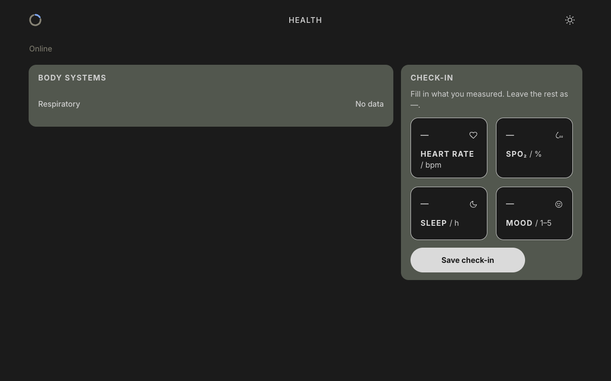
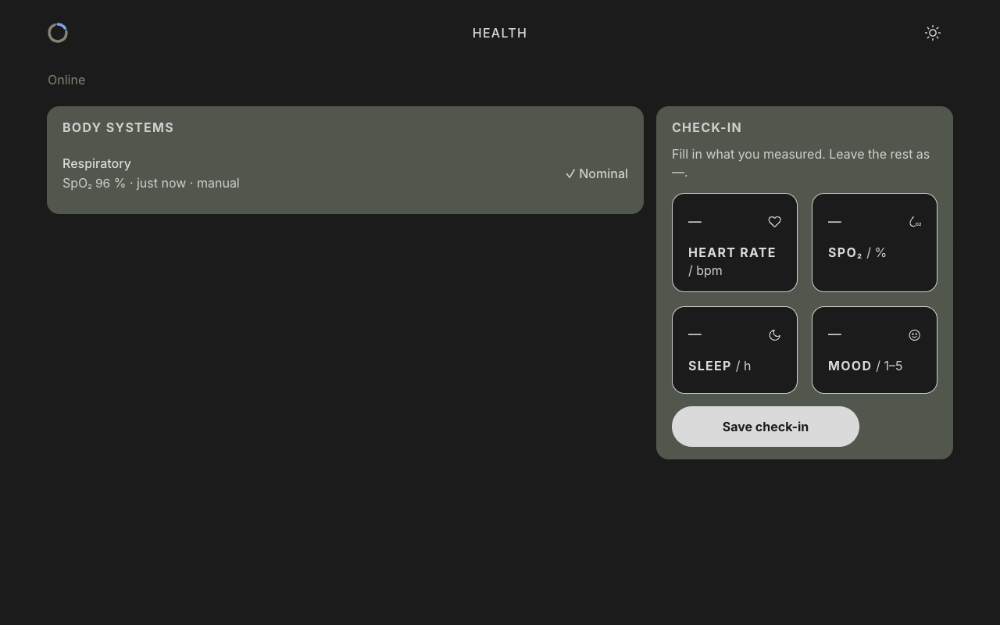
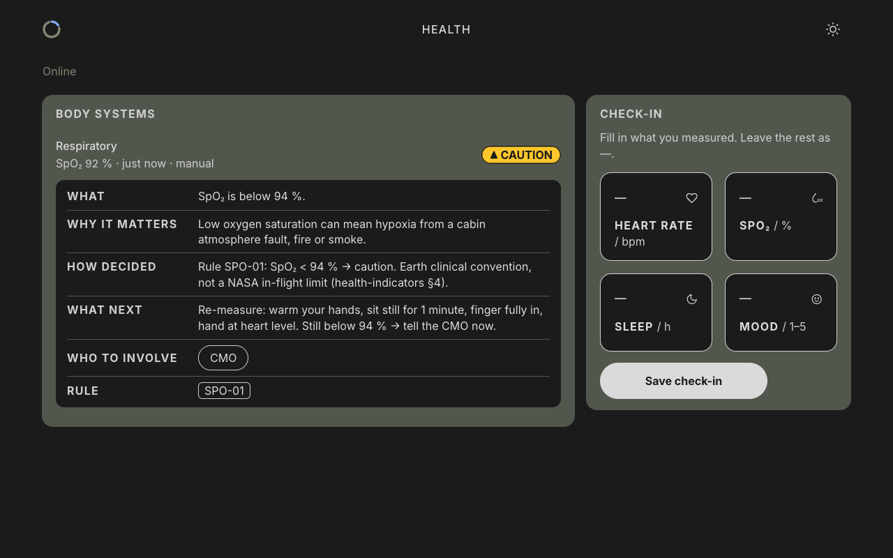
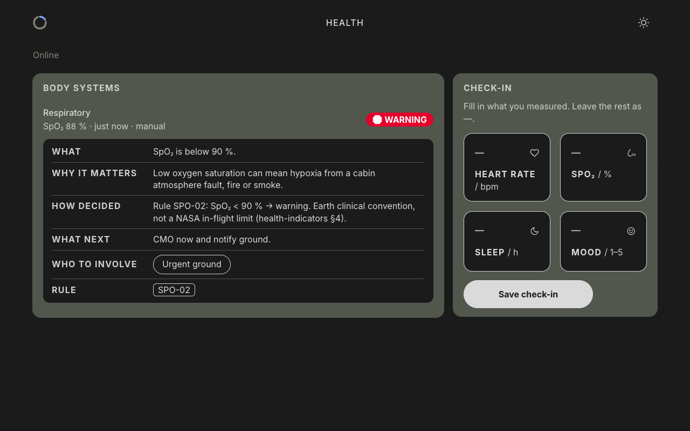
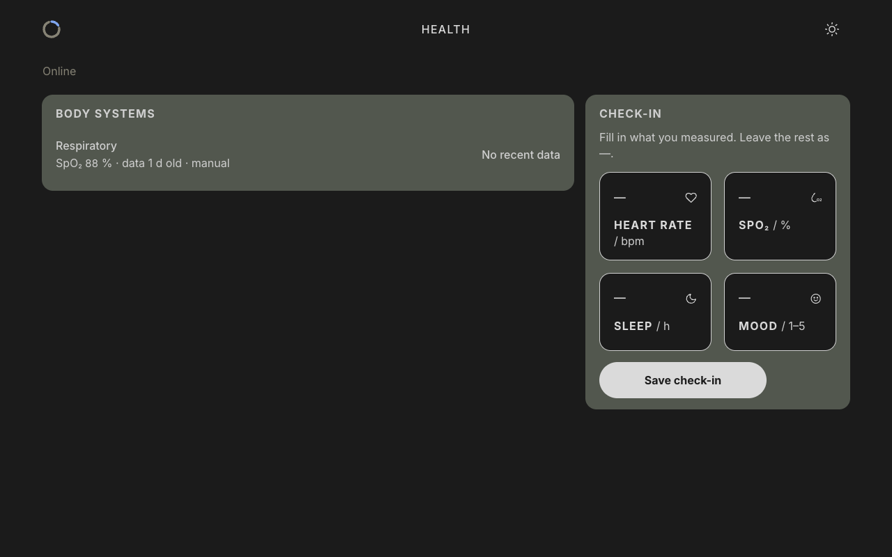
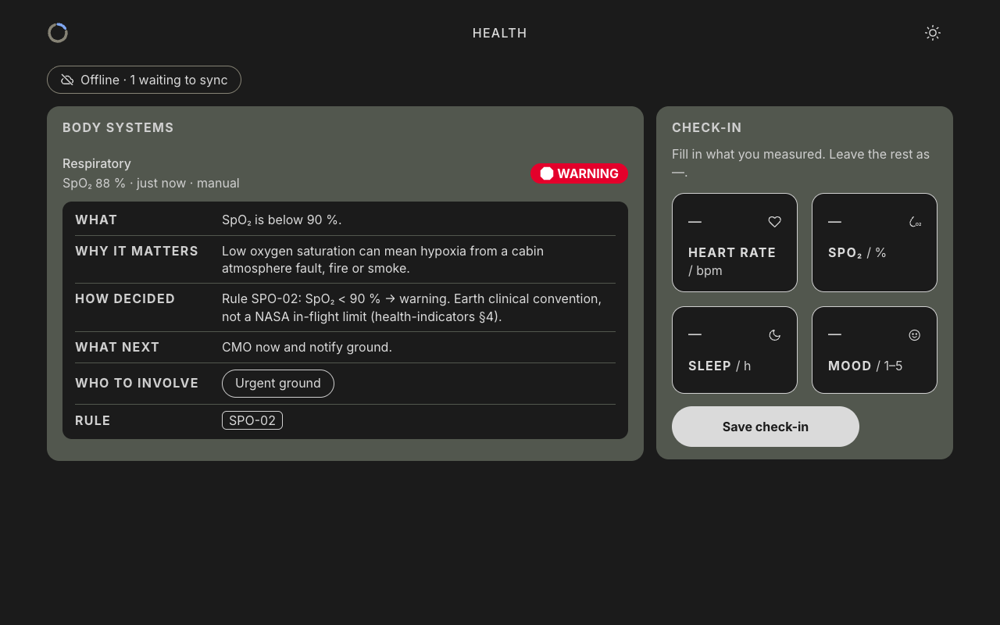

# #1 SpO₂ core loop: rule table → Respiratory status on home

The crew app now interprets a check-in. Each saved SpO₂ value is checked on the tablet against rules SPO-01 (< 94 % → caution) and SPO-02 (< 90 % → warning) in `src/main/frontend/src/infrastructure/rules.json`. The "Body systems" panel shows the Respiratory status with what, why, how it was decided, what to do next and who to involve. It works offline, and the list is re-read after each save and every 60 s. Features F4, F5 and F6 in [features.md](../../ideas/features.md); issue [#1](https://github.com/jdo-lv/galagans/issues/1).

**Try it:** `mvn clean verify`, then `mvn spring-boot:run`, open http://localhost:8080, enter an SpO₂ value and click "Save check-in". **Retake the screenshots** with the app running: `target/node/node docs/features/1-spo2-core-loop.shots.mjs` (script: [1-spo2-core-loop.shots.mjs](1-spo2-core-loop.shots.mjs)).

## Screens

### No data (nothing stored yet)

### Nominal (SpO₂ 96)
Quiet: muted "✓ Nominal", no fill, no explanation.

### Caution (SpO₂ 92, rule SPO-01)

### Warning (SpO₂ 88, rule SPO-02)
Octagon icon plus the word, white on red (5.77:1 light, 4.85:1 dark), so it passes at body size.

### Stale (SpO₂ 88 recorded 25 h ago)
Old data shows its age, never an alarm.

### Offline (SpO₂ 88 saved with the network off)
The warning appears without the server; the check-in waits to sync.

"Status unavailable" (rules or storage fail to load) can't be triggered from the running app; it's covered by `SystemStatusList.test.tsx` (AC14).

## Mockup and deviations

Layout follows [01-body-map.png](../../ideas/mockups/01-body-map.png) ("Body systems" panel, rows, status pills) and the explanation rows of [02-detail.png](../../ideas/mockups/02-detail.png). Colours, type, sizes and status styles follow [ui-guidelines.md](../../ideas/ui-guidelines.md) (tokens in `src/main/frontend/src/ui/theme/`), in light and dark; the screenshots are dark because the machine that took them is set to dark mode.

| Deviation | Reason |
|---|---|
| "✓ Nominal" instead of the mockup's "● Nominal" | Issue AC2 fixes the text. |
| Red WARNING pill, not in the mockups | No mockup shows a warning; style from [ui-guidelines.md](../../ideas/ui-guidelines.md) §5 (status badge). |
| Header with brand ring, "HEALTH" wordmark and theme toggle instead of the mockup's top bar of context pills | Canvas header from the guidelines; crew, mode and flight-day pills have no data yet. |
| Text at least 16 px, inputs as field tiles, "Who to involve" as a pill and the rule id as a tag | Guidelines §3–§5 (NASA minimum text height; routing kept neutral and apart from urgency). The mockups use 11–14 px. |
| One system (Respiratory), no body figure, hazard lens, routine or readings panels | Out of scope for #1. |
| Explanation inline in the row, not a separate detail screen; tier shown as a value, not the 4-step ladder | The issue puts the texts in the row (AC4, AC6); the detail screen is out of scope. |
| Check-in form in a right-hand "Check-in" panel with all fields on one screen | No mockup for the current form; 06-questionnaire (one question per screen) is a later feature. Fields use the guidelines' field tile and primary button. |
