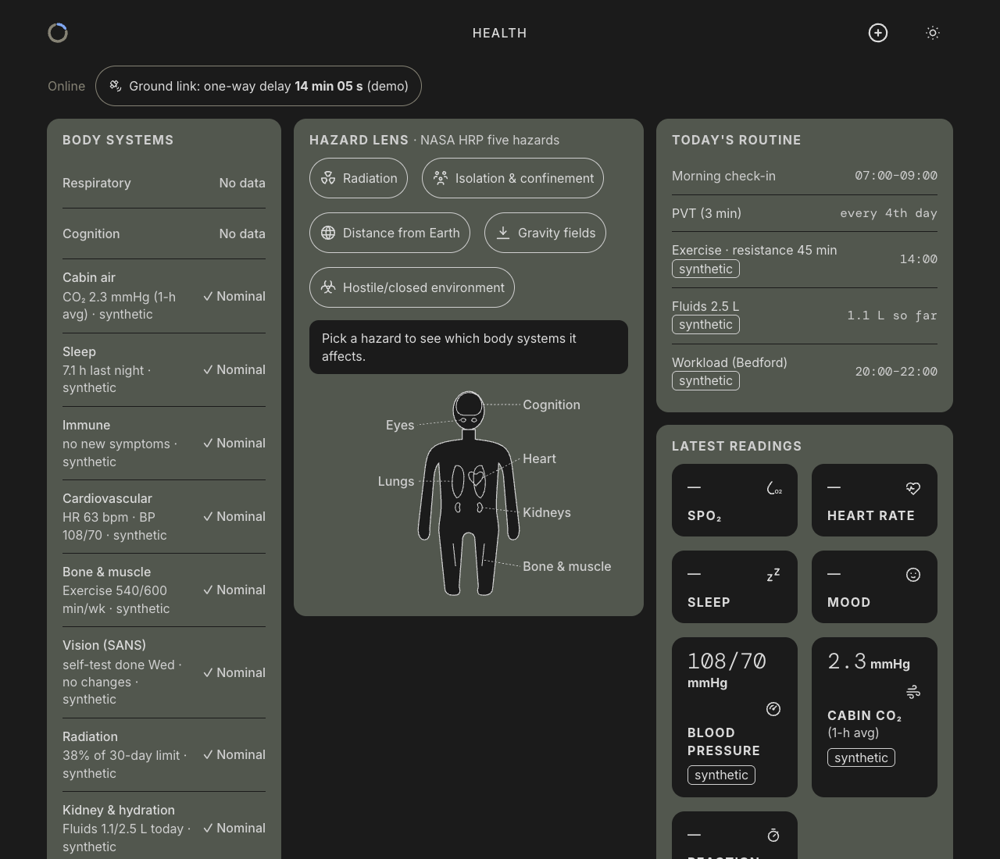
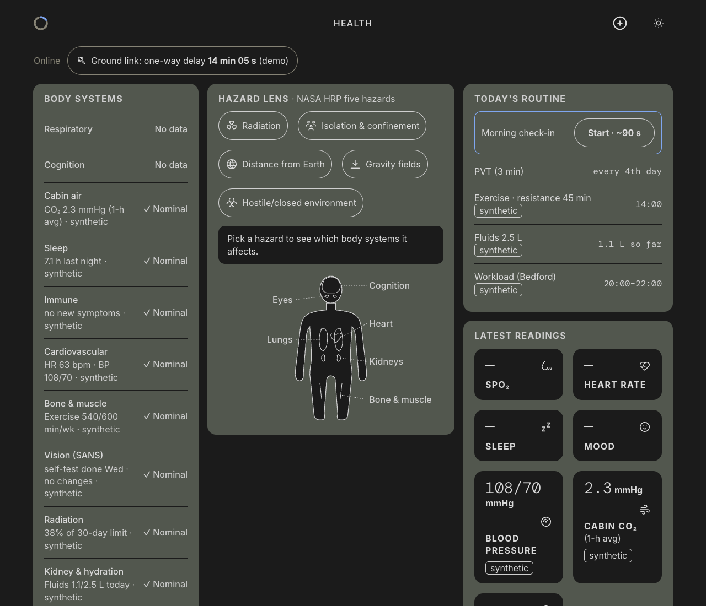
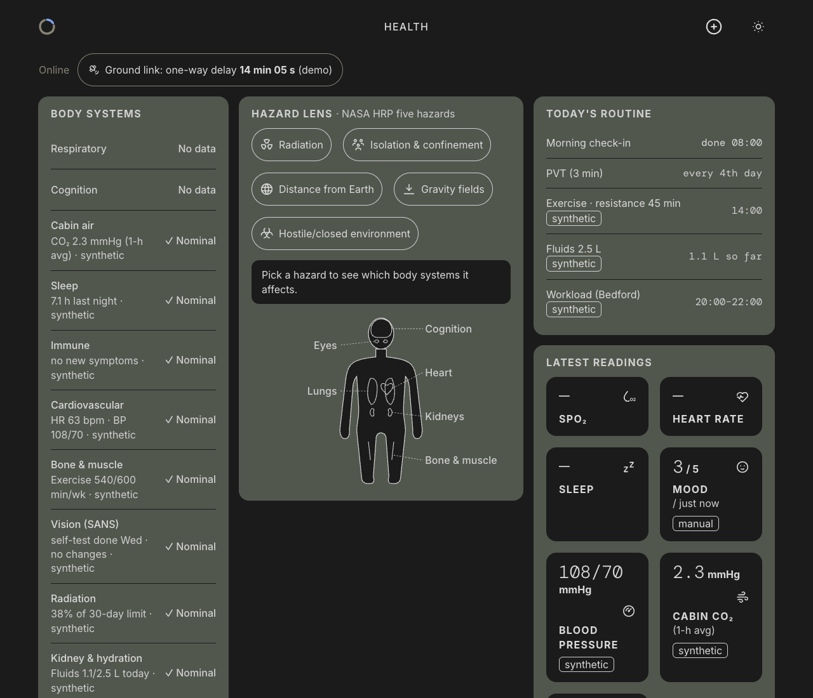
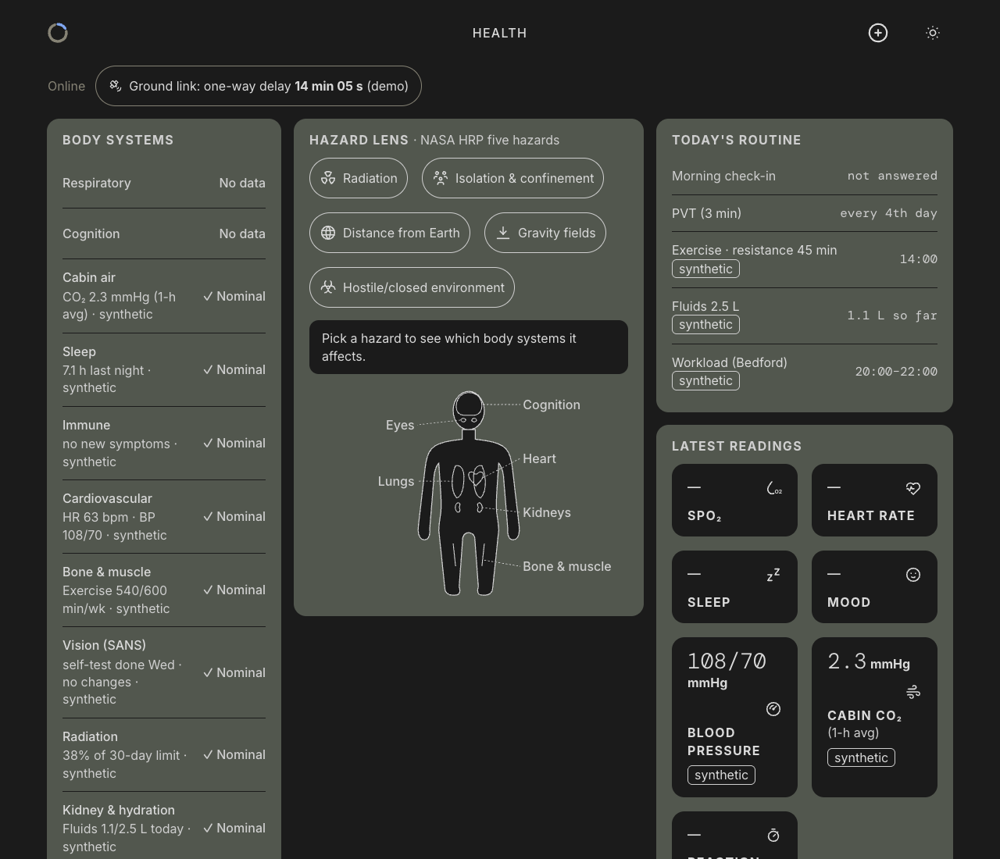
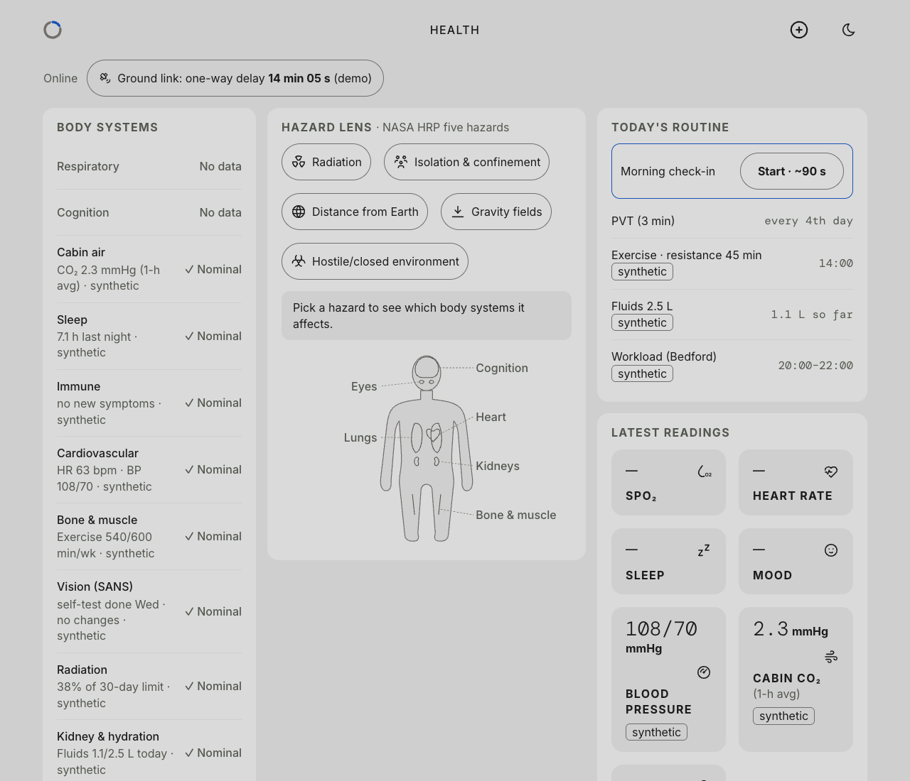
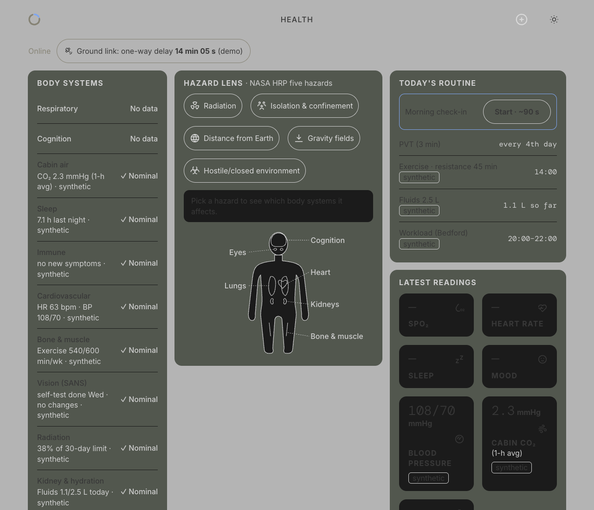
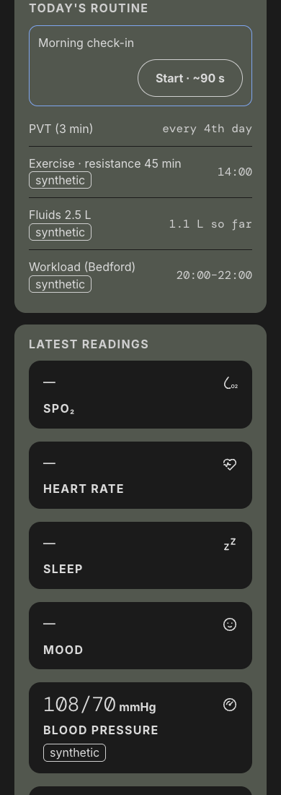

# #10 Today's routine card on home

The "Today's routine" card on home lists what the crewmember has to do today. The Morning check-in row is real: it reads upcoming before 07:00, due from 07:00 with a "Start · ~90 s" button (it opens the check-in at `#/check-in`, [#29](29-check-in-questionnaire.md)), "done HH:MM" once any check-in is saved today, and "not answered" from 09:00. State comes from the device clock and the stored check-ins, so it works offline and moves within 60 s of the clock. PVT, exercise, fluids and Bedford workload are synthetic placeholder rows (`src/main/frontend/src/infrastructure/mockRoutine.ts`) that look the same at every time of day. Feature F15 in [features.md](../../ideas/features.md); issue [#10](https://github.com/jdo-lv/galagans/issues/10).

**Try it:** `mvn clean verify`, then `mvn spring-boot:run`, open http://localhost:8080. Before 07:00 the row is upcoming, between 07:00 and 09:00 it is due; click "Start · ~90 s", which opens the check-in ([#29](29-check-in-questionnaire.md)); answer or skip the steps and click "Save check-in" to see "done HH:MM".

**Retake the screenshots** with the app running: `target/node/node docs/features/10-todays-routine.shots.mjs` (script: [10-todays-routine.shots.mjs](10-todays-routine.shots.mjs)). It fixes the page's local clock to 2026-11-14 with an injected `Date`, and clears the stored check-ins before each shot. `APP_URL` points it at another server and `CDP_PORT` picks another DevTools port. All shots are 1280 px wide unless the heading says otherwise.

## Screens

### Upcoming (clock 06:30, no check-ins)
The row is muted and shows the window "07:00–09:00", with no button.

### Due (clock 08:00, no check-ins)
The row has the accent outline and a "Start · ~90 s" button.

### Done (clock 08:00, mood 3 saved)
The row reads "done 08:00" with no glyph and no button.

### Missed (clock 10:00, no check-ins)
The row is muted and reads "not answered".

### Light and dark (due, switched with the theme toggle)

### Phone, 390 px (due)
The card stacks under Body systems. The button drops under the label and stays on the right.

"Routine unavailable" appears when the stored check-ins fail to load, and then the card has no rows. It can't be triggered from the running app; `TodaysRoutine.test.tsx` covers it (AC14–AC15).

## Mockup and deviations

The card follows "Today's routine" in [01-body-map.png](../../ideas/mockups/01-body-map.png), shown in the due state above Latest readings ([issue mock](img/10-mock.png)). Styles follow [ui-guidelines.md](../../ideas/ui-guidelines.md) "Today's routine".

| Deviation | Reason |
|---|---|
| PVT is a synthetic "every 4th day" row, not "✓ done 07:19" | A placeholder never claims something happened, and #4's Cognition row shows a PVT value. |
| No "KSS + sleep re-check" and no "Vision self-test (Wed)" row | Rule-triggered rows aren't built, and #4 already says the vision self-test was done Wednesday. |
| No "✓" on done rows, no "☐" on open rows | In the status badge ✓ means Nominal; "done HH:MM" carries the meaning. |
| Accent outline with no blue fill on the due row | ui-guidelines §2.3: due is neutral accent, and the outline passes 3:1 on the surface (§2.4). |
| "Start · ~90 s" on the check-in row | The mockup's Start sits on a rule-triggered KSS re-check row, which isn't built; the KSS is asked inside the morning check-in ([#29](29-check-in-questionnaire.md)). |
| "synthetic" tags on placeholder rows | Data honesty: everything not measured is labelled. |
| Right-hand text in DM Mono, 16 px text | ui-guidelines §3 (the mockups use smaller text). |
