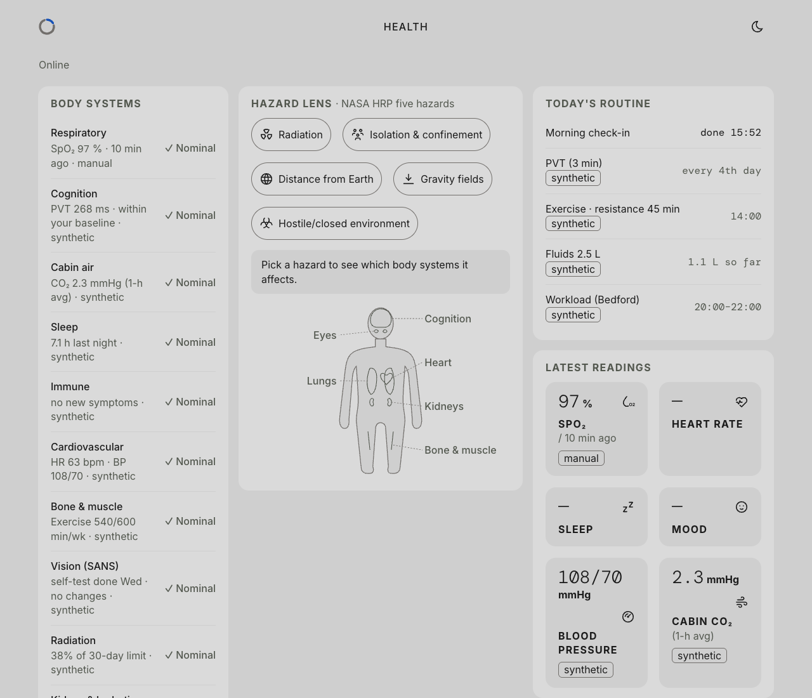
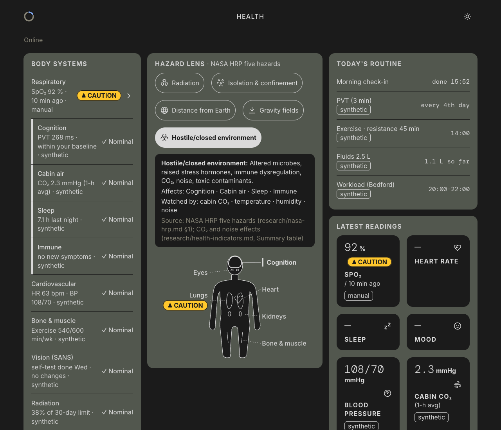
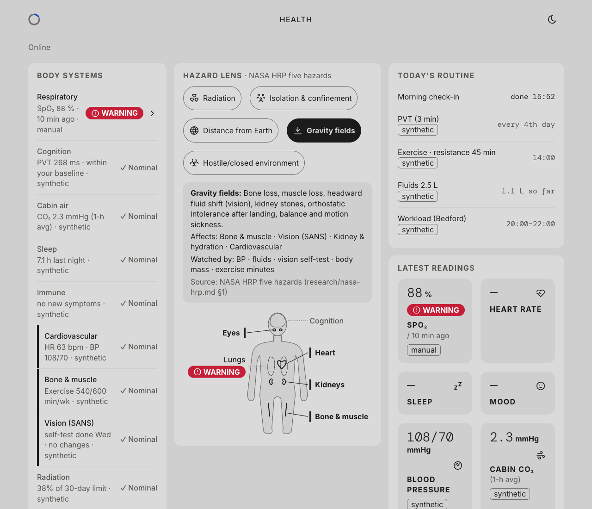
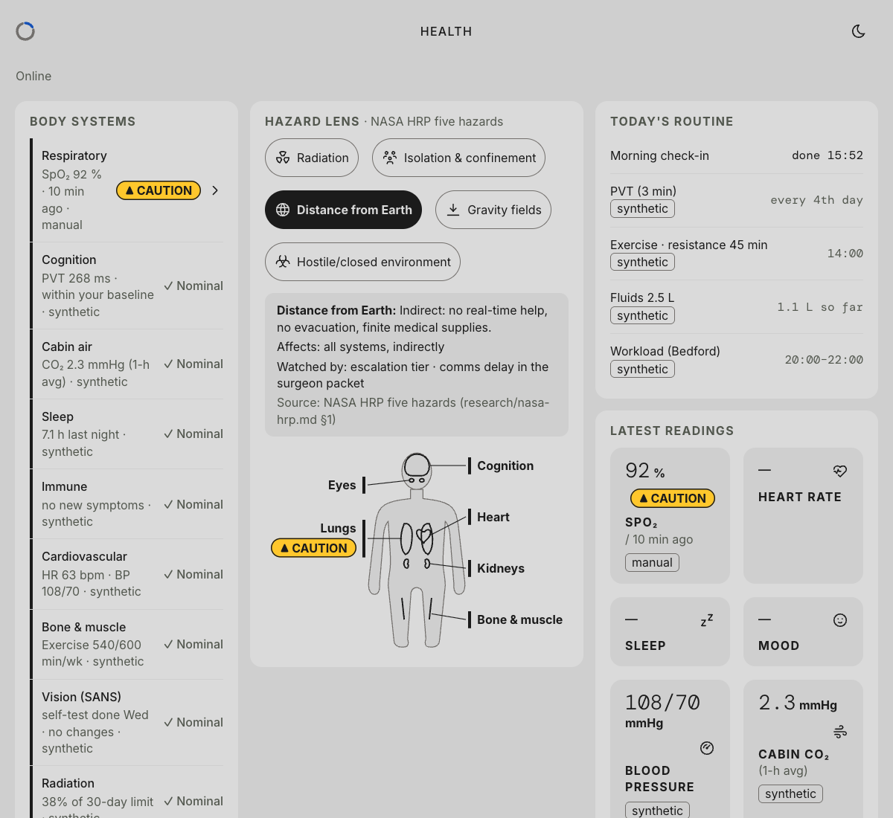
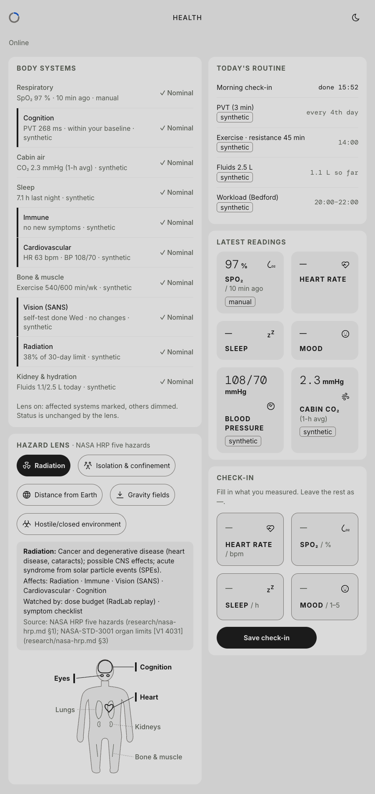
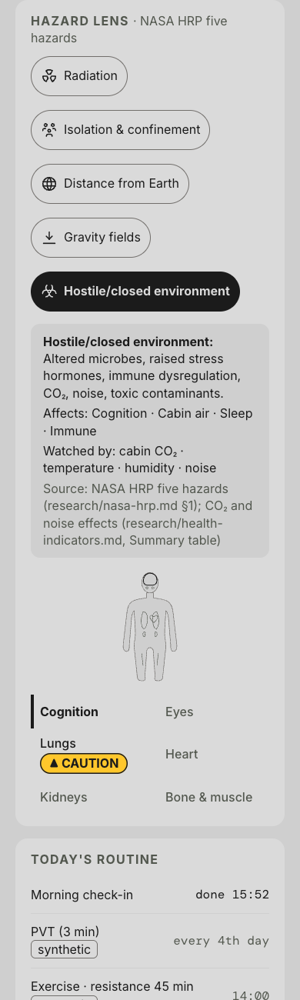
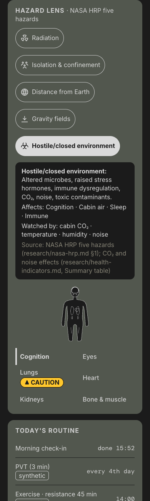

# #14 Hazard lens and body figure

Home has a Hazard lens card between Body systems and the right column. It holds NASA's five HRP hazards as toggles, a caption and a body figure. Picking a hazard marks the Body systems rows and figure labels it affects (a bar on the side) and dims the rest. The caption says what the hazard does, which systems it affects, which checks watch it and the source. The lens never changes a status and never dims a caution or warning. The choice is remembered on the device. Features F12 and F6 (the figure) in [features.md](../../ideas/features.md); issue [#14](https://github.com/jdo-lv/galagans/issues/14).

**Try it:** `mvn clean verify`, then `mvn spring-boot:run`, open http://localhost:8080. Enter SpO₂ 92, click "Save check-in", then click "Hostile/closed environment", "Gravity fields" and "Distance from Earth". Click a pressed hazard again to turn the lens off. **Retake the screenshots** with the app running: `target/node/node docs/features/14-hazard-lens.shots.mjs` ([script](14-hazard-lens.shots.mjs)); set `APP_URL` for another port.

## Screens

### Lens off (SpO₂ 97, 1280 px, light)
"Pick a hazard to see which body systems it affects." No marks, no note.

### Hostile/closed environment with a caution (SpO₂ 92, 1280 px, dark)
Cognition, Cabin air, Sleep and Immune are marked; the rest are dimmed. Respiratory is in caution and outside this hazard, so it keeps full contrast and gets no mark, in the list and on the Lungs label.

### Gravity fields with a warning (SpO₂ 88, 1280 px, light)
Eyes, Heart, Kidneys and Bone & muscle are marked on the figure, with organ outlines and leader lines drawn solid. The Lungs label keeps its WARNING badge undimmed.

### Distance from Earth (SpO₂ 92, 1200 px, light)
Every row and label is marked, nothing is dimmed: "Affects: all systems, indirectly". This is the narrowest three-column width.

### Radiation on a tablet (SpO₂ 97, 900 px, light)
Two columns: the Hazard lens card sits under Body systems, which stays first and visible without scrolling. The note "Lens on: …" ends the Body systems card.

### Phone (SpO₂ 92, Hostile/closed environment, 390 px, light and dark)
The figure shrinks and its labels form a two-column grid under it, without leader lines.

## Mockup and deviations

Follows the centre panel of [mockup 01](../../ideas/mockups/01-body-map.png) and the issue's mock ([14-mock.png](img/14-mock.png), [source](14-hazard-lens.mock.html)). Deviations, all decided in the issue:

- Tabler icons instead of the mockup's ☢ ◐ ↔ ⇣ ◎ glyphs; the pressed chip is the inverse pill with no "✓".
- Lens marks are neutral (`--color-text`), not the mock's blue: open PR #11 reserves colour for alert levels.
- A figure label shows the status badge (icon and word) instead of a coloured "▲ Cognition" pill; organ shapes never take a status colour.
- A Lungs label was added, so the one system with real data (Respiratory) shows on the figure.
- Dimming uses muted text, not opacity. The "Lens on" note has no "▍" glyph.
- The caption follows the idea's mapping table and cites a source per hazard, rather than the mockup's text.
- Not built (out of scope): the Body | Systems toggle, the Cabin air box, the reminder banner, the adaptation-timeline note, tapping a figure label.
- The three-column grid is a `layout--home` modifier, because the detail screen (#9) also uses `.layout`.
