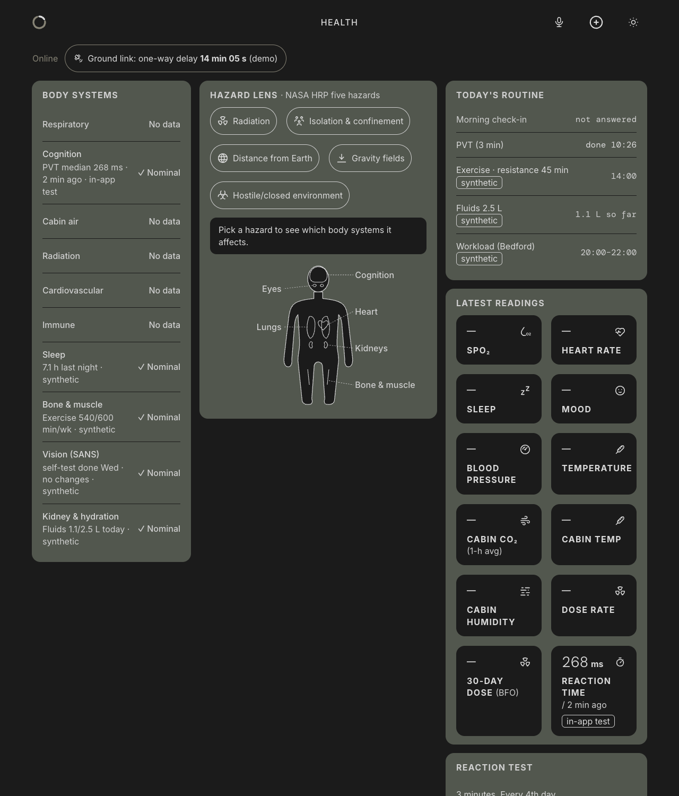
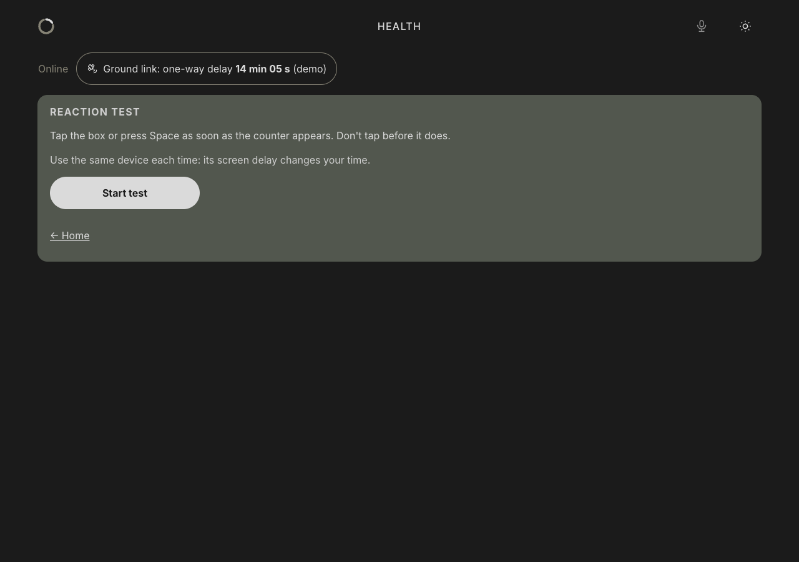
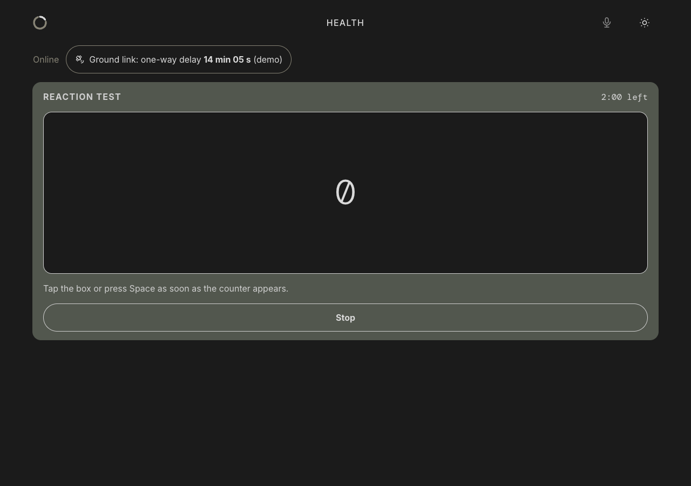
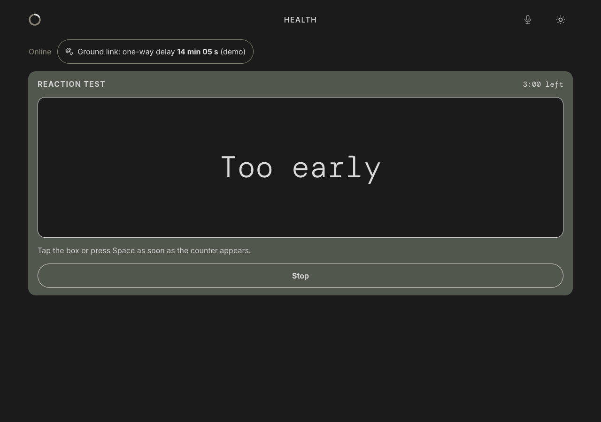
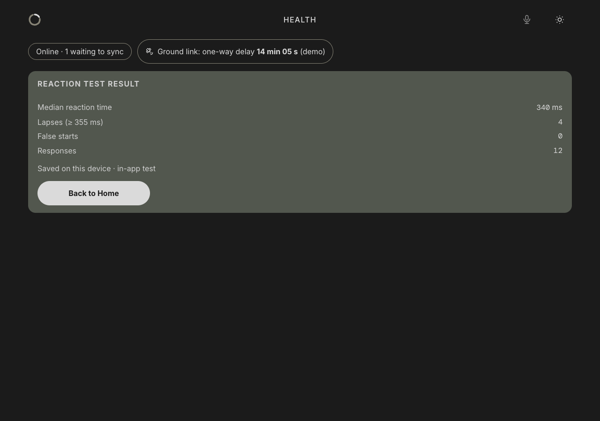
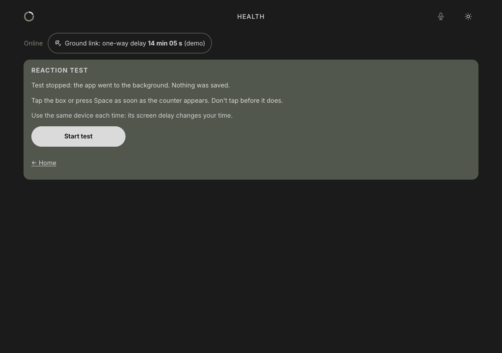
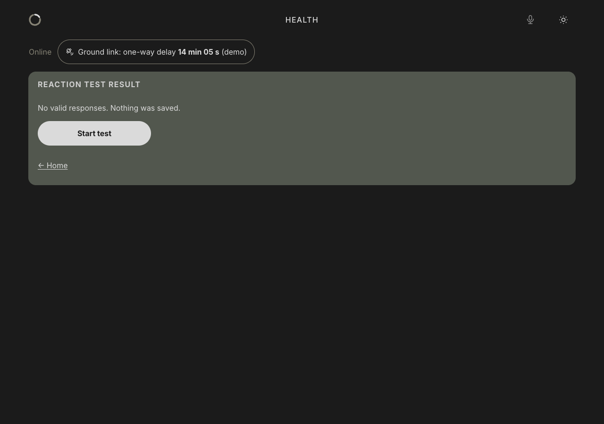

# #16 PVT reaction test

The crew can run the 3-minute PVT-B from Home: a counter appears at random 2–5 s intervals, and they tap the box or press Space as fast as they can. The app scores the median reaction time, lapses (≥ 355 ms) and false starts (< 130 ms) and saves the result offline as a check-in labelled "in-app test", synced like any other. The result shows as a "Reaction time" tile and marks the PVT row of Today's routine done. Feature F7 in [features.md](../../ideas/features.md); issue [#16](https://github.com/jdo-lv/galagans/issues/16). The Cognition rule that reads it is [#17](https://github.com/jdo-lv/galagans/issues/17).

**Try it:** `mvn clean verify`, then `mvn spring-boot:run`, open http://localhost:8080 and click "Start reaction test", then "Start test". **Retake the screenshots** with the app running: `target/node/node docs/features/16-pvt-test.shots.mjs` ([script](16-pvt-test.shots.mjs)). A test takes 3 minutes, so the script fast-forwards it with Chrome's virtual time.

## Screens

### Home: Reaction test card, Reaction time tile, PVT routine row (a 268 ms result saved 2 min ago)

### Start screen (`#/pvt`)

### Running (counter 2000 ms into a stimulus: a lapse in progress)

### Too early (a tap before the counter appears)

### Result (12 responses, saved; the pill counts it as waiting to sync)

### Stopped: the app went to the background

### No valid responses (every tap came before a stimulus)

"Couldn't save the result on this device" (IndexedDB fails) and "Median over 10 000 ms" can't be produced from the running app. `PvtTest.test.tsx` covers them (AC24, AC26).

## Mockup and deviations

No mockup in `ideas/mockups/` shows the test itself. The screens follow the issue mock [16-mock.png](img/16-mock.png) ([source](https://github.com/jdo-lv/galagans/blob/864f2551aa3b196627f75b4d1916398c9c7b9a6b/docs/features/16-pvt-test.mock.html)). The tile follows the "Latest readings" panel of [01-body-map.png](../../ideas/mockups/01-body-map.png). Styles follow [ui-guidelines.md](../../ideas/ui-guidelines.md) "Test screen (PVT)" and "Metric tile". The screenshots are dark because the machine that took them is in dark mode.

| Deviation | Reason |
|---|---|
| The Home card sits below Latest readings, not beside the tile as in the mock | Issue AC9: under Latest readings in the right column (the Check-in card that followed it left home in [#29](29-check-in-questionnaire.md)). |
| No status colour on the counter or result | A slow response isn't a level; the Cognition rule (#17) decides that. |
| The Cognition row still shows its synthetic "PVT 268 ms · within your baseline" | Accepted until #17 replaces it (AC33). |
