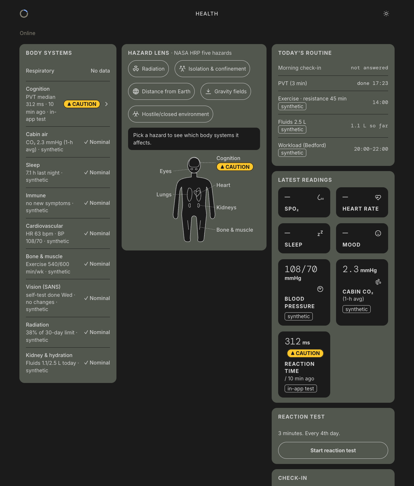
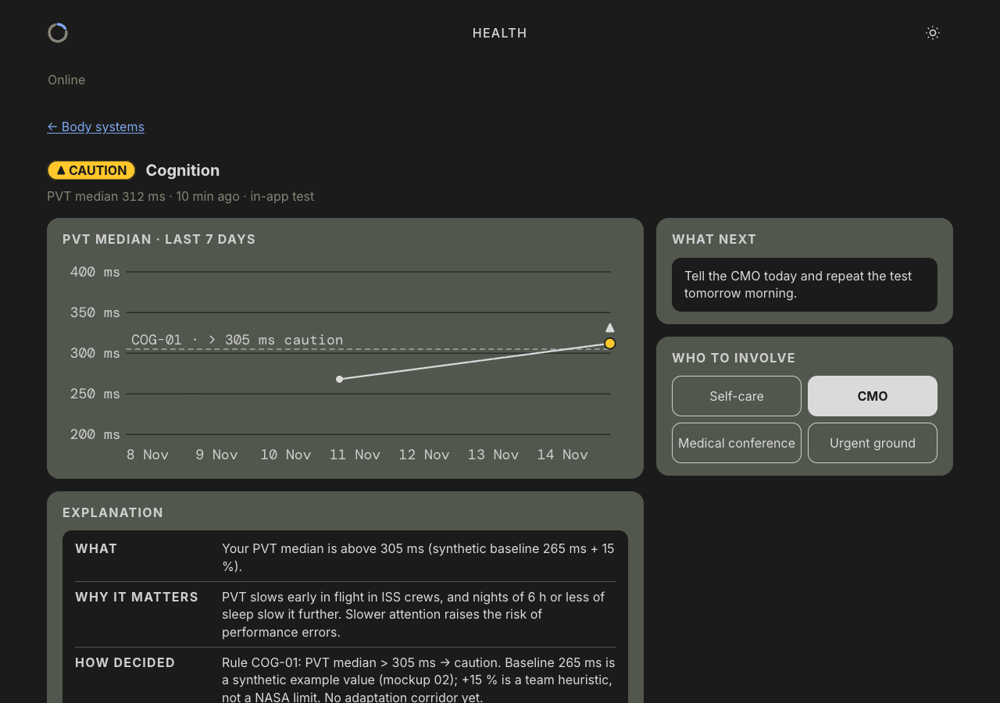
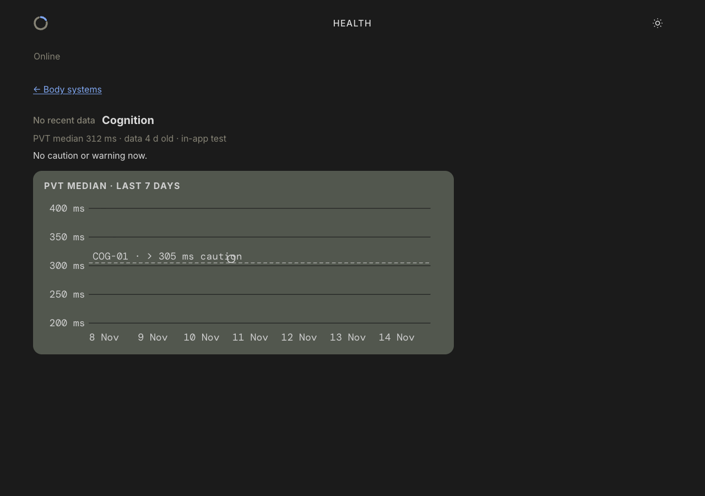

# #17 Cognition status from the PVT (rule COG-01)

Cognition on Home is now real: rule COG-01 reads the latest PVT median (from the [#16](16-pvt-test.md) reaction test). A median above 305 ms flags Cognition as ▲ CAUTION on the Body systems list, the body figure and the Reaction time tile, and the row opens the Cognition detail with the trend, explanation, next step and the CMO tier. A PVT result goes stale after 4 days (the test runs every 4th day). Features F4 and F6 in [features.md](../../ideas/features.md); issue [#17](https://github.com/jdo-lv/galagans/issues/17).

The 305 ms threshold is a synthetic 265 ms baseline (mockup 02) + 15 % (team heuristic). Research gives no absolute PVT cut-off ([health-indicators.md](../../research/health-indicators.md) §13). The personal baseline (F3) replaces it later, and without the adaptation corridor (F11) an early-flight slowing is flagged too. The rule's "How decided" text says so.

**Try it:** `mvn clean verify`, then `mvn spring-boot:run`, open http://localhost:8080 and run the reaction test (tap slowly to get a median above 305 ms). **Retake the screenshots** with the app running: `target/node/node docs/features/17-cognition-rule.shots.mjs` ([script](17-cognition-rule.shots.mjs)), which writes PVT results straight into IndexedDB.

## Screens

### Home, caution (PVT 268 ms 4 days ago, 312 ms 10 min ago)
Cognition row with its link, the figure's Cognition label and the Reaction time tile all show ▲ CAUTION.

### Home, nominal (PVT 268 ms)

### Home, no PVT yet
Cognition shows "No data"; the synthetic Cognition placeholder is gone.

### Cognition detail, caution

### Cognition detail, stale (PVT 312 ms, 4 d 2 h old)

## Mockup and deviations

The detail follows [02-detail.png](../../ideas/mockups/02-detail.png) through the #9 detail screen and the issue mock [17-mock.png](img/17-mock.png). The screenshots are dark because the machine that took them is in dark mode.

| Deviation | Reason |
|---|---|
| No adaptation corridor or baseline band; X axis is the last 7 days | F3 and F11 aren't built. |
| No lapses in the rule | The engine rules one indicator per system; COG-01 uses the median only. |
| The chart's Y-axis gutter is wider (72 instead of 60 viewBox units), for SpO₂ too | "400 ms" didn't fit the old gutter. |
| On the stale chart, the hollow point can overlap the threshold label | Labels sit at a fixed spot on the left; cosmetic. |
