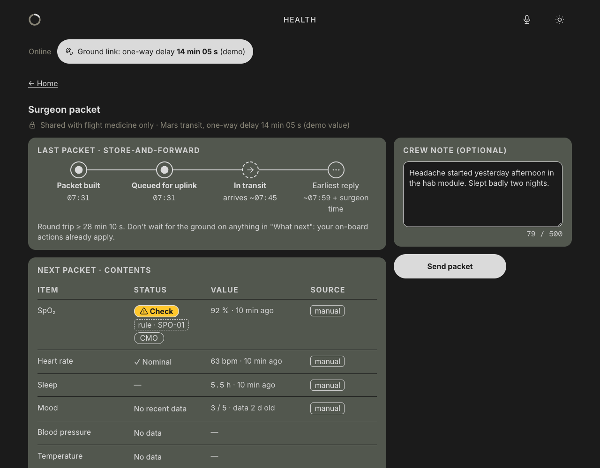
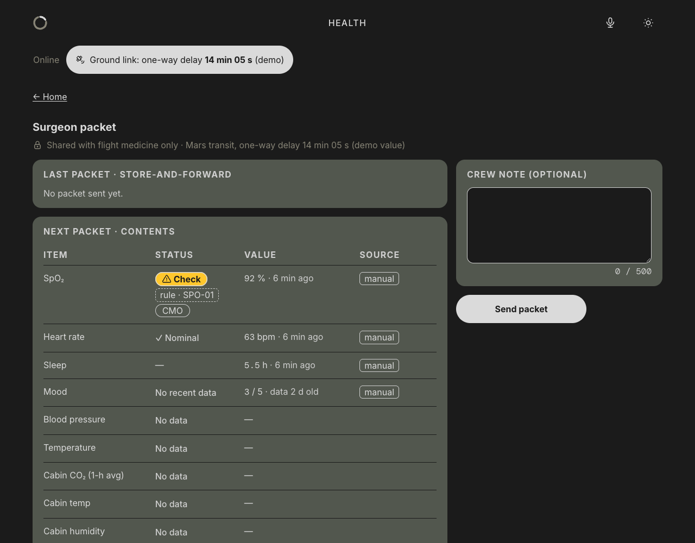
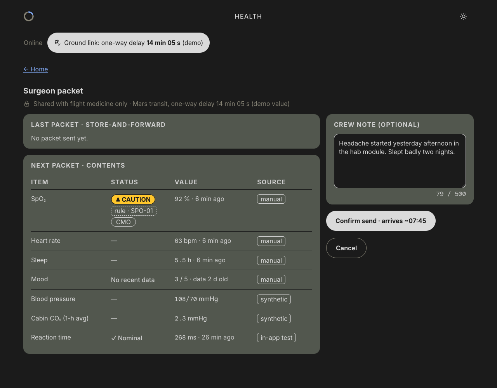
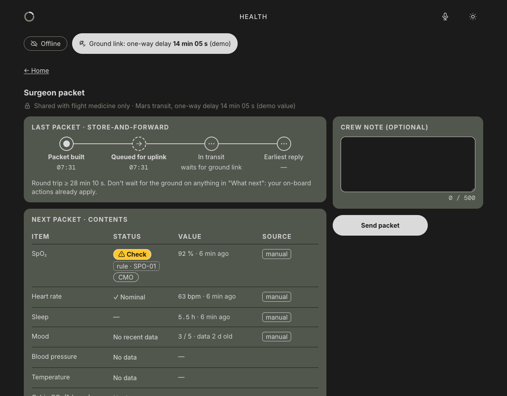
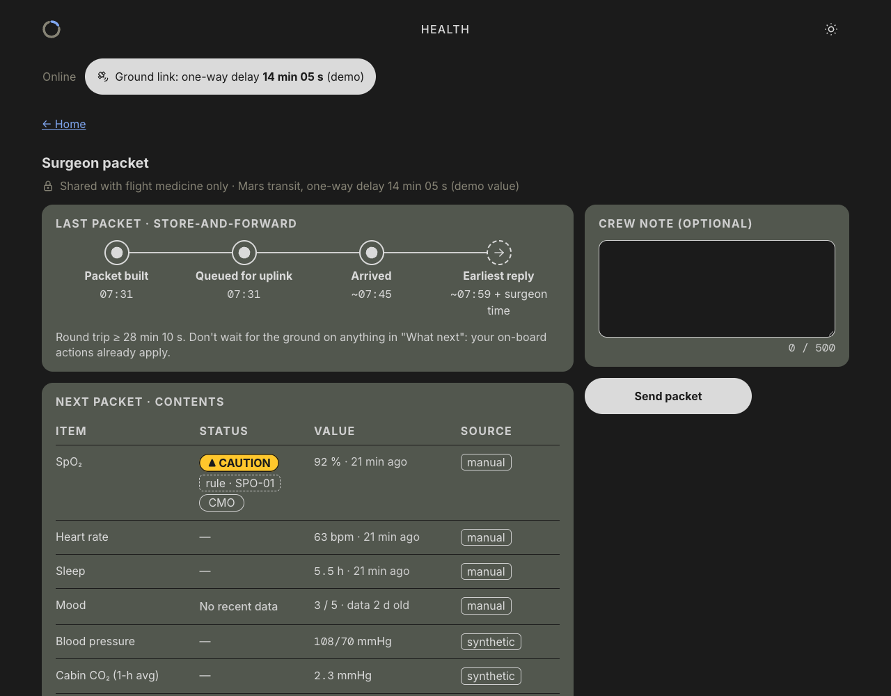
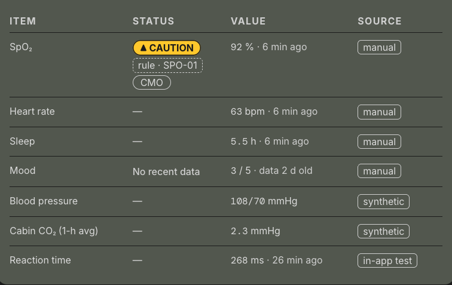
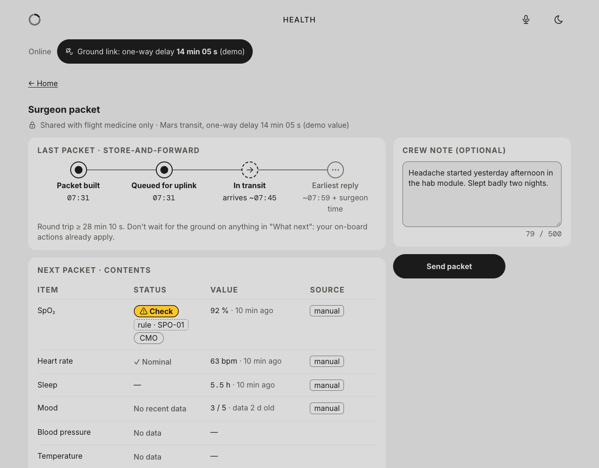
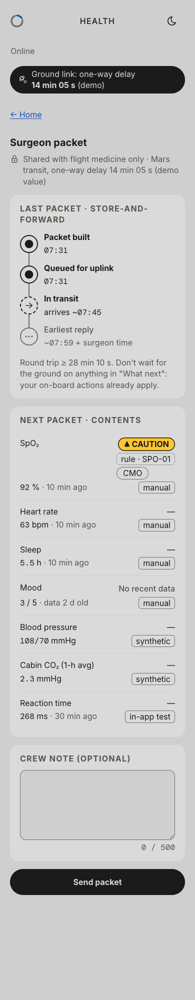

# #19 Surgeon packet

The crew can send the flight surgeon a packet: a snapshot of the latest readings (with status, the rule and tier behind each flag, value, data age and source) plus an optional crew note. The packet is stored on the tablet first and sent to the ground station (`POST /api/packets`, #18) when the link is up, one request per packet. A timeline shows the last packet: built, queued, in transit or arrived, and the earliest reply, all with the Mars one-way delay of 14 min 05 s (a demo value). A ground-link pill on every screen opens it. Feature F14 in [features.md](../../ideas/features.md); issue [#19](https://github.com/jdo-lv/galagans/issues/19).

**Try it:** `mvn clean verify`, then `mvn spring-boot:run`, open http://localhost:8080, save a check-in with SpO₂ 92, then click the "Ground link" pill under the header. Type a note, click "Send packet", then "Confirm send · arrives ~HH:MM". Switch the browser offline (DevTools › Network › Offline) before confirming to see the packet wait for the ground link; it goes out when you switch back online. **Retake the screenshots** with the app running: `target/node/node docs/features/19-surgeon-packet.shots.mjs` ([script](19-surgeon-packet.shots.mjs)); it seeds the check-ins and packets in IndexedDB, sets the page clock to 14 Nov 2026 and fakes offline, so `npm run preview` works too (set `APP_URL`).

Seeded check-ins for every shot: SpO₂ 92 %, heart rate 63 bpm and sleep 5.5 h at 07:25, a PVT median of 268 ms at 07:05, mood 3 / 5 two days earlier. Blood pressure and cabin CO₂ are the synthetic placeholders.

## Screens

### In transit (packet sent at 07:31, clock 07:35, next note drafted)

### No packet yet (clock 07:31)

### Confirm step (online at 07:31: the arrival estimate is fixed at the click)

### Queued, offline (confirmed at 07:31 with no ground link)

### Arrived (packet sent at 07:31, clock 07:46: arrival 07:45:05 has passed, the earliest reply is current)

### Caution row (SpO₂ 92 %: caution badge, rule tag, tier pill; heart rate and sleep are "—" not rated; mood is stale; reaction time 268 ms is nominal under COG-01)

### Light theme (in transit)

### Phone, 390 px (in transit, light)

"Packet contents unavailable", "Packet status unavailable" and "Packet not saved. Try again." need a failing rule file or IndexedDB and can't be produced from the running app. `SurgeonPacket.test.tsx` covers them (AC15, AC24, AC30).

## Mockup and deviations

The screen follows the issue mock [19-mock.png](img/19-mock.png) and [19-mock-390.png](img/19-mock-390.png) ([source](19-surgeon-packet.mock.html)), which adapts [03-surgeon-packet.png](../../ideas/mockups/03-surgeon-packet.png). Styles follow [ui-guidelines.md](../../ideas/ui-guidelines.md) §5 "Surgeon packet", "Pills and tags" and "Level badge". The badges are still today's caution and warning: the 0–5 levels of [alert-levels.md](../../ideas/alert-levels.md) reach the packet through `Badge` when they are built.

Deviations from mockup 03, all decided in the issue:

| Deviation | Reason |
|---|---|
| No FHIR panel, no "Review & edit", no crew or flight-day pills, no symptoms row | Out of scope: FHIR is F24 (pitch only), the symptom checklist of the check-in ([#29](29-check-in-questionnaire.md)) isn't in the packet yet, roles and flight day are F20/F21. |
| The contents card is the next packet; the timeline card is the last packet sent | One screen state: Send always builds a new packet from the live draft. |
| Unrated rows show "—" (Not rated), never "Nominal" | No rule row judges heart rate, sleep or mood yet, so calling them nominal would claim a judgement no rule made. Reaction time became rated on its own when COG-01 (#17) arrived. |
| The tier is a separate neutral pill under the rule tag | ui-guidelines §5 "Level badge": urgency is the colour, who acts is a separate neutral pill. |
| Done steps are filled dots, not checks | A check would read as the ✓ of Nominal in the same screen (one icon, one meaning). |
| "Send packet" opens an inline confirm, not "Send now" | ui-guidelines §5 Buttons: consequential actions get confirm or undo. |
| A seventh row, "Reaction time" | The PVT reading from #16 joins the packet like every other `READINGS` row. |

Deviations from the issue mock: the "Online" pill is centred on the ground-link pill instead of top-aligned, and the brand ring and theme toggle show in the header (the mock left them empty). The Confirm and Cancel buttons wrap onto two lines in the 380 px column; the mock doesn't show the confirm step.
