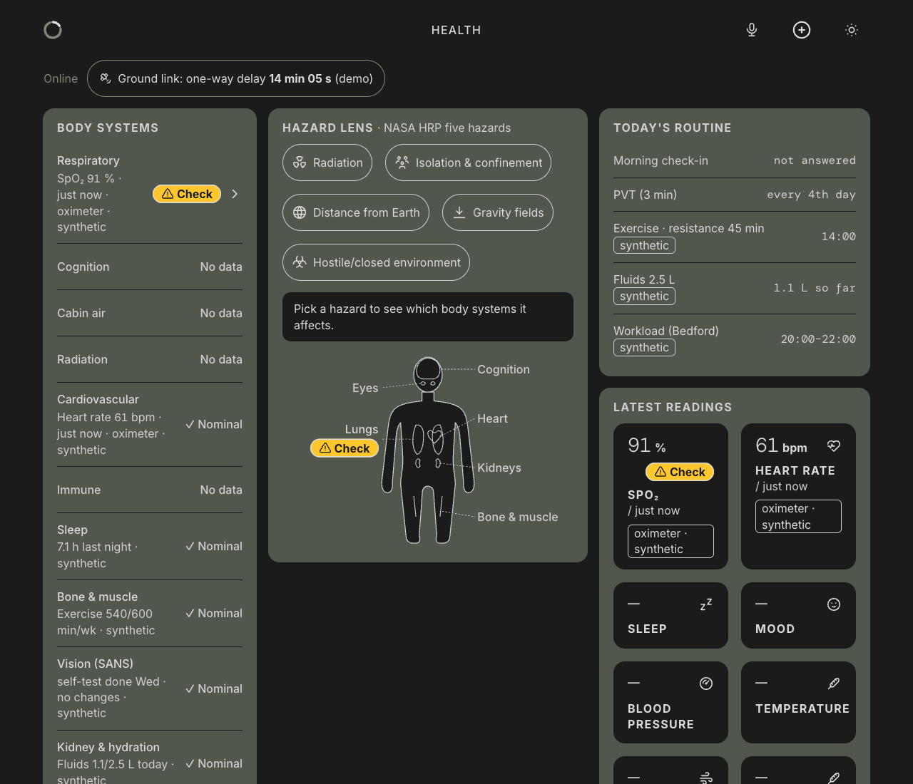

# #22 Personal Health Gateway: oximeter SpO₂ over the device link

A simulated finger oximeter can now feed the crew app. The Personal Health Gateway (F9) listens on the device link (the WebSocket relay at `/ws/devices` in the Spring Boot app, topic `crew/a1/oximeter`; Mosquitto until #25), checks each message and stores it as a FHIR-shaped `Observation`, offline, beside the manual check-ins. The newest reading wins across sources: SpO₂ drives the Respiratory status and both the SpO₂ and Heart rate tiles, labelled `oximeter · synthetic` (or `replay`, `proxy`), and Home and the Respiratory detail update the moment a reading arrives. Issue [#22](https://github.com/jdo-lv/galagans/issues/22); features F9 and build-order step 1 in [features.md](../../ideas/features.md).

**Try it:** `mvn clean verify` and `mvn spring-boot:run`, open http://localhost:8080 and publish a reading, from the [Device Simulator](25-device-simulator.md) (http://localhost:8080/simulator.html) or the command line:

```bash
target/node/node tools/publish-reading.mjs 91 61
```

The app connects to `ws(s)://<page host>/ws/devices` and works without it. **Retake the screenshot** with the app running: `target/node/node docs/features/22-phg-oximeter.shots.mjs` ([script](22-phg-oximeter.shots.mjs)). The script publishes through the real device link, so the screenshot shows the full path.

## Screens

### Home, oximeter SpO₂ 91 %, pulse 61 bpm (`src: synthetic`), published while Home was open
Respiratory, the figure's Lungs and the SpO₂ tile show ▲ CAUTION (rule SPO-01); the row, the SpO₂ tile and the Heart rate tile carry the `oximeter · synthetic` source tag.


## Mockup and deviations

Follows [01-body-map.png](../../ideas/mockups/01-body-map.png); there's no new UI element or layout change, only source label text, refresh timing and the Cardiovascular placeholder text.

- The Cardiovascular placeholder reads `BP 108/70 · synthetic` (was `HR 63 bpm · BP 108/70`), because heart rate is now a real reading on its own tile.
- At this width the `oximeter · synthetic` tag wraps onto two lines inside a tile. The tag style is unchanged from the guidelines; the label is just longer than `manual`.
- There's no device link indicator in the crew app (out of scope). A missing device link is silent.
