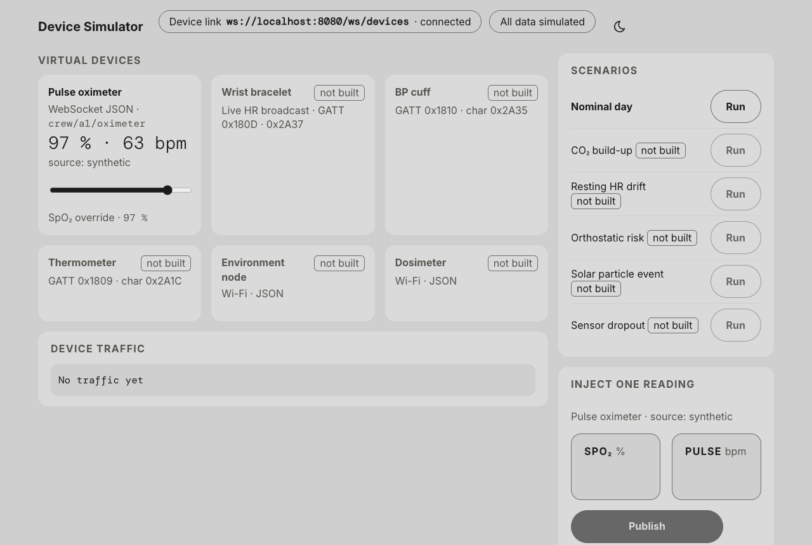
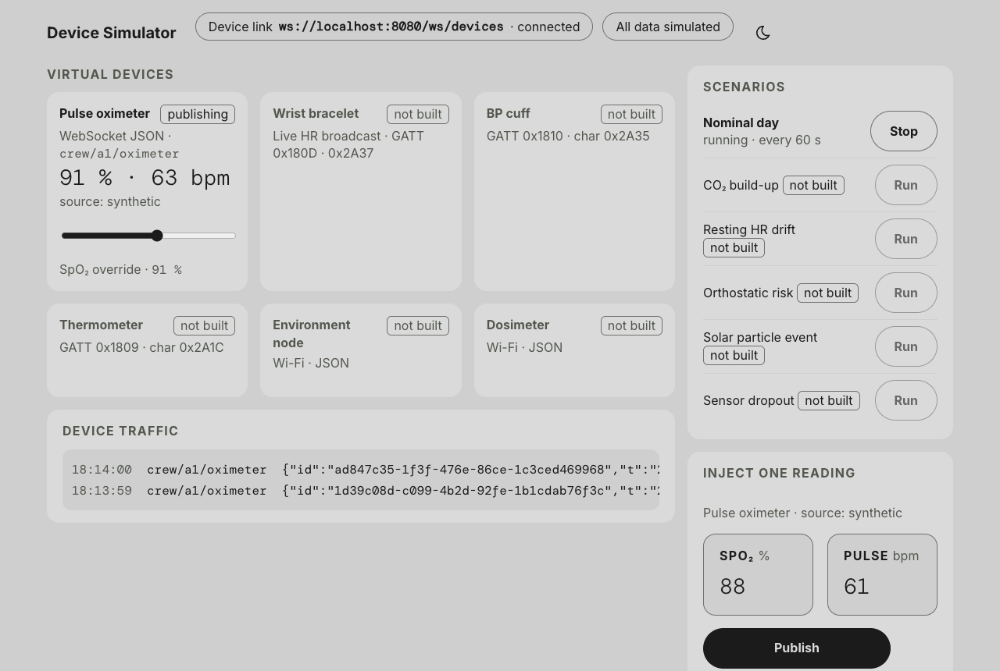
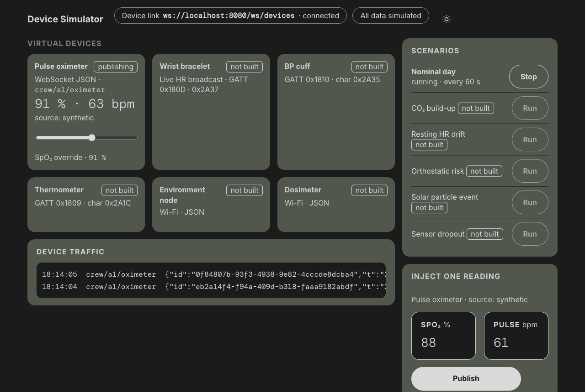

# #25 Device Simulator and the device link

The operator's console for the demo: a second page, `/simulator.html`, that plays the spacecraft's devices while another screen shows the crew app. The pulse oximeter works: "Nominal day" sends SpO₂ 97 % / 63 bpm at once and every minute, the SpO₂ override slider changes what the next reading sends, and "Inject one reading" sends one value. Readings travel over the **device link**, a WebSocket relay at `/ws/devices` in the Spring Boot app that replaces Mosquitto, so a tablet that opens the app at the machine's LAN IP gets them with no broker or Docker. The other five devices and five scenarios show as `not built`. Issue [#25](https://github.com/jdo-lv/galagans/issues/25); feature F8 in [features.md](../../ideas/features.md).

**Try it:** `mvn clean verify`, then `mvn spring-boot:run`. Open http://localhost:8080/simulator.html on the laptop and http://&lt;machine IP&gt;:8080 on the tablet (or another tab). Click **Run** on Nominal day: the crew app's SpO₂ tile shows 97 % `oximeter · synthetic`. Move the slider to 91 and wait a minute, or type SpO₂ 91 and click **Publish**: Respiratory turns ▲ CAUTION (rule SPO-01). From a shell: `target/node/node tools/publish-reading.mjs 91 61`.

At a LAN IP over plain `http:` the browser isn't in a secure context: ids fall back to `crypto.getRandomValues` (so check-ins, packets and readings still get ids), but there's no service worker, so the tablet has no offline cache there. Both demo machines need automatic network time, because the gateway drops readings more than 60 s ahead of the tablet.

**Retake the screenshots:** with the app on :8080, `target/node/node docs/features/25-device-simulator.shots.mjs`; for the disconnected one, stop the app, run `npm run preview` in `src/main/frontend`, then `target/node/node docs/features/25-device-simulator.shots.mjs disconnected` ([script](25-device-simulator.shots.mjs)).

## Screens

### Idle, device link connected
Nothing sent yet: the traffic card reads "No traffic yet" and Publish stays disabled until SpO₂ is a whole number in 50–100.

### Nominal day running, slider at 91, SpO₂ 88 / pulse 61 injected (light)
The oximeter tag reads `publishing`; the newest message is on top, times in UTC. The log scrolls sideways for the full payload.

### Same, dark

### Device link disconnected (app stopped), Nominal day running, SpO₂ 91 injected
Nothing is queued: each unsent tick or inject is logged as `not sent · device link disconnected`, the scenario keeps running and the tag reads `not sending`.

## Mockup and deviations

Follows [04-simulator.png](../../ideas/mockups/04-simulator.png) in layout, through the issue mock ([25-mock.png](img/25-mock.png), source `ideas/mockups/src/11-simulator-oximeter.html`).

- Crew app tokens in light and dark, not mockup 04's dark-only colours; body text at 16 px, so the log uses `--text-body`.
- `Device link` pill and `Device traffic` card instead of Broker / MQTT traffic; the oximeter line reads `WebSocket JSON · crew/a1/oximeter`, the environment node and dosimeter `Wi-Fi · JSON`.
- No mission clock and no source dropdown: the oximeter always sends `synthetic`.
- Five devices and five scenarios show `not built` with no values or controls.
- Scenario buttons keep the 52 px touch target from the guidelines (the mock used 40 px), so some `not built` tags wrap under the scenario name.
- The inject fields are field tiles (guidelines "Field tile"), labelled `SpO₂ %` and `Pulse bpm`, not the mock's plain inputs.
- The log shows full ids and scrolls sideways; the mock shortened ids.
