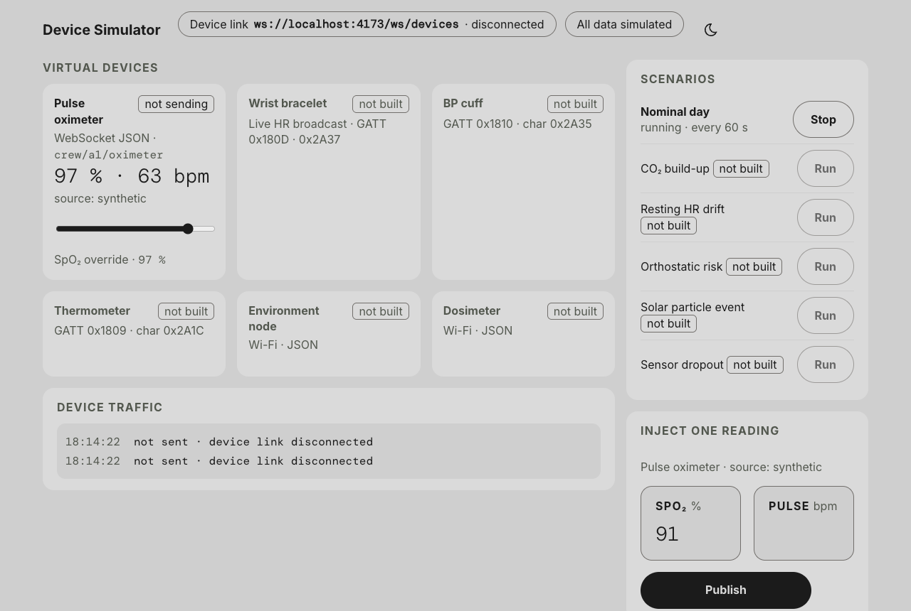

# #25 Device Simulator and the device link

The operator's console for the demo: a second page, `/simulator.html`, that plays the spacecraft's devices while another screen shows the crew app. Each of the six devices (pulse oximeter, wrist bracelet, BP cuff, thermometer, environment node, dosimeter) has one section with an input per metric, an **Every N s** frequency with **Start**/**Stop**, and **Send now** for one reading. A send always uses the values in the inputs at that moment, so editing a value while a device is sending changes its next reading. Readings travel over the **device link**, a WebSocket relay at `/ws/devices` in the Spring Boot app that replaces Mosquitto, so a tablet that opens the app at the machine's LAN IP gets them with no broker or Docker. Issue [#25](https://github.com/jdo-lv/galagans/issues/25); feature F8 in [features.md](../../ideas/features.md).

**Try it:** `mvn clean verify`, then `mvn spring-boot:run`. Open http://localhost:8080/simulator.html on the laptop and http://&lt;machine IP&gt;:8080 on the tablet (or another tab). Click **Start** on each device: every Latest readings tile fills in with its device tag (SpO₂ 97 %, heart rate 63 bpm, BP 108/70, 36.8 °C, cabin CO₂ 2.3 mmHg, 22 °C, 45 % RH, 0.5 mSv/day, 95 mGy-Eq). Then try a check with **Send now**:
- Pulse oximeter SpO₂ 91 → Respiratory Check (SPO-01).
- Environment node CO₂ 3.4, cabin temp 28 or humidity 80 → Cabin air Check (CAB-01, CAB-03, CAB-05); the row shows the worst of the three.
- Dosimeter 30-day BFO dose 130 → Radiation Check (RAD-01); above 250 → Emergency (RAD-02).

From a shell: `target/node/node tools/publish-reading.mjs 91 61` (oximeter only).

At a LAN IP over plain `http:` the browser isn't in a secure context: ids fall back to `crypto.getRandomValues` (so check-ins, packets and readings still get ids), but there's no service worker, so the tablet has no offline cache there. Both demo machines need automatic network time, because the gateway drops readings more than 60 s ahead of the tablet.

**Retake the screenshots:** with the app on :8080, `target/node/node docs/features/25-device-simulator.shots.mjs`; for the disconnected one, stop the app, run `npm run preview` in `src/main/frontend`, then `target/node/node docs/features/25-device-simulator.shots.mjs disconnected` ([script](25-device-simulator.shots.mjs)).

## Screens

### Idle, device link connected
Every input starts at its nominal value, every device at Every 60 s and "Not sent yet".

### Oximeter every 60 s, bracelet every 5 s, environment node with CO₂ 3.4 every 60 s, BP cuff sent once (light)
A sending device shows `sending every N s` and its frequency is locked until Stop; each section shows its last send time (UTC).

### Same, dark

### Device link disconnected (app stopped), same actions
Nothing is queued: each section shows `Not sent · device link disconnected HH:MM:SS`, and a sending device keeps trying on its period.

## Mockup and deviations

Follows [12-simulator-device-sections.html](../../ideas/mockups/src/12-simulator-device-sections.html), which replaced the scenario layout of [04-simulator.png](../../ideas/mockups/04-simulator.png) (first built from [25-mock.png](img/25-mock.png)).

- Crew app tokens in light and dark, not mockup 04's dark-only colours.
- No scenarios, sliders, inject card or traffic log: one section per device instead.
- Every device publishes JSON over the device link, not the GATT bytes of mockup 04; the source is always `synthetic`.
- No mission clock.
- Frequency is 1–3600 s per device; a value outside its device limits, or the wrong number of decimals, disables Start and Send now.
