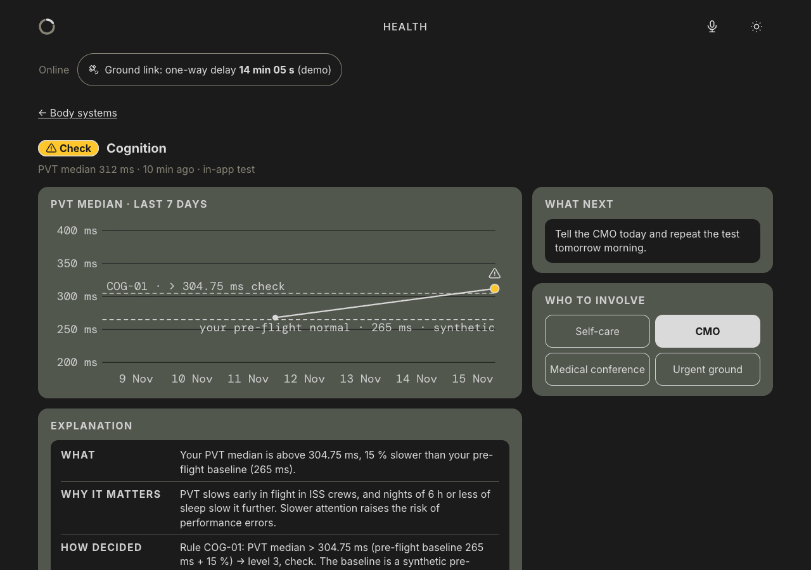
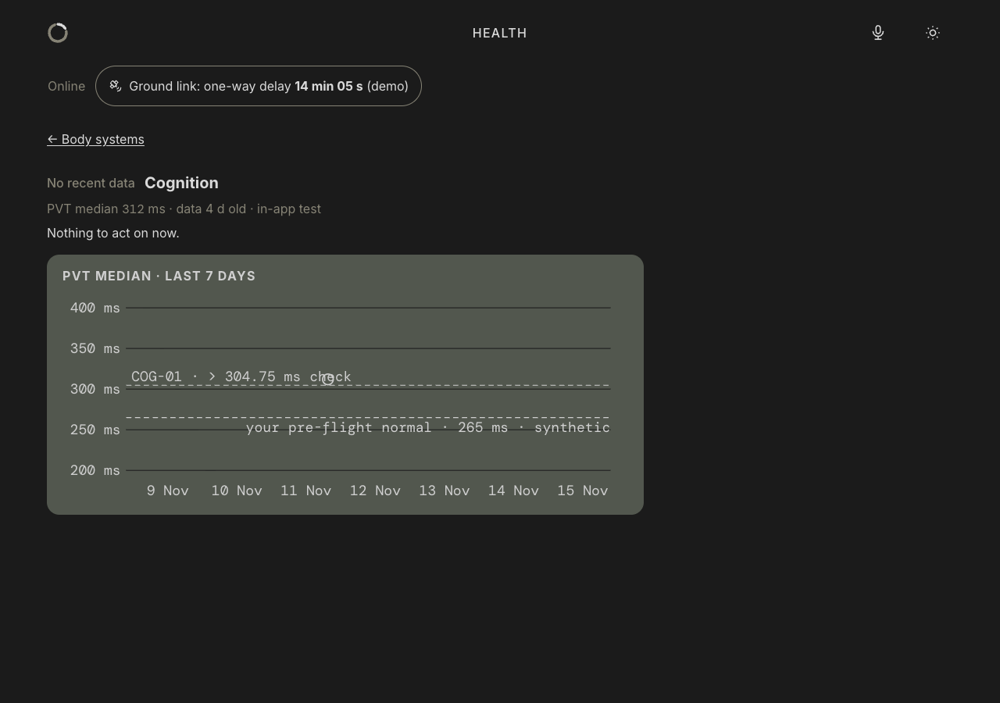
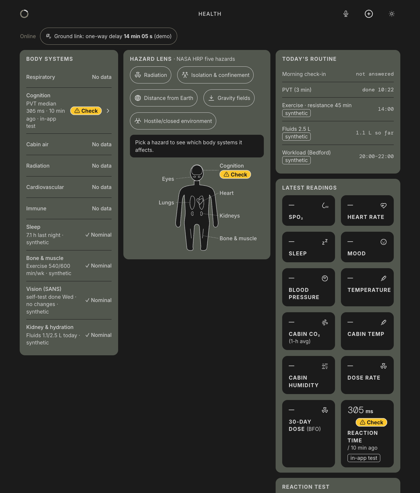

# #28 Personal baseline for the PVT (F3)

Cognition is now judged against the astronaut's own pre-flight normal instead of a number typed into the rule. A pre-loaded profile (`src/main/frontend/src/infrastructure/baseline.json`, synthetic) gives the PVT baseline 265 ms. COG-01 flags a median above baseline + 15 % (304.75 ms), and its "What" and "How decided" texts are filled from the profile. The Cognition chart draws the baseline as a dashed line, labelled "your pre-flight normal · 265 ms · synthetic". SpO₂ keeps its absolute clinical guardrails. Features F3, F4 and F5 in [features.md](../../ideas/features.md); issue [#28](https://github.com/jdo-lv/galagans/issues/28).

A median of exactly 305 ms was nominal under #17 (> 305 ms) and is now a check (> 304.75 ms). Stored readings are re-evaluated; packets already stored or queued are not rebuilt. The 265 ms value and the +15 % margin are a synthetic example (mockup 02) and a team heuristic. Research gives no absolute PVT cut-off, only "relative to the person's baseline" ([health-indicators.md](../../research/health-indicators.md) §13).

**Try it:** `mvn clean verify`, then `mvn spring-boot:run`, open http://localhost:8080 and run the reaction test. Tap slowly to get a median above 304.75 ms, then open Cognition. **Retake the screenshots** with the app running: `target/node/node docs/features/28-personal-baseline.shots.mjs` ([script](28-personal-baseline.shots.mjs)). Set `APP_URL` to use a port other than 8080. The 7-day charts need a build with `VITE_DEMO_MODE=false` (DEMO_MODE, on by default since [#43](43-demo-mock-modes.md), shows the last minute).

## Screens

### Cognition detail, check (PVT 268 ms 4 days ago, 312 ms 10 min ago)
The baseline line at 265 ms sits under the COG-01 line at 304.75 ms; the explanation names both values.

### Cognition detail, stale (PVT 312 ms, 4 d 2 h old)
The chart still draws, so the baseline line shows too.

### Home, PVT 305 ms 10 min ago
305 ms is now a check on the Body systems list, the figure and the Reaction time tile.

With no PVT reading the detail shows no chart and no baseline, as before (#17).

## Mockup and deviations

Follows [02-detail.png](../../ideas/mockups/02-detail.png) through the #9 detail screen and the issue mock [28-mock.png](img/28-mock.png). The screenshots are dark because the machine that took them is in dark mode.

The mock HTML predates the level tokens of [#33](33-alert-levels.md), so it no longer renders as its committed PNG.

| Deviation | Reason |
|---|---|
| The label adds the value and "synthetic" ("your pre-flight normal · 265 ms · synthetic") | Data honesty: the profile is synthetic. `ideas/ui-guidelines.md` §5 Charts now says so. |
| A single baseline value, no band; no adaptation corridor; X axis is the last 7 days | The band's width comes with the corridor (F11). |
| No date on the baseline | The profile is static and synthetic; an invented date would be less honest. |
