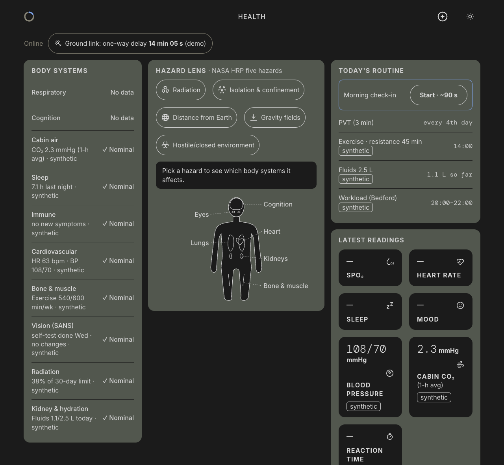
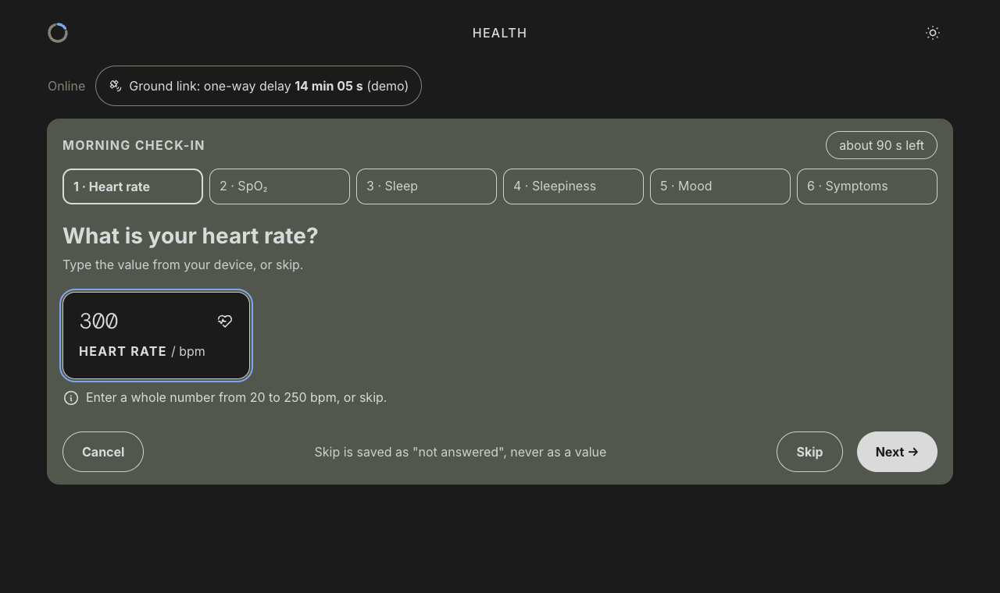
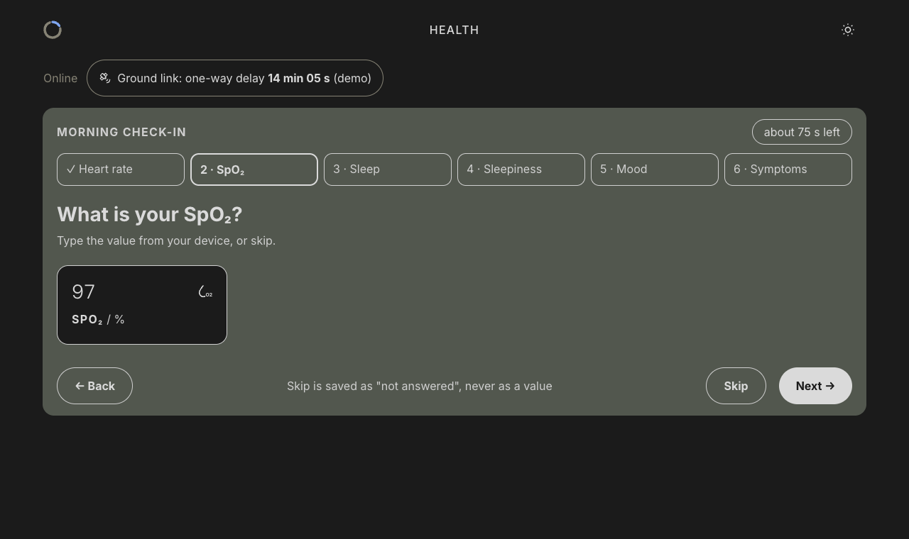
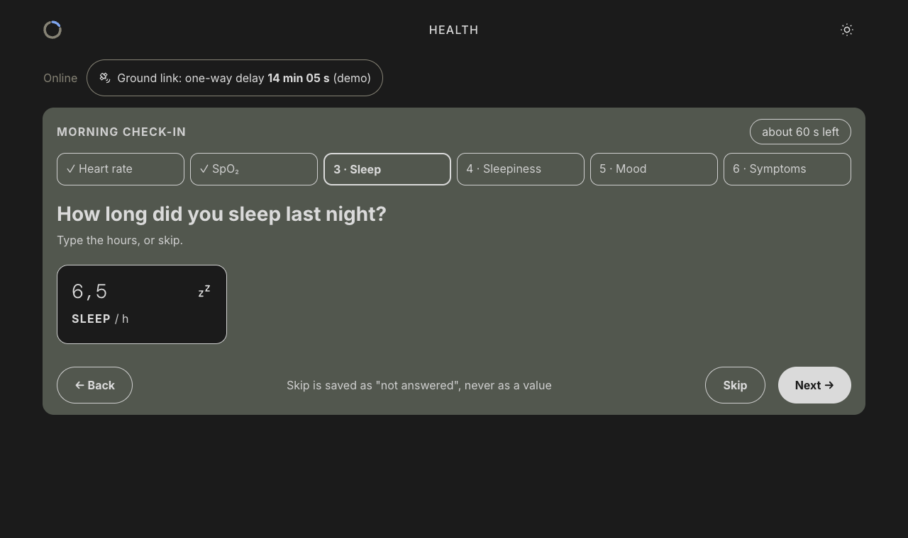
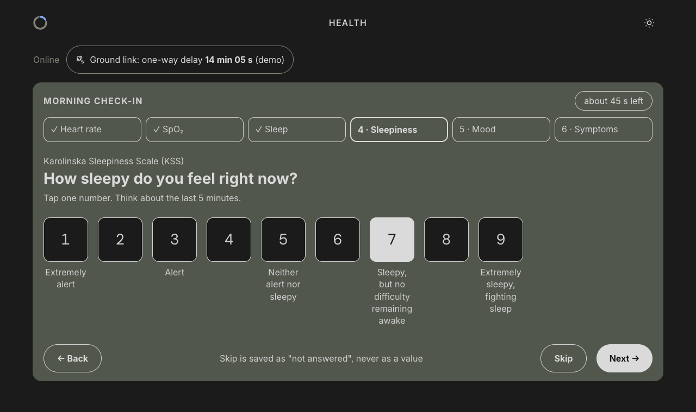
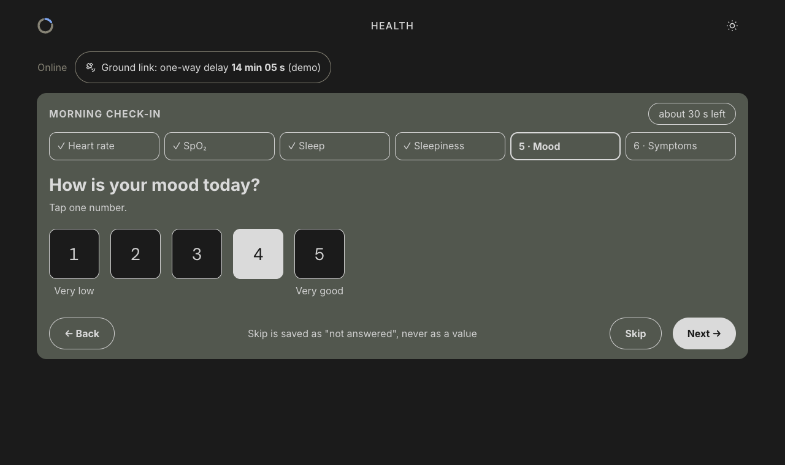
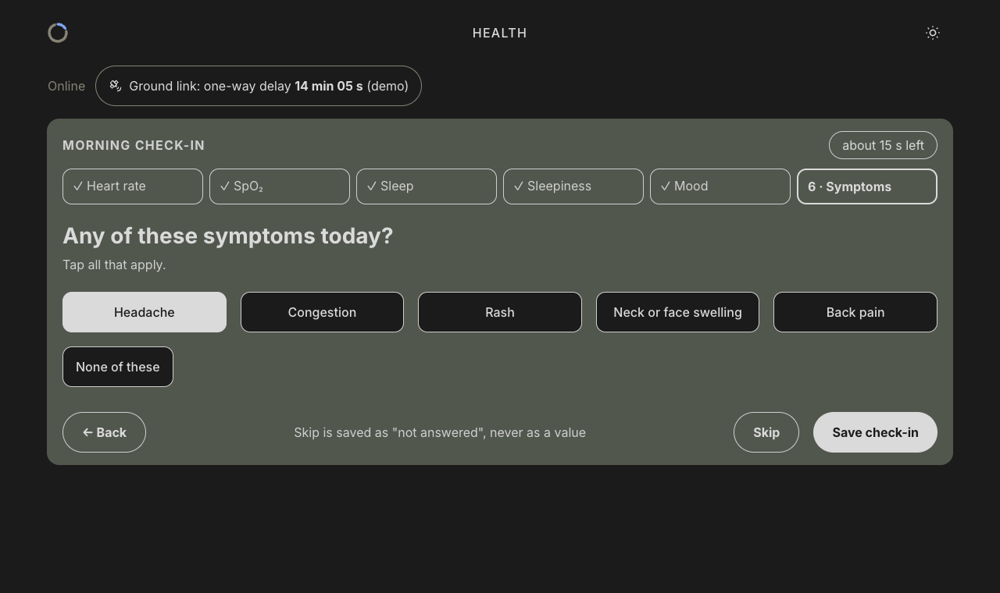
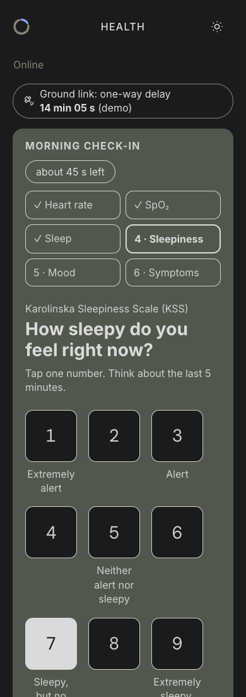
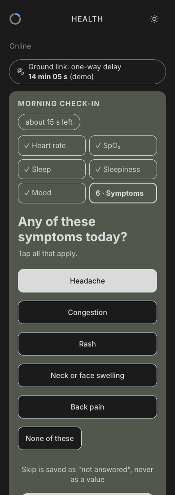
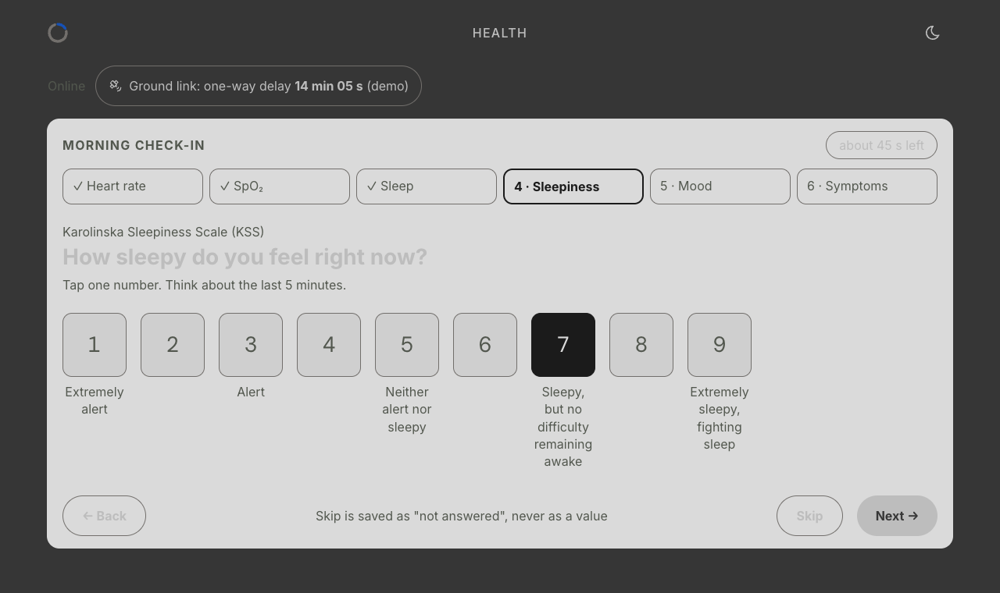

# #29 Morning check-in: one question per screen

The morning check-in is its own screen at `#/check-in`, one question per step as in mockup 06: heart rate, SpO₂, sleep hours, the Karolinska Sleepiness Scale (KSS), mood and a symptom checklist. The crewmember opens it from Today's routine "Start" (when due) or the header "+" (any time), sees progress and time left, can always skip, and saves once at the end. Nothing is stored until "Save check-in", and everything works offline. Features F1 and F15 in [features.md](../../ideas/features.md); issue [#29](https://github.com/jdo-lv/galagans/issues/29).

**Try it:** `mvn clean verify`, then `mvn spring-boot:run`, open http://localhost:8080 and click Check-in in the navigation bar (or "Start · ~90 s" between 07:00 and 09:00). Type 300 on the heart rate step to see the error, skip a step, go back, and finish with "Save check-in". **Retake the screenshots** with the app running: `target/node/node docs/features/29-check-in-questionnaire.shots.mjs` ([script](29-check-in-questionnaire.shots.mjs)); set `APP_URL` for another port. Other shot scripts save through the steps with `tools/checkin-shots.mjs`.

## Screens

### Home at 08:00, check-in due
"Start · ~90 s" in Today's routine and "+" (Add entry) in the header both open the check-in. The inline Check-in card is gone. The estimate is the sum of the steps (6 × 15 s).

### Step 1, heart rate
Six tabs show progress, the pill the time left, and step 1 offers "Cancel" where later steps offer "← Back". The question takes focus.

### Step 1 with 300 bpm and "Next →"
The step stays, the field keeps focus, and an info icon and a sentence explain the limit. Never red or yellow: a typing error is not a health status.

### Step 2, SpO₂ 97 typed after heart rate 63
An answered earlier step reads "✓ Heart rate".

### Step 3, sleep 6.5 h

### Step 4, KSS 7 picked
Nine big buttons with the S56 words under 1, 3, 5, 7 and 9; the pick is the inverse fill.

### Step 5, mood 4 picked

### Step 6, Headache picked
Symptoms toggle; "None of these" and any symptom cancel each other. "Save check-in" stores one check-in and shows its completion ([#40](40-reporting-win.md)); "Done" returns home with focus on Body systems.

### Phone (390 px)
Tabs in two columns, the number buttons three per row with each word under its own button, and the actions stacked below the Skip line.

### Light theme

The save failure ("Not saved. Try again.", answers kept) and the in-flight state (every button disabled) can't be triggered from the running app; they're covered by `src/main/frontend/src/ui/CheckInScreen.test.tsx` (AC39–AC41).

## What is stored

One `CheckIn` per save: `heartRateBpm`, `spo2Percent`, `sleepHours`, `kss` and `mood` when answered, `symptoms` as ids (`headache`, `congestion`, `rash`, `neck-face-swelling`, `back-pain`, in that order) and `symptomsAnswered: true` when a symptom or "None of these" was picked. A skipped step is absent, never a value. The ground station accepts `kss` and `symptomsAnswered` and ignores them for now, like the PVT fields.

## Mockup and deviations

The screen follows [06-questionnaire.png](../../ideas/mockups/06-questionnaire.png): step tabs, instrument line, question, hint, big number buttons with words, and Back · Skip line · Skip · Next. The issue mock is [29-check-in-questionnaire.mock.html](29-check-in-questionnaire.mock.html). Colours and sizes come from [ui-guidelines.md](../../ideas/ui-guidelines.md).

The mock HTML predates the level tokens of [#33](33-alert-levels.md), so it no longer renders as its committed PNG.

| Deviation | Reason |
|---|---|
| Six steps: heart rate and SpO₂ come first, and the sleep diary asks hours only | F1 lists heart rate and SpO₂ in the daily check-in, and the inline form that took them is gone. The full RST diary would need five new fields. |
| No "Why you're seeing this", "Questionnaires · next" or privacy note | Rule-triggered items (F15) and role views (F20) aren't built; the panels would have nothing true to say. |
| Full-width card with the time-left pill inside it | Six tabs need the width; the PVT keeps its timer inside its screen too. |
| Selection is the inverse fill, the current tab a 2 px text outline | Colour means alert level only (ui-guidelines rule 1); the mockup's blue is a status-like accent. |
| KSS words follow S56 ("Sleepy, but no difficulty remaining awake", "Extremely sleepy, fighting sleep") | The instrument's own anchors, never paraphrased ("Rendering rules"); mockup 06 now uses them too. |
| Number buttons wrap three per row on a phone, not 5 + 4 | Five 52 px targets with 18 px gaps need 332 px; the card has 310 px at 390 px width. |
| "+" and the theme toggle 18 px apart, not 4 px as in the issue mock | ui-guidelines rule 7: touch targets at least 18 px apart. |
