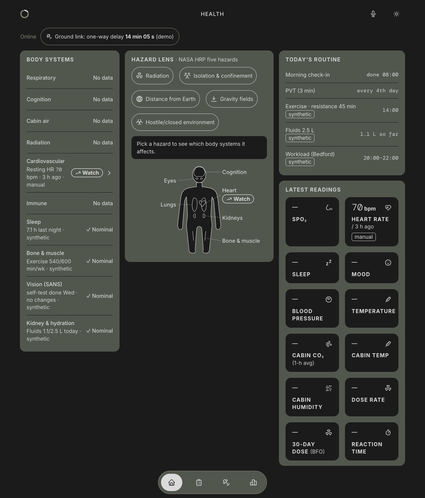
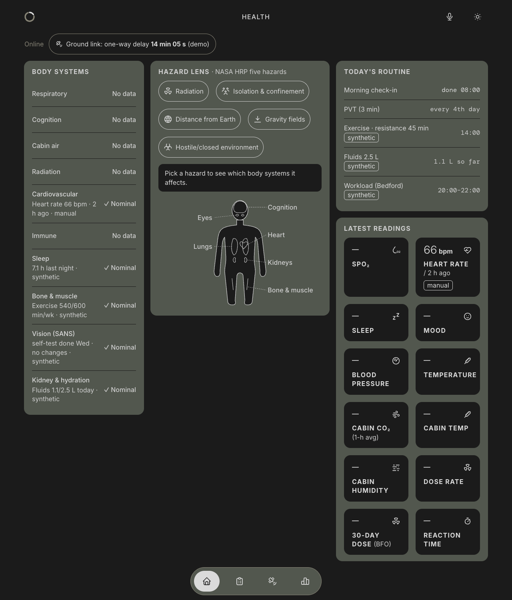
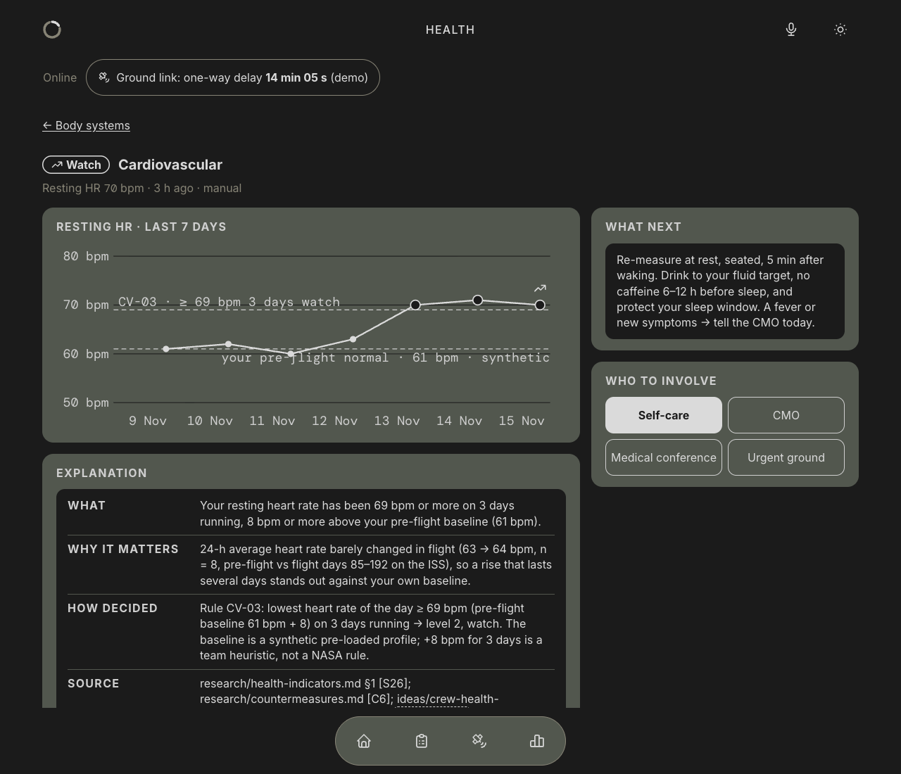
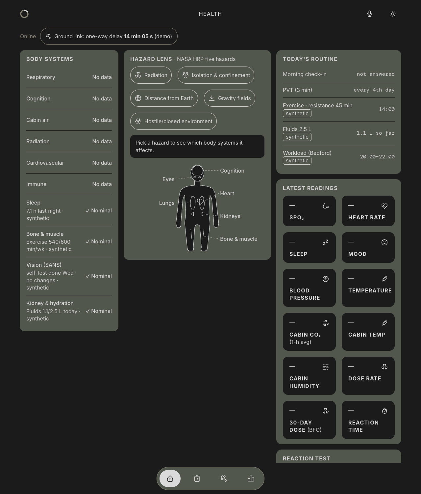

# #35 Resting HR drift rule CV-03 (F3, F4, F5, F6)

In flight, heart rate stays about flat (63 → 64 bpm, [health-indicators.md](../../research/health-indicators.md) §1 [S26]), so a resting heart rate that stays above the astronaut's own pre-flight baseline for several days matters more than an Earth cut-off. Rule CV-03 takes the lowest heart rate of each UTC day from any source (check-in, oximeter, BP cuff pulse, bracelet). When that daily resting HR is at least baseline 61 bpm + 8 = 69 bpm on 3 days running, Cardiovascular goes to level 2 Watch (Self-care), with a daily chart against the baseline. CV-03 is its own group in Cardiovascular, next to CV-01/02 (heart rate) and BP-01..07. The system shows the worst group, and equal levels keep table order. The baseline is synthetic, and +8 bpm for 3 days is a team heuristic. Issue [#35](https://github.com/jdo-lv/galagans/issues/35).

The drift row never rates the Heart rate tile or the surgeon packet item; CV-01/02 still do. The Device Simulator and MOCK_MODE ignore it, so heart-rate devices keep Nominal and Check. A drift shows only from several days of seeded or real data.

**Try it:** build with `VITE_DEMO_MODE=false` (DEMO_MODE charts only the last minute, so the drift chart would read "No readings in the last minute"), run `mvn spring-boot:run` and open http://localhost:8080. You need heart-rate readings of 69 bpm or more on 3 UTC days in a row, the newest within the last 24 h. Enter them through the check-in on three days, or write them to IndexedDB as the shots script does. **Retake the screenshots** with the app running from a `VITE_DEMO_MODE=false` build: `APP_URL=http://localhost:<port>/ target/node/node docs/features/35-resting-hr-drift.shots.mjs` ([script](35-resting-hr-drift.shots.mjs)). The script writes check-ins relative to today's UTC date, so the dates in the images move.

## Screens

### Home, Watch (HR 70 at 07:00 UTC on the last 3 days)
Cardiovascular shows "Resting HR 70 bpm" with the Watch badge and its up arrow, and the Heart item on the figure shows the same badge. The Heart rate tile stays unrated.

### Home, nominal (the same plus HR 66 today at 08:00)
Today's lowest reading is 66, so the run breaks. Cardiovascular shows the newest heart rate, "Heart rate 66 bpm", as Nominal.

### Cardiovascular detail, Watch (HR 61, 62, 60, 63, 70, 71, 70 at 07:00 on the last 7 days, plus HR 90 yesterday at 18:00)
One point per day at the day's lowest reading (yesterday's 90 isn't plotted). The last 3 points are Watch, with one marker on the newest point. The axis runs 50–80 bpm, with the CV-03 line at 69 and the baseline at 61. The explanation, what next and the Self-care tier come from the CV-03 row.

### Home, no data (no heart-rate and no BP reading)

## Mockup and deviations

Follows [08-check-and-act.png](../../ideas/mockups/08-check-and-act.png) for the content (Watch badge, "Cardiovascular · resting heart rate", baseline 61 bpm, +8 bpm for 3 days, daily chart), laid out as the detail screen of [02-detail.png](../../ideas/mockups/02-detail.png), through the issue mock [35-mock.png](img/35-mock.png) ([source](35-resting-hr-drift.mock.html)). The screenshots are dark because the machine that took them is in dark mode.

| Deviation | Reason |
|---|---|
| A 7-day window instead of 14 days | Every chart uses `CHART_WINDOW_MS`. |
| One Watch marker on the newest point of the run, not one per point | The existing `TrendChart` rule: one marker per run of same-level points. |
| No check-and-act card and no medical conference panel | Out of scope (F22, F23). |
| Source tag reads `manual` or `<device> · synthetic` | The gateway's labels. |
