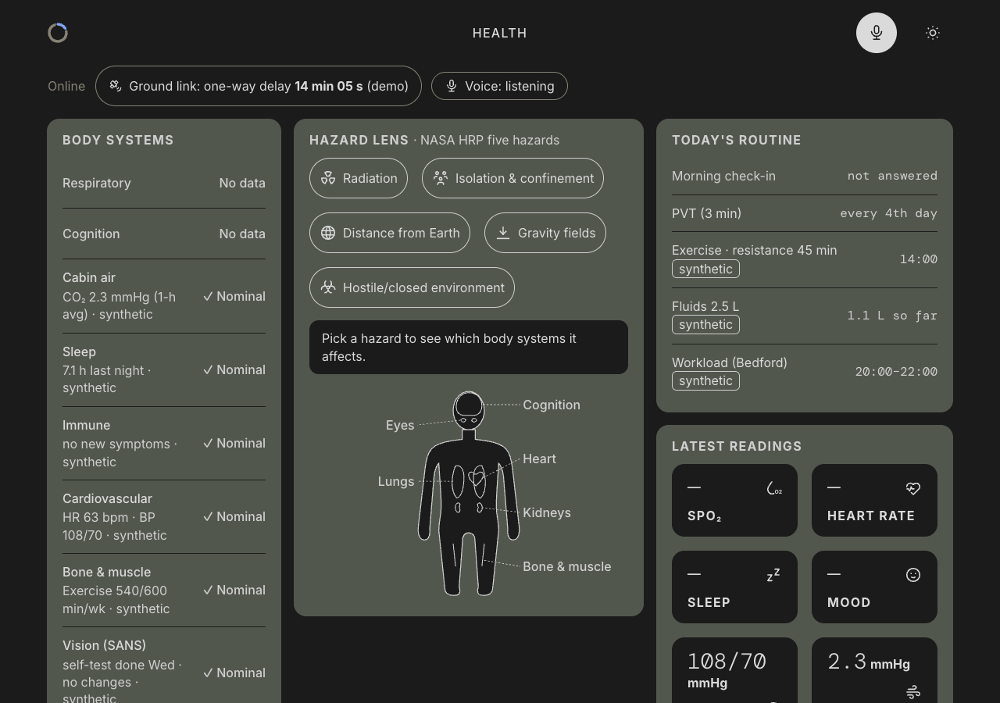
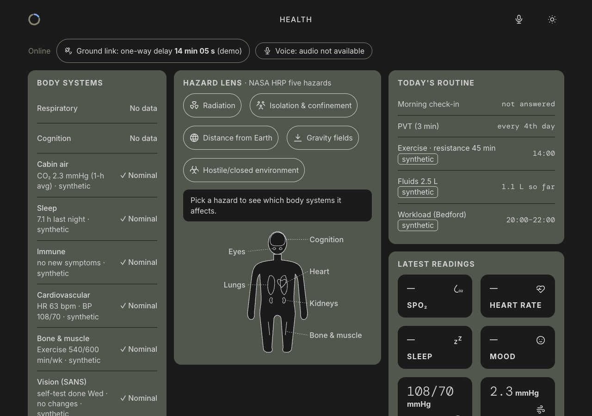
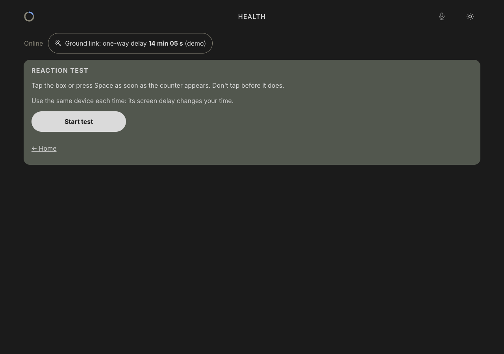
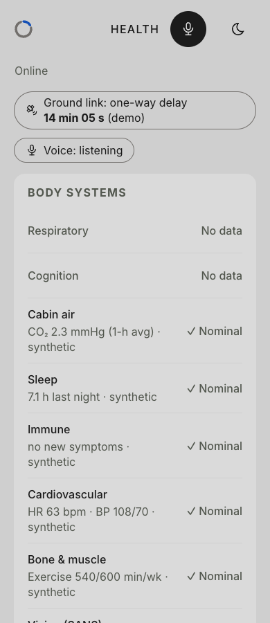

# #37 Hands-free voice: health briefing, commands and check-in by voice

The astronaut taps the microphone in the header and hears a short health briefing: each caution and warning in its rule's own sourced words, "all your (other) readings are nominal", systems without data, what is still to do today, then "What would you like to do next?". Voice can then open screens, repeat the briefing and take sleep, heart rate, SpO₂ and mood, read back and saved only after a spoken confirm. Speech-to-text (whisper.cpp), the command model (Qwen3.5-4B on llama.cpp) and read-aloud (Piper) run on a local voice host; the model only turns speech into one command and never words a status. Feature F25 in [features.md](../../ideas/features.md); issue [#37](https://github.com/jdo-lv/galagans/issues/37).

**Try it:** start the voice host with `podman compose -f voice-host/compose.yaml up -d --build` (Podman VM with 8 GB; the first start downloads the 2.7 GB model), then `cd src/main/frontend && npm run dev`, open http://localhost:5173 in Chrome, tap the microphone and allow it. Voice works only through the Vite dev server; the built app on :8080 shows "Voice host unreachable". Use headphones in a shared module: the briefing speaks health values aloud. **Retake the screenshots** with both running: `target/node/node docs/features/37-voice-briefing.shots.mjs` ([script](37-voice-briefing.shots.mjs)). It grants or denies the microphone through CDP and blocks `/voice/*` requests (`Network.setBlockedURLs`) for the unreachable state; the issue named `Fetch.failRequest`, which fails the requests the same way but needs event handling that `tools/cdp.mjs` doesn't have. Playback is ended at once in the script, because headless Chrome sometimes never fires the audio `ended` event; sound doesn't show in a screenshot.

## What it says (demo data)

The screen only changes in the header button and the voice pill, so the spoken texts are quoted here (captured from the app with the demo statuses).

**Briefing, nothing flagged** (Respiratory and Cognition without data, no check-in or PVT yet):
> All your readings are nominal. There is no Respiratory or Cognition reading yet. To do today: your morning check-in and the reaction test. What would you like to do next?

**Briefing after a check-in with SpO₂ 92 %** (rule SPO-01, caution):
> Caution, Respiratory. SpO₂ is below 94 %. Yours is 92 %. Low oxygen saturation can mean hypoxia from a cabin atmosphere fault, fire or smoke. Re-measure: warm your hands, sit still for 1 minute, finger fully in, hand at heart level. Still below 94 % → tell the CMO now. Who to involve: CMO. All your other readings are nominal. There is no Cognition reading yet. To do today: the reaction test. This is decision support; your flight surgeon has the final word. What would you like to do next?

Piper hears the symbols as words ("S P O 2 is below 94 percent", "…, then tell the CMO now").

**"How is my breathing?"** with SpO₂ 92 % opens the Respiratory detail and says its caution with the decision-support line; with no data it stays on the screen and says "There is no Respiratory data yet. What would you like to do next?"

**"I slept six hours, mood four"**: "Sleep 6 hours, mood 4 of 5. Say confirm to save, or no." Nothing is saved until "yes" or "confirm"; "no" says "Not saved."

**"Oxygen forty five"**: "Oxygen 45 percent is outside what the check-in takes. Please say it again or type it." The value is never saved.

## Screens

### Voice on, listening (Home, dark, 1280 px)

### Voice host unreachable (all `/voice/*` requests fail)

### Microphone blocked

### PVT screen: the mic is disabled, so voice can't talk during the timed test

### Phone, 390 px, light, voice on

The issue mock is [37-mock.png](img/37-mock.png) ([script](37-voice-briefing.mock.mjs)), Home while the briefing is spoken. "Check-in not saved. Say confirm to try again, or no." needs a failing IndexedDB and can't be produced from the running app; `VoiceSession.test.ts` covers it.

## Mockup and deviations

Home follows [01-body-map.png](../../ideas/mockups/01-body-map.png). Deviation: a microphone icon button left of the theme toggle and a voice pill after the ground-link pill; no voice mockup exists. Styles follow [ui-guidelines.md](../../ideas/ui-guidelines.md) §5 "App header", "Buttons" (inverse fill while on, 60 % opacity while disabled), "Pills and tags" and "Icons" (`VoiceIcon`). The header buttons are 20 px apart (`gap: var(--space-5)`, rule 7).
