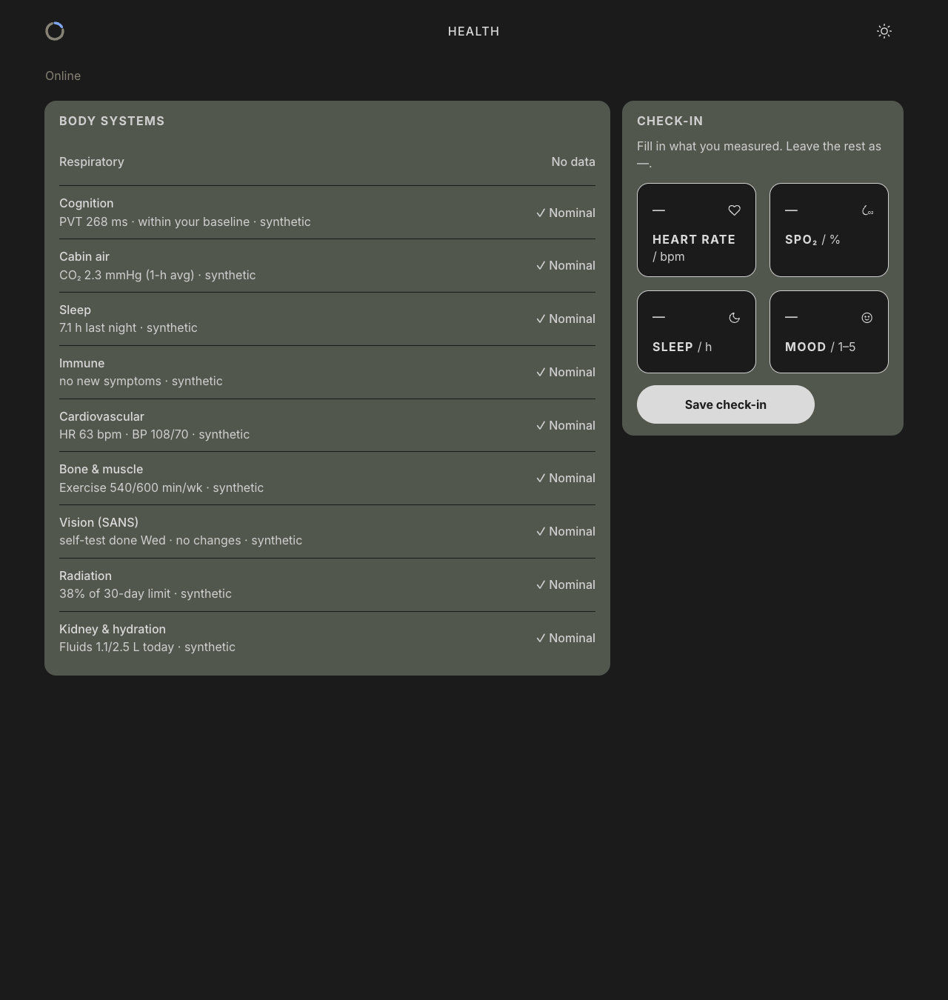
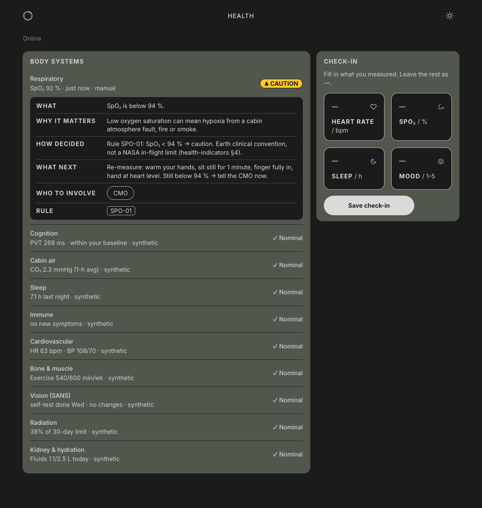
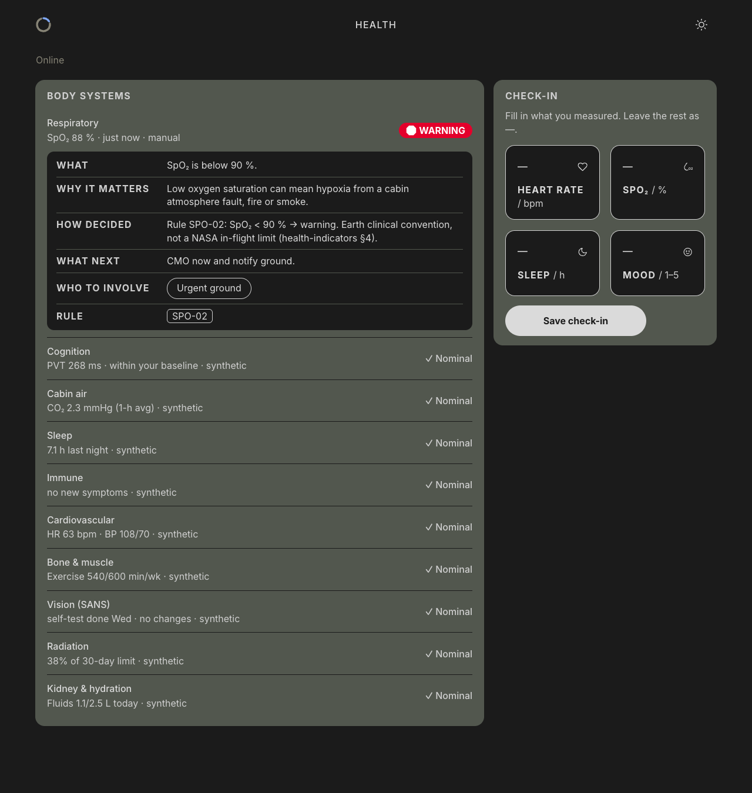

# #4 Body systems list: Respiratory plus synthetic placeholders

The "Body systems" card on home lists all ten systems of mockup 01. Respiratory is the only system with rules (SPO-01/02, [#1](1-spo2-core-loop.md)), so it shows real check-in data. The other nine show fixed synthetic values from `src/main/frontend/src/infrastructure/mockStatuses.ts`, always "✓ Nominal", labelled "synthetic", with no data age and no explanation. When a rule row is added for one of those systems, its placeholder disappears and the real status takes its place. Feature F6 in [features.md](../../ideas/features.md); issue [#4](https://github.com/jdo-lv/galagans/issues/4).

**Try it:** `mvn clean verify`, then `mvn spring-boot:run`, open http://localhost:8080, click "+" (Add entry) in the header, type an SpO₂ value on its step, click "Next →" through the other steps and "Save check-in" on the last ([#29](29-check-in-questionnaire.md)). **Retake the screenshots** with the app running: `target/node/node docs/features/4-body-systems-list.shots.mjs` (script: [4-body-systems-list.shots.mjs](4-body-systems-list.shots.mjs)).

## Screens

Since [#17](17-cognition-rule.md) Cognition is no longer a placeholder: it comes from the PVT (rule COG-01) and shows "No data" until a test is done.

Since [#9](9-detail-screen.md) the explanation is no longer inline: the Respiratory row links to its detail screen when it is in caution or warning. Since [#29](29-check-in-questionnaire.md) values are entered through the check-in steps, not a form on home. The screenshots below predate both changes.

### No check-ins yet
Respiratory shows "No data"; the nine placeholders follow in mockup 01 order.

### Caution (SpO₂ 92, rule SPO-01)
Only Respiratory changes; the placeholders stay quiet.

### Warning (SpO₂ 88, rule SPO-02)

"Status unavailable" (rules or storage fail to load, so no rows at all, placeholders included) can't be triggered from the running app; it's covered by `SystemStatusList.test.tsx` (AC6).

## Mockup and deviations

The list follows the "Body systems" panel of [01-body-map.png](../../ideas/mockups/01-body-map.png): system name, muted sub line, status on the right. Styles follow [ui-guidelines.md](../../ideas/ui-guidelines.md) "Body-system list" (placeholder row added there).

| Deviation | Reason |
|---|---|
| Cognition, Cabin air and Sleep are "✓ Nominal", not CAUTION | A caution must show what / why / how decided / what next, and a placeholder has no rule behind it. The `Placeholder` type only allows nominal. |
| Values reworded: Cognition "PVT 268 ms · within your baseline", Cabin air "CO₂ 2.3 mmHg (1-h avg)", Sleep "7.1 h last night", Vision "self-test done Wed · no changes" | The mockup's wording describes cautions or missed data, which contradicts a nominal row. CO₂ 2.3 mmHg is the median ISS cabin value ([data-sources.md](../../research/data-sources.md)). |
| Respiratory row added at the top; no hazard-lens marks or dimming | Respiratory is the system with rules (#1); the hazard lens is a later feature. |
| No body figure, hazard lens, routine or readings panels | Out of scope for #4. |
