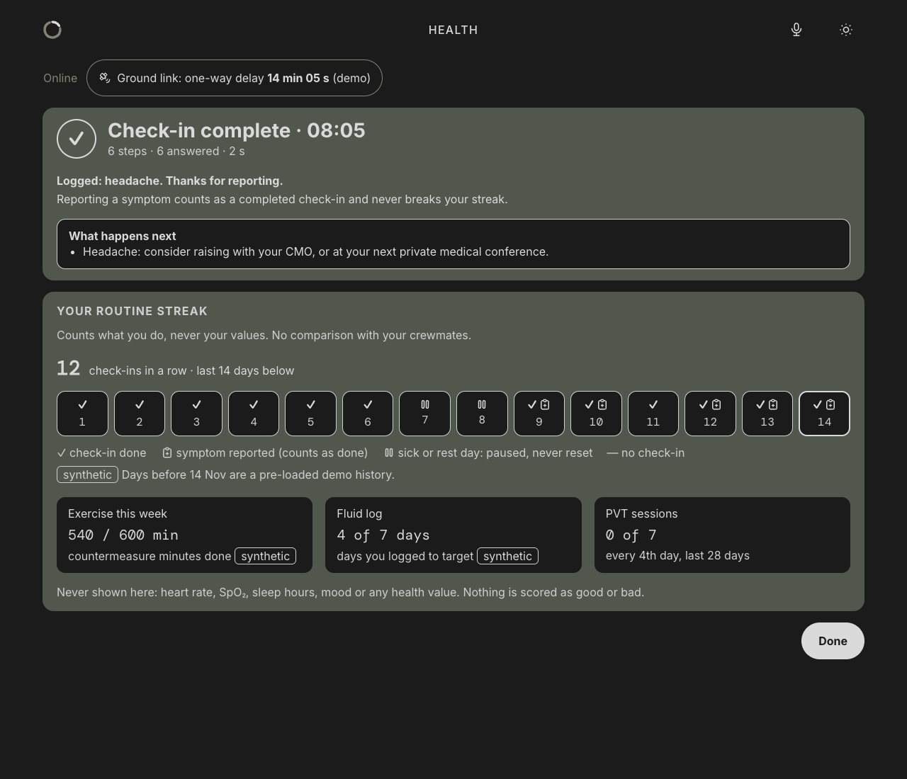
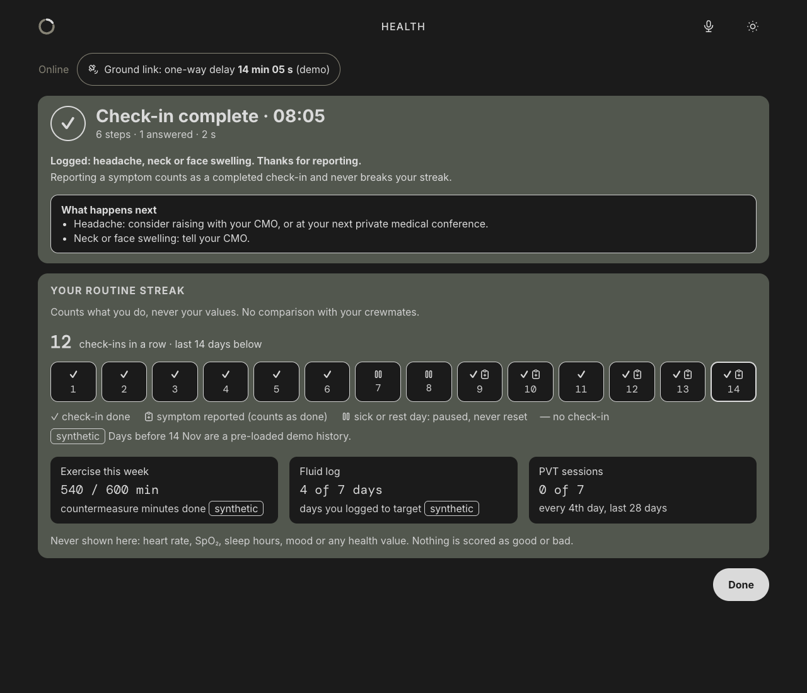
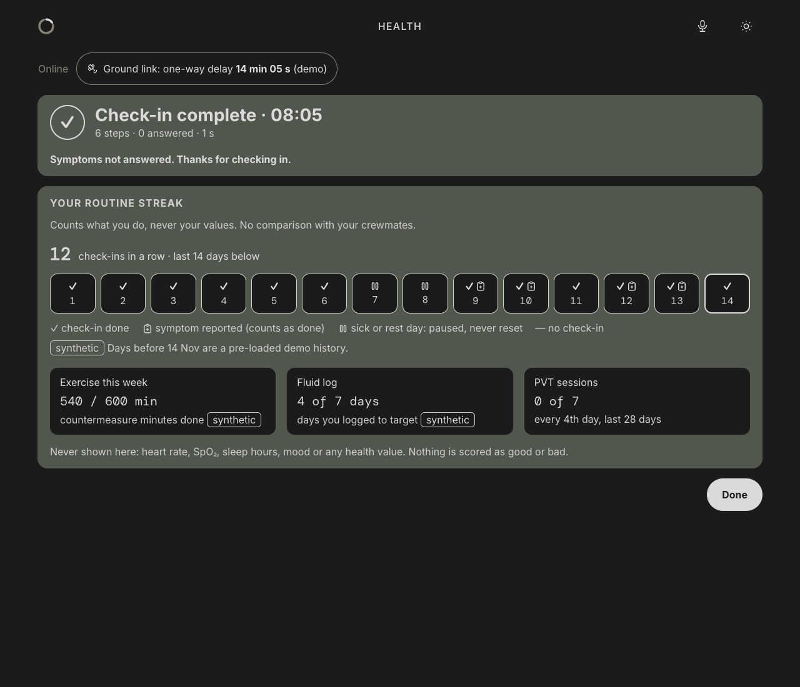
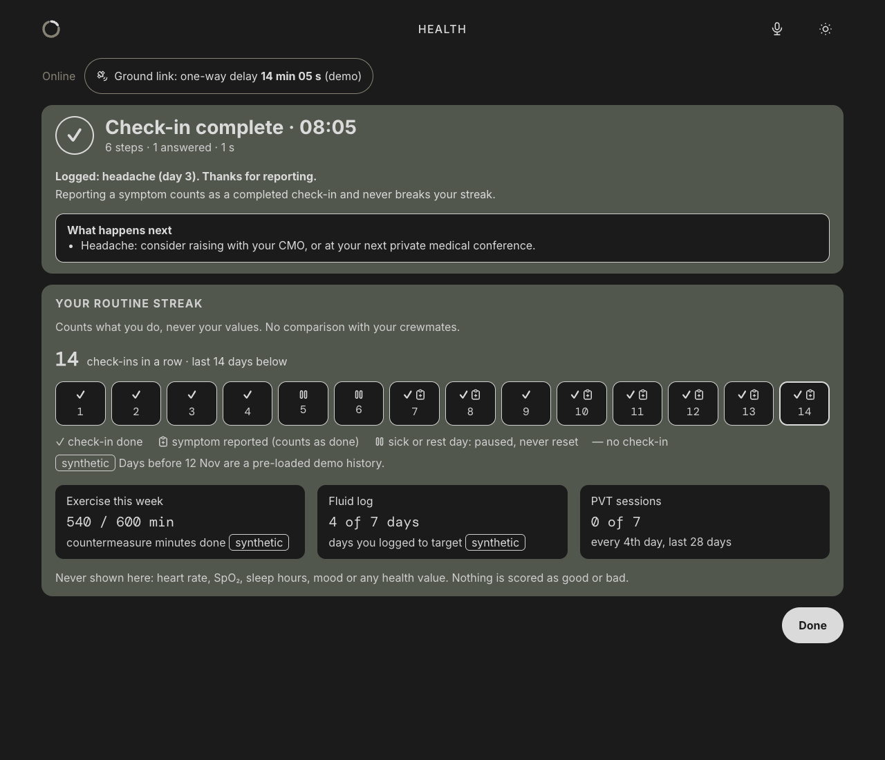
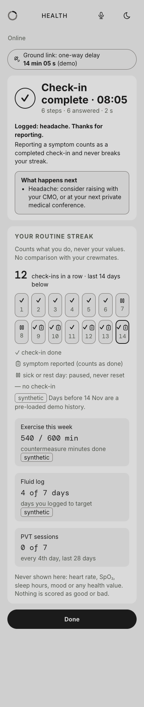

# #40 Reporting is a win: check-in completion and routine streak

After "Save check-in" the morning check-in shows its completion on the same screen. A logged symptom gets a neutral "Thanks for reporting" and one line per symptom on what to do next. A routine streak counts check-ins, never values; symptom days count as done, and paused days never reset it. "Done" returns home. Feature F13 in [features.md](../../ideas/features.md); issue [#40](https://github.com/jdo-lv/galagans/issues/40).

**Try it:** `mvn clean verify`, then `mvn spring-boot:run`, open http://localhost:8080 and click Check-in in the navigation bar. Pass the steps with "Next →", tap Headache on the last one and click "Save check-in". On a fresh browser profile the first day reads "12 check-ins in a row": the 13 days before it are a synthetic demo history. **Retake the screenshots** with the app running: `target/node/node docs/features/40-reporting-win.shots.mjs` ([script](40-reporting-win.shots.mjs)); set `APP_URL` for another port. The page clock is pinned to 14 Nov 2026 08:05.

## Screens

### Headache logged, every step answered (1280 px, dark)
The ✓ circle, "Check-in complete · 08:05", "6 steps · 6 answered · 2 s", the acknowledgement and the "What happens next" box. Below it, the streak: 12 days in a row on the first real day, 14 cells with today outlined, the legend, the "synthetic" caption, and three counters (PVT real, exercise and fluids synthetic).

### Headache and neck or face swelling
Each next-step line starts with its symptoms. Swelling goes to the CMO only.

### "None of these"
"No symptoms logged. Thanks for checking in." No next-step box, nothing praised. Today's cell is ✓ without the symptom mark.

### Symptom step left empty
"Symptoms not answered. Thanks for checking in." and "0 answered".

### Headache logged on 12, 13 and 14 Nov
"Logged: headache (day 3)." Real check-ins on 12 and 13 Nov move the first real day, so the caption reads "Days before 12 Nov" and the count is 14 (3 real days, then 11 counted synthetic days).

### Phone (390 px, light)
Day cells wrap 7 per row, the counters stack, and "Done" is full width.

The pending and failed streak reads, the offline save and the skipped-day run can't be triggered from the running app; `src/main/frontend/src/ui/CheckInScreen.test.tsx` covers them (#40 AC13, AC16, AC21, AC32, AC33).

## Manual checks

- **AC50:** at 1280 px in the dark theme, the 14 cells sit in one row and the counters in three columns (first screenshot).
- **AC51:** at 390 px in the light theme, the cells wrap 7 per row, the counters stack, and "Done" is full width (last screenshot).
- **AC52:** the [ui-guidelines §8](../../ideas/ui-guidelines.md) checklist passes:
  - tokens only, no hex;
  - no level colour or badge;
  - text 16 px or more, the streak count at the 28 px value size, "Done" 52 px high;
  - icons from `icons.tsx` (`SymptomIcon`, the new `PausedIcon`);
  - checked in light and dark at 390 and 1280 px.

  The counter values use the 20 px heading size: they are process counts, not health values.

## Mockup and deviations

The screen follows the right column of [09-reporting-win.png](../../ideas/mockups/09-reporting-win.png); the symptom step on its left is #29's step 6, whose hint now adds "Logging a symptom always counts as a completed check-in." The issue mock is [40-reporting-win.mock.html](40-reporting-win.mock.html).

The mock HTML predates the level tokens of [#33](33-alert-levels.md), so it no longer renders as its committed PNG.

| Deviation | Reason |
|---|---|
| No conference date and no "Open agenda →" | No conference agenda (F23) or schedule exists yet. |
| One next-step line per symptom group; neck or face swelling says "tell your CMO." | Swelling can signal a jugular clot ([long-duration-literature.md](../../research/long-duration-literature.md) "Veins / clotting" [L4]); the others follow the CMO → private medical conference escalation. |
| "…never breaks your streak" instead of "your streak continues" | True even on the first day of a new streak. |
| Day-of-month labels, not flight days | There is no mission clock yet (F21). |
| A "synthetic" caption under the cells and tags on two counters | The history before the first real day and the exercise and fluid counters are synthetic (ui-guidelines rule 4). |
| A "— no check-in" legend entry | Real days without a check-in show "—". |
| No privacy note | Role views (F20) aren't built, and the sync sends the whole check-in. |
| A "Done" button | The completion is a state of `#/check-in`; "Done" returns home with focus on Body systems. |
| Text 16 px and more, counters in DM Mono | ui-guidelines sizes; the mockup uses smaller text. |
