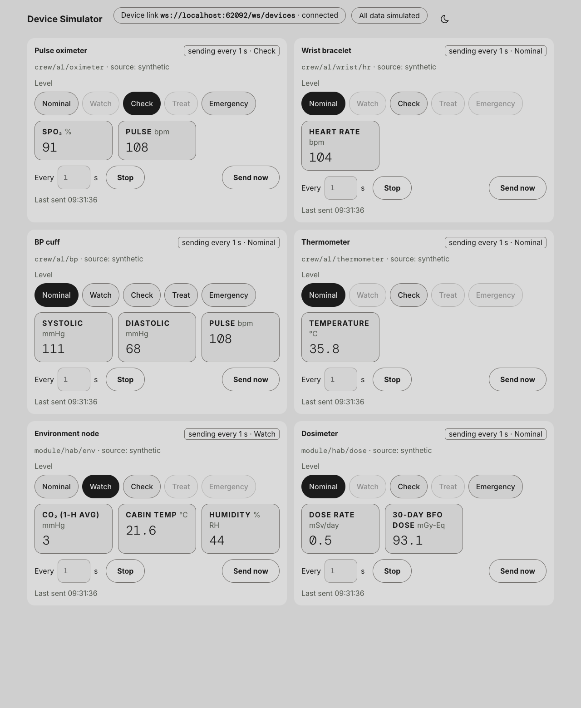
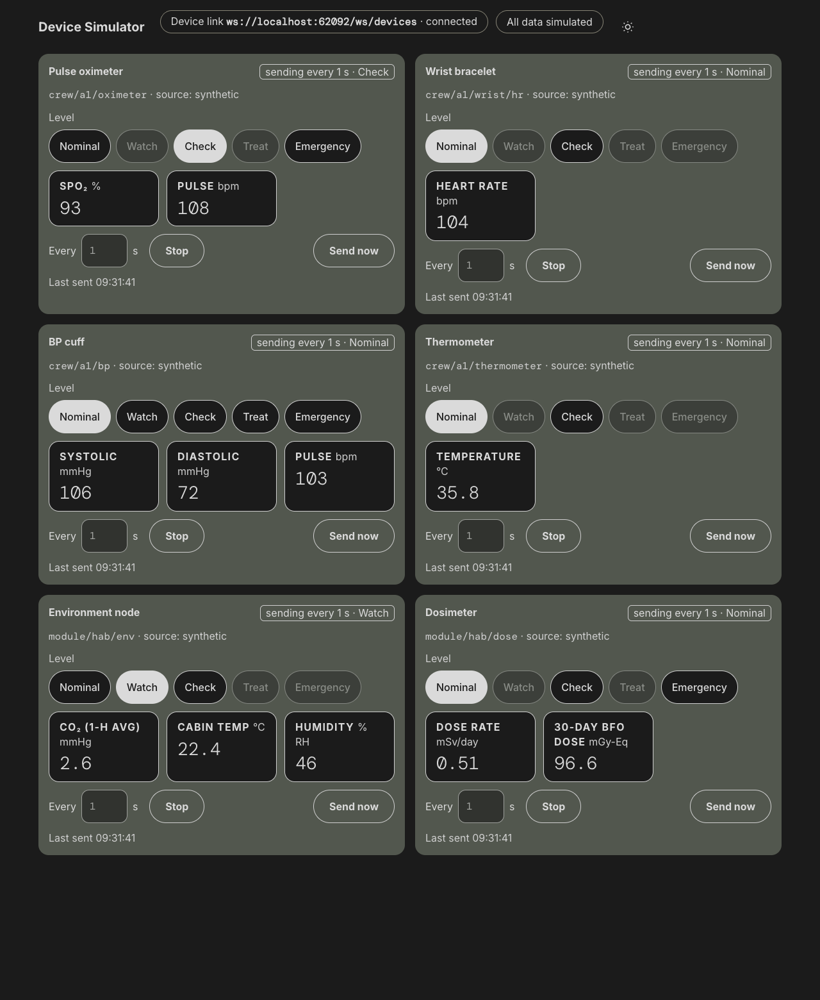
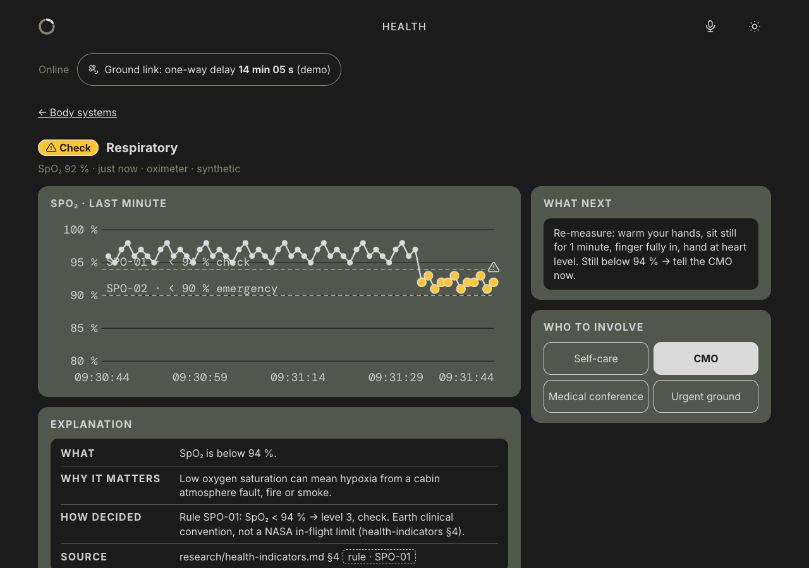
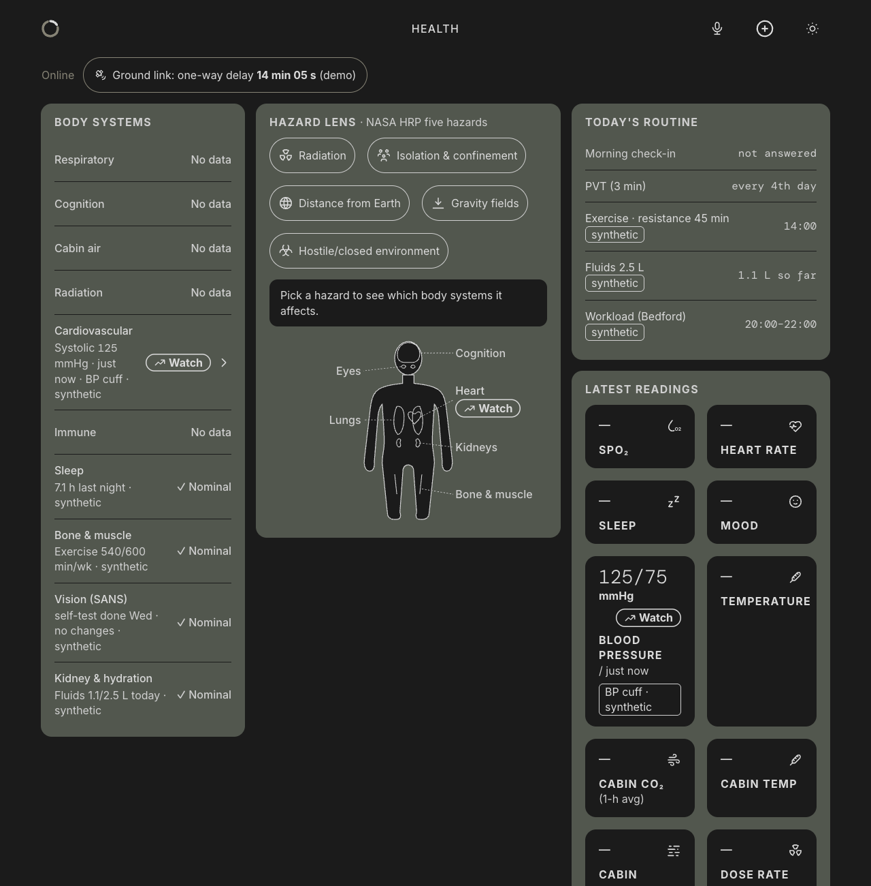
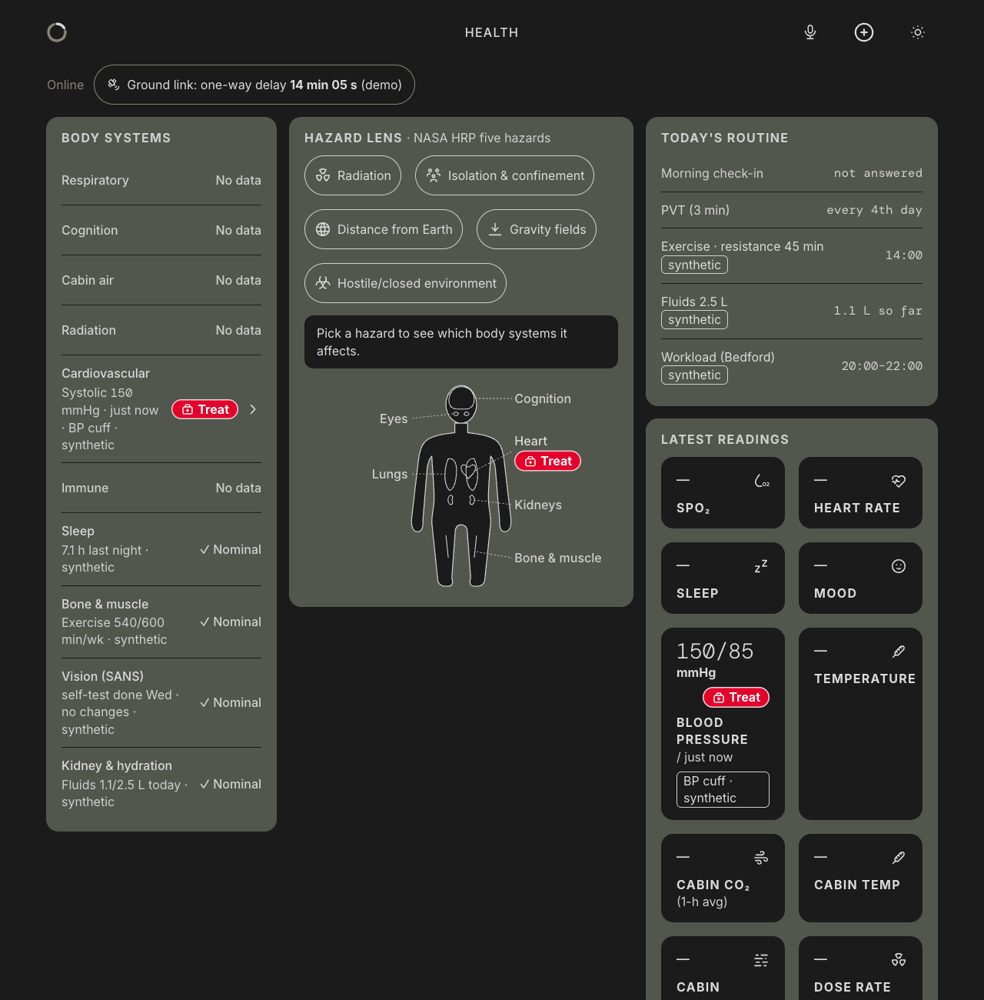

# #43 Health levels, DEMO_MODE, MOCK_MODE and a level-driven Device Simulator

The rules engine now speaks the five health levels of [alert-levels.md](../../ideas/alert-levels.md): Nominal, Watch (2, trend arrow), Check (3, triangle), Treat (4, first-aid kit) and Emergency (5, octagon). Every device metric has sourced rule rows, so heart rate, blood pressure, temperature and dose rate are rated, and Cardiovascular and Immune are real Body systems rows. For demos, values change in seconds: the Device Simulator picks a level per device instead of typing values, the detail chart spans the last minute (DEMO_MODE), and the GitHub Pages build feeds itself in the browser (MOCK_MODE). Issue [#43](https://github.com/jdo-lv/galagans/issues/43); features F4, F5, F6, F8, F9, F12, F14 and F25 in [features.md](../../ideas/features.md).

**Try it:** `mvn clean verify`, then `mvn spring-boot:run`. Open http://localhost:8080/simulator.html and, in another tab, http://localhost:8080. Every simulator device starts sending nominal values once a second. Then:
- Pulse oximeter → **Check**: Respiratory turns Check within a second; open it to see the last minute of SpO₂ with the SPO-01 and SPO-02 lines.
- BP cuff → **Watch**: Cardiovascular shows Watch with a trending-up arrow (BP-01); **Treat** gives Treat (BP-04/05), **Emergency** Emergency (BP-06/07).
- Wrist bracelet → **Check**: the bracelet, oximeter and BP cuff pulse all go to 101–110 bpm, so heart rate never flickers.

**Modes** are Vite build variables, fixed at build time; only `container.ts` reads them (`src/main/frontend/src/modes.ts`):
- DEMO_MODE, on unless `VITE_DEMO_MODE=false`: the detail chart spans 60 s with clock-time labels, and device readings older than 10 min are deleted when a new one is stored.
- MOCK_MODE, on only with `VITE_MOCK_MODE=true` (the Pages workflow sets it): no device link; an in-browser feed sends nominal values for every device once a second, and every 5 min one random device runs one of its non-nominal levels for 60 s. Try it with `cd src/main/frontend && VITE_MOCK_MODE=true npm run build && npm run preview`.

**Retake the screenshots:** build, then with the app on :8080 run `target/node/node docs/features/43-demo-mock-modes.shots.mjs`, or against `npm run preview` with `APP_URL=http://localhost:<port>/` ([script](43-demo-mock-modes.shots.mjs)). The script writes device Observations straight into IndexedDB, and gives the simulator an in-page stand-in WebSocket so its link reads "connected" without a relay.

## Screens

### Device Simulator, oximeter at Check and environment node at Watch (light)
Each device sends from page load (`SIM_CONFIG`: Nominal, every 1 s). The tag names the period and level; levels with no rule row for the device are disabled ("No rule row for this level"); tiles show the values of the last message the link took.

### Same, dark

### Respiratory detail in DEMO_MODE: SpO₂ once a second, the last 12 s at 90–93 %
The chart spans the last minute, labelled at −60, −45, −30, −15 and 0 s (UTC); check points are yellow, and each run of check points has one alert-triangle marker on its newest point ([#33](33-alert-levels.md)).

### Home with blood pressure 125/75 (BP-01, watch)
Cardiovascular row, Heart label and Blood pressure tile show Watch with a trending-up arrow: an outline, no colour.

### Home with blood pressure 150/85 (BP-04, treat)

## Mockup and deviations

Follows the issue mock [43-mock.png](img/43-mock.png) ([source](43-demo-mock-modes.mock.html)), built on [12-simulator-device-sections.png](../../ideas/mockups/12-simulator-device-sections.png) for the simulator and [02-detail.png](../../ideas/mockups/02-detail.png) for the chart.

- Per-device Level buttons replace the value inputs; tiles show the last values sent (as the mock).
- Devices keep the mockup 04 order (oximeter, bracelet, BP cuff, …); the mock showed the BP cuff second.
- The x-axis shows times, not dates, in DEMO_MODE; the last label is end-anchored so it isn't cut off (the mock's last label overflows).
- Treat and Emergency badges and points share the red `--color-alert` token, Check the yellow `--color-check` ([#33](33-alert-levels.md)).
- Since [#33](33-alert-levels.md) a run of same-level points gets one marker, on its newest point, so a minute of check readings stays readable.
