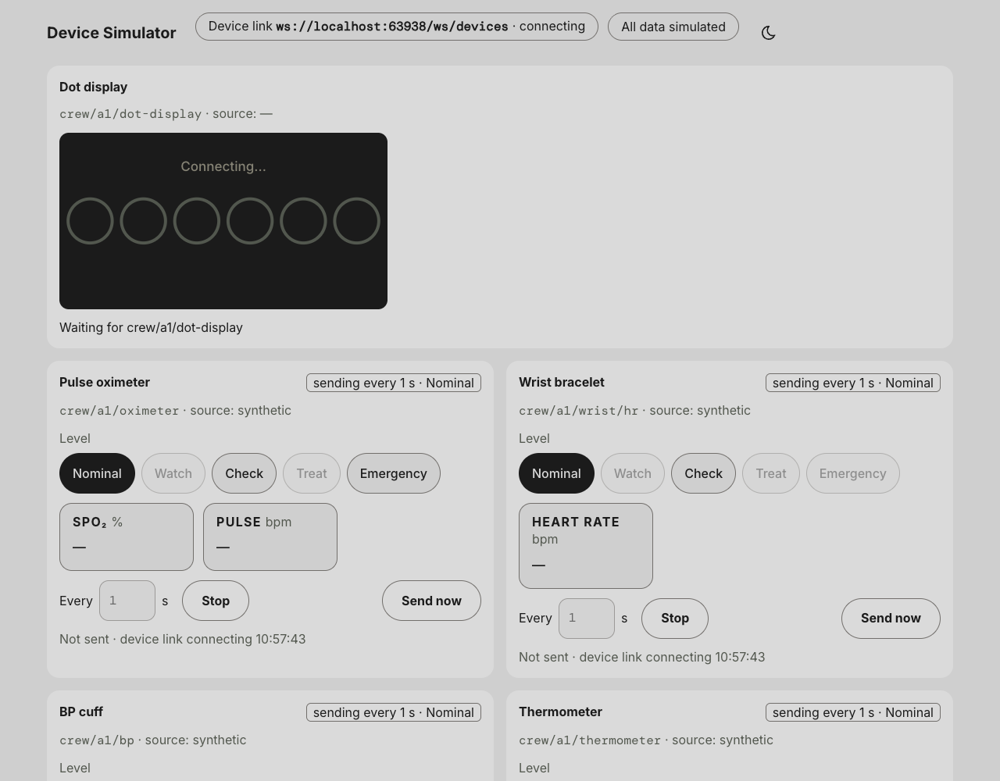
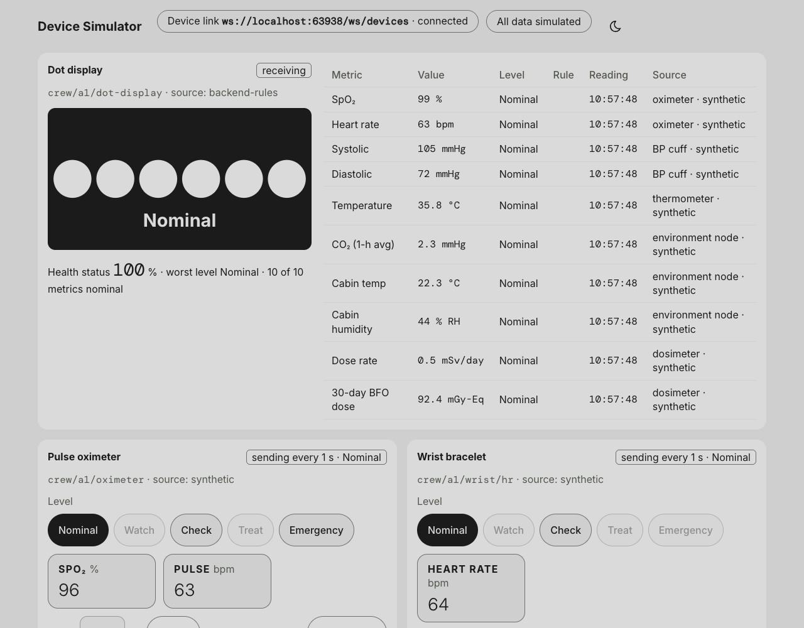
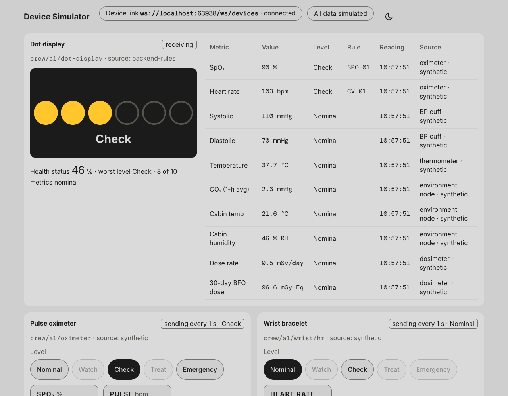
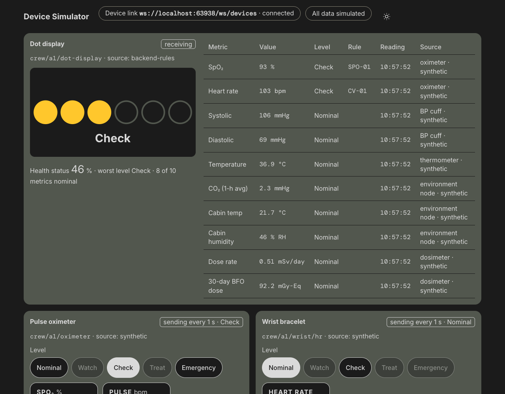
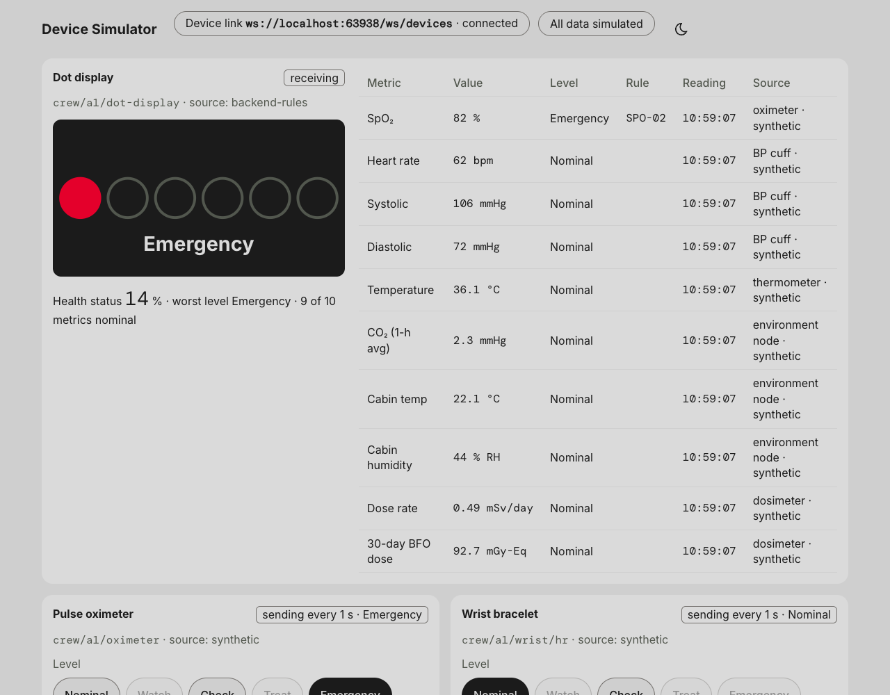
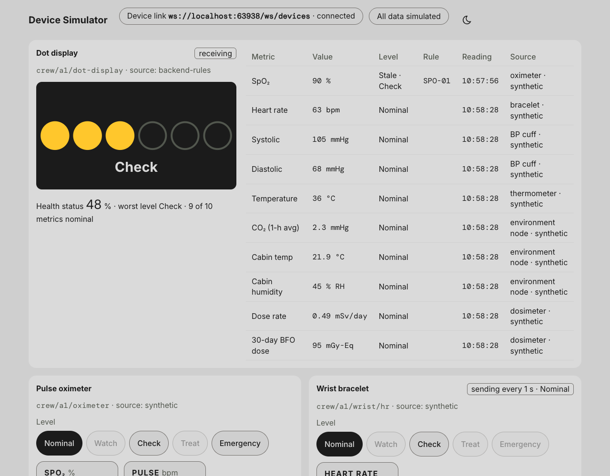
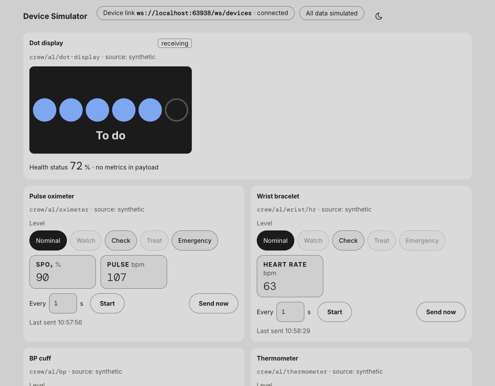
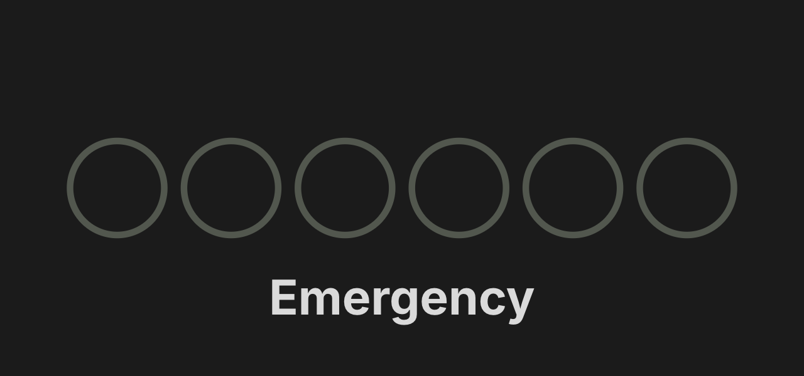

# #45 Dot display status from the backend, and its Device Simulator card

The dot display now has a publisher. A health engine in the Spring Boot app (`com.galagans.crewhealth.health`) reads every device frame on the device link, judges each of the 10 device indicators with the crew app's `rules.json`, and publishes `{id, t, pct, level, src: "backend-rules", metrics}` on `crew/a1/dot-display` once a second, so the display works without the tablet open. The Device Simulator gets a **Dot display** card at the top that shows the same panel and the metrics behind it. Issue [#45](https://github.com/jdo-lv/galagans/issues/45); features F26 and F8 in [features.md](../../ideas/features.md).

**Try it:** `mvn clean verify`, then `mvn spring-boot:run`, and open http://localhost:8080/simulator.html. Every device sends at Nominal from page load, so within a second the card reads 100 % and 6 white dots. Pick **Check** on the pulse oximeter: SpO₂ and heart rate turn Check and the card reads 46 %, 3 yellow dots. **Stop** a device and after 30 s its rows read `Stale · <last level>`. Stop every device and after 30 s the backend stops publishing; the panel dims and shows the data age, as on the board. `/device/websocket` and the ESP32 board show the same value.

**What the percentage means:** a team heuristic, not a sourced score. The worst level among the metrics picks the band of its dots (Nominal 84–100 → 6, Watch 50–66 → 4, Check 34–49 → 3, Treat 17–33 → 2, Emergency 0–16 → 1), and the share of fresh nominal metrics places the value inside the band (`round(min + (max − min) × nominal ÷ counted)`). The dots always equal the worst metric's level. A metric is fresh for 30 s after its reading (the display's `STALE_MS`); a stale metric keeps its last level and never counts as nominal.

**Deliberate exceptions**, recorded in `CLAUDE.md` and [ui-guidelines.md](../../ideas/ui-guidelines.md) rule 8: crew-facing rules run in the backend for the display, and the display shows a composite percentage. Only device frames are judged: check-ins, PVT, sleep and mood aren't on the relay, so the display may differ from the tablet.

**Retake the screenshots:** after `mvn clean verify`, run `java -jar target/crew-health-companion-0.0.1-SNAPSHOT.jar`, then `target/node/node docs/features/45-dot-display-status.shots.mjs` (about 80 s; `APP_URL` and `CDP_PORT` override the defaults) ([script](45-dot-display-status.shots.mjs)).

## Screens

### Waiting: device link not open yet
No payload yet: source `—`, `Waiting for crew/a1/dot-display`, no tag and no table. The panel says "Connecting...".

### Nominal: every device at Nominal
10 of 10 metrics nominal → 100 %, 6 white dots. No rule ids.

### Check: pulse oximeter at Check
SpO₂ (SPO-01) and heart rate (CV-01) at Check, 8 of 10 nominal → 46 %, 3 yellow dots; the mock's state.

### Check, dark theme
The panel stays dark like the board's LCD in both themes.

### Emergency: pulse oximeter at Emergency
SpO₂ below 90 % (SPO-02), 9 of 10 nominal → 14 %, 1 red dot that flashes at 1 Hz (shot in its lit half).

### One device stopped: oximeter stopped at Check, then set back to Nominal
The oximeter's SpO₂ is older than 30 s: `Stale · Check`, still SPO-01, not counted as nominal. Heart rate now comes from the bracelet, fresh and nominal. 9 of 10 nominal → 48 %, still 3 dots.

### Pct-only frame: every device stopped, then `tools/publish-dot-display.mjs 72`
With nothing fresh the backend publishes nothing; a stand-in frame without metrics shows `Health status 72 % · no metrics in payload`, source `synthetic`, 5 blue dots, no table.

### `/device/websocket` unchanged
The device page still fills the window with the panel alone (its page rules moved to `device/page.css`).

## Mockup and deviations

Follows the issue's mock ([dot-display-status-mock.png](https://github.com/jdo-lv/galagans/blob/24a875889d14d286f9eb192ed427deb0ba22a3d4/docs/features/img/dot-display-status-mock.png?raw=true), source `docs/features/dot-display-status.mock.html` on branch `feat/dot-display-status`): the panel copies [13-dot-display.png](../../ideas/mockups/13-dot-display.png) through the shared `DeviceScreen`, and the card follows the simulator sections of [12-simulator-device-sections.png](../../ideas/mockups/12-simulator-device-sections.png).

- The panel sets the dot display's tokens to their dark values on top of `color-scheme: dark`: the build compiles `light-dark()` into variables resolved on `:root`, so `color-scheme` alone left the panel light on a light page.
- The card stacks the table under the panel below 900 px; the mock shows only the laptop width.
- Values and times in the screenshots are random draws of the running simulator, not the mock's literal values (the unit test `AC20, AC22` checks the mock's payload row by row).
