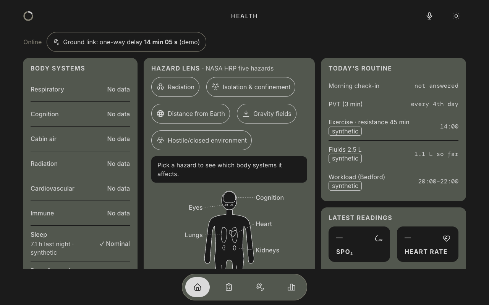
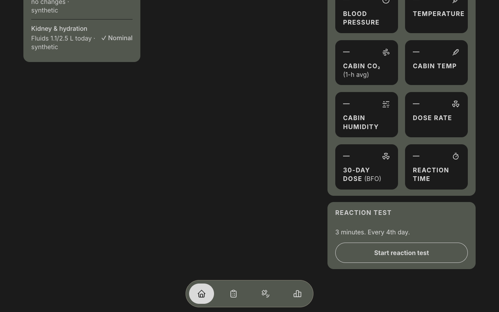
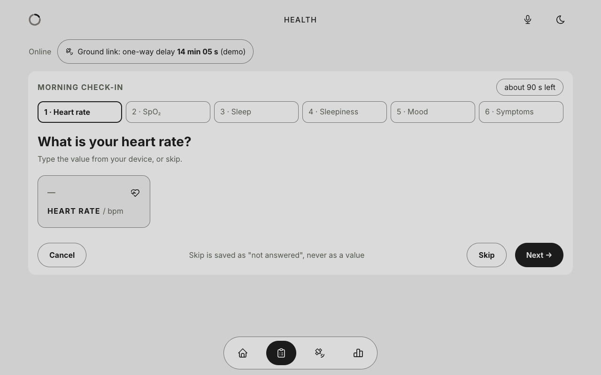
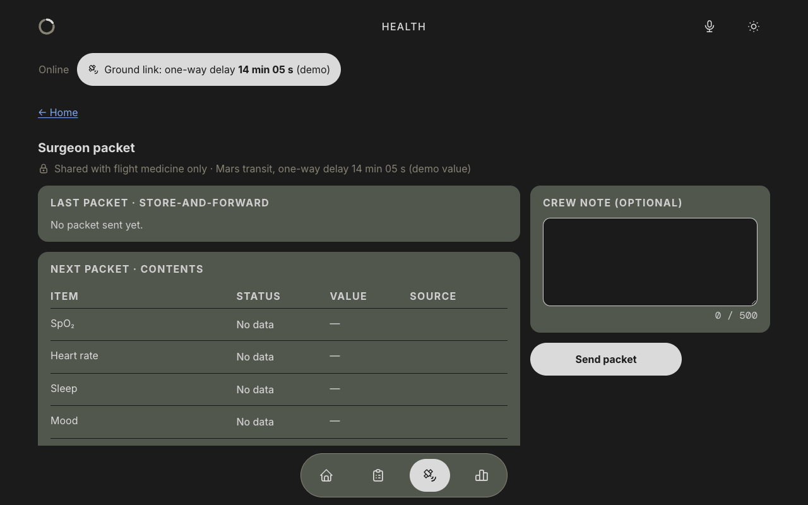
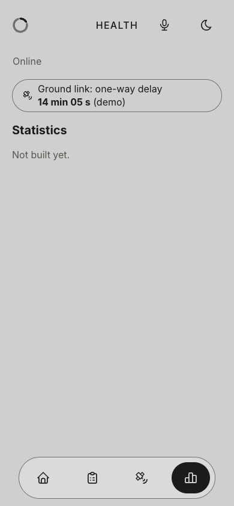
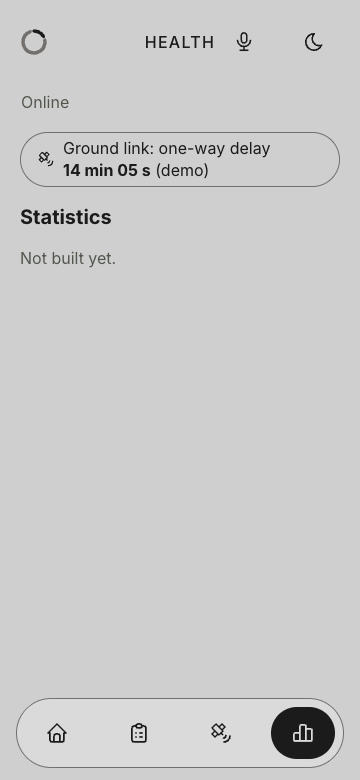
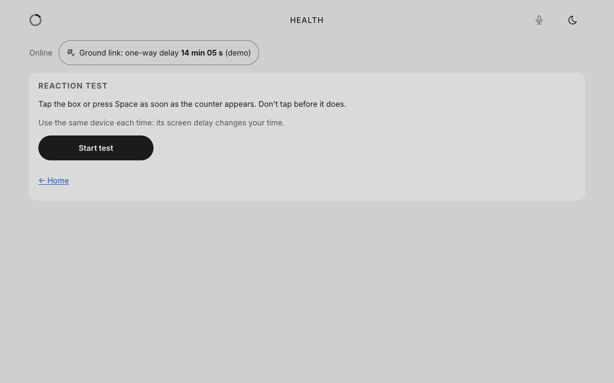

# #46 Navigation bar

An icon-only bar at the bottom centre of every screen takes the crew to Home, the morning check-in, Messages (the surgeon packet) and Statistics (an empty page for now) in one tap. The current screen's icon sits in an inverse pill. The bar is hidden on the reaction test so a stray tap can't end it, and the header "+" is gone because the bar's Check-in replaces it. App shell, no feature id in [features.md](../../ideas/features.md); issue [#46](https://github.com/jdo-lv/galagans/issues/46).

**Try it:** `mvn clean verify`, then `mvn spring-boot:run`, open http://localhost:8080 and tap the four icons at the bottom: Home, Check-in, Messages, Statistics. Start the reaction test from its card on Home: the bar goes away until you leave it. **Retake the screenshots** with the app running: `target/node/node docs/features/46-nav-bar.shots.mjs` ([script](46-nav-bar.shots.mjs)); set `APP_URL` for another port and `CDP_PORT` when 9333 is taken.

## Screens

### Home (1280 px, dark)
The pill sits on a full-width strip in the page background, 12 px above the bottom edge; Home is current. Cards scroll under the strip, never around the pill.

### Home scrolled to the bottom (1280 px, dark)
The page's bottom padding keeps the Reaction test card above the strip (AC20).

### Check-in (1280 px, light)
Check-in in the bar opens step 1 and becomes current. The header holds only voice and the theme toggle.

### Messages (1280 px, dark)
Messages opens the surgeon packet. The ground-link pill, which shows the one-way delay, is current too.

### Statistics (390 px, light)
A heading and "Not built yet." "HEALTH" is centred on the page now that the header has two buttons (AC21).

### Statistics (360 px, light)
The 328 px pill still fits with all four links in view and no horizontal scroll (AC22).

### Current link hovered (1280 px, light)
Under the pointer, Home keeps its inverse pill and icon colour (AC23).

### Keyboard focus on Messages, Home current (1280 px, light)
The 2 px accent focus ring around the focused link (AC24).

### Reaction test (1280 px, light)
No bar; the voice button is disabled as before (#37).

The detail screen with no current item, the draft dropped when leaving a half-filled check-in, the completion state and focus on arrival are covered by `src/main/frontend/src/ui/NavBar.test.tsx` (AC4, AC9–AC16).

## Manual checks

- **AC19:** at 1280 × 800 dark, measured in the running app: a 1280 × 94 px strip in `--color-bg`, the 328 × 70 px pill centred with 12 px above and below, 8 px padding and a 1 px `--color-edge` border on `--color-surface`, four 64 × 52 px links 18 px apart, 24 px icons; the current link in `--color-inverse-bg` with its icon in `--color-inverse-text` (first screenshot).
- **AC20:** scrolled to the bottom, the last card ends at 690 px, above the strip at 706 px (second screenshot).
- **AC21:** at 390 × 844 light, the pill is centred, "HEALTH" is centred at 195 px and the page is 390 px wide.
- **AC22:** at 360 × 780 light, the links run from 25 to 335 px and the page is 360 px wide.
- **AC23:** hovering Home in the light theme keeps it ink with a bone icon (hover screenshot; the script checks `:hover`).
- **AC24:** Tab moves from Check-in to Messages with the focus ring (focus screenshot; the script checks `:focus-visible`). The bar comes after `main` in the page, so Tab reaches it after the page content.
- **AC25:** the [ui-guidelines §8](../../ideas/ui-guidelines.md) checklist passes:
  - tokens only, no hex;
  - no level colour: the bar and the Statistics page use greys and the inverse pill only;
  - targets 64 × 52 px, 18 px apart; the Statistics text at 16 px and its heading at 20 px;
  - icons from `icons.tsx` (the new `HomeIcon` and `StatisticsIcon`, plus `QuestionnaireIcon` and `GroundLinkIcon`); each link has an `aria-label` and the current one `aria-current="page"`;
  - checked in light and dark at 360, 390 and 1280 px.

## Mockup and deviations

The bar follows [14-nav-bar.png](../../ideas/mockups/14-nav-bar.png) (on the home wireframe, iPad 7) and [15-nav-bar-states.png](../../ideas/mockups/15-nav-bar-states.png) (every state in light and dark, and on a phone). The issue mock is [46-nav-bar.mock.mjs](46-nav-bar.mock.mjs).

| Deviation | Reason |
|---|---|
| A full-width strip in `--color-bg` behind the pill | Home scrolls under the fixed bar, and the pill's `--color-surface` matches the cards; the strip keeps the mockup's look at every scroll position. |
| Home keeps today's layout, not the wireframe's panels | The issue covers the bar only; the home redesign is separate. |
| The header keeps the context pills under it | Same: the wireframe's header without pills belongs to the home redesign. |
