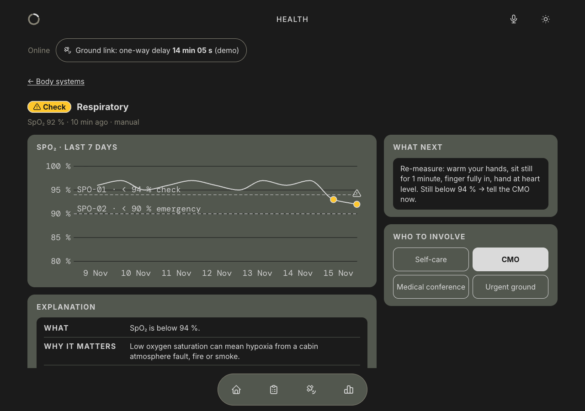
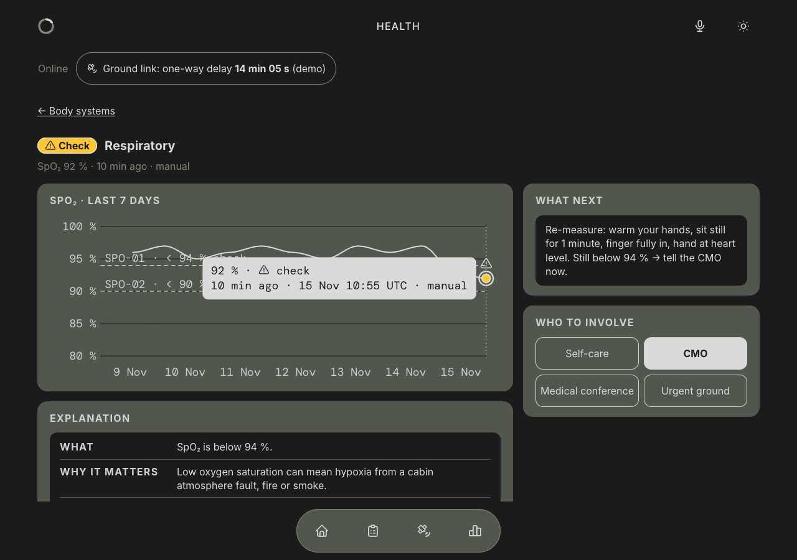
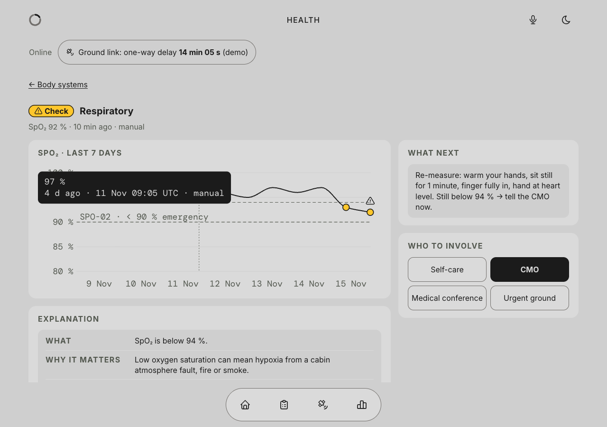
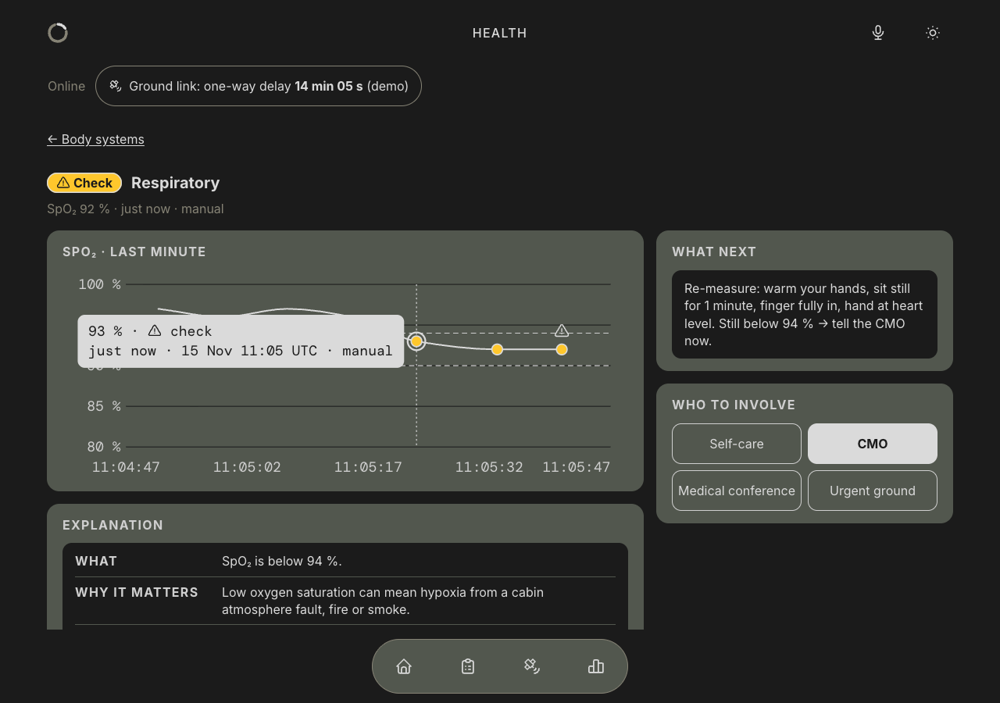
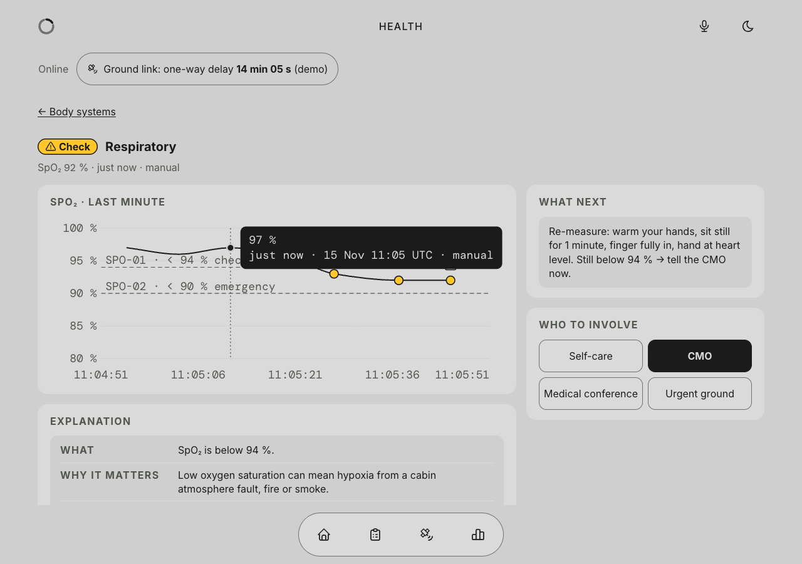

# 48: Detail chart with a smooth line and a crosshair readout

The trend chart on a system's detail screen (F5, [#9](9-detail-screen.md)) draws a smooth line through the readings. It has no dot on nominal readings, only on the ones that set a level. Pointing at the chart shows a dotted crosshair and a readout of the nearest reading: value, level, data age, UTC time and source.

Try it: `mvn spring-boot:run`, save a check-in with SpO₂ 92 at `#/check-in`, open Respiratory from home, then move the mouse over the chart. On a touch screen, tap the chart to pin the readout, drag to scrub while pinned, tap outside to clear it.

## Week chart, idle (dark)

7-day chart (`VITE_DEMO_MODE=false` build) with SpO₂ readings every 14 h between 95 and 97 % and a 92 % check 10 min ago. No dots on the nominal readings; the two check readings keep their dots and the level marker.

## Week chart, hover on a check reading (dark)

Mouse over the newest reading: dotted crosshair, a ring on the reading, and the readout `92 % · ⚠ check` / `10 min ago · <date> UTC · manual`.

## Week chart, hover on a nominal reading (light)

Mouse over a nominal reading: the ring is filled and the readout shows the value only (quiet when nominal).

## One-minute chart (DEMO_MODE)

Same component on the last-minute window, readings 56 s to 6 s ago, hovering a check reading (dark) and a nominal one (light).

## Mockup and deviations

Follows [02-detail.png](../../ideas/mockups/02-detail.png) (chart card) and the issue mock [48-mock.png](img/48-mock.png). Retake the shots with [48-smooth-trend-chart.shots.mjs](48-smooth-trend-chart.shots.mjs).

- The hover readout is new; 02-detail.png has none.
- The mock draws the check marker as a plain ▲; the readout uses the same Tabler level icon as the chart marker and the badge (#33), then the lower-case level word. The icon is drawn, not text, so the readout's text content reads `92 % · check`.
- The readout box can cover threshold labels near the reading (the readout is a transient overlay; it ignores the pointer).
- Level markers on the chart keep the #33 icons instead of the glyphs the issue lists.
