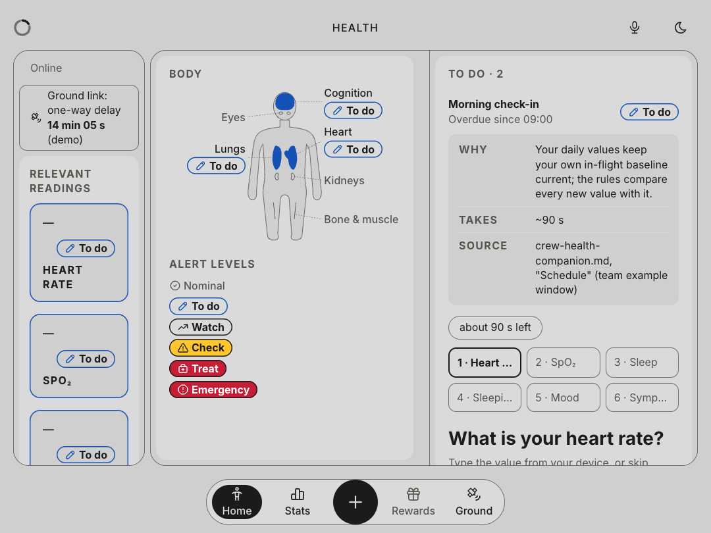
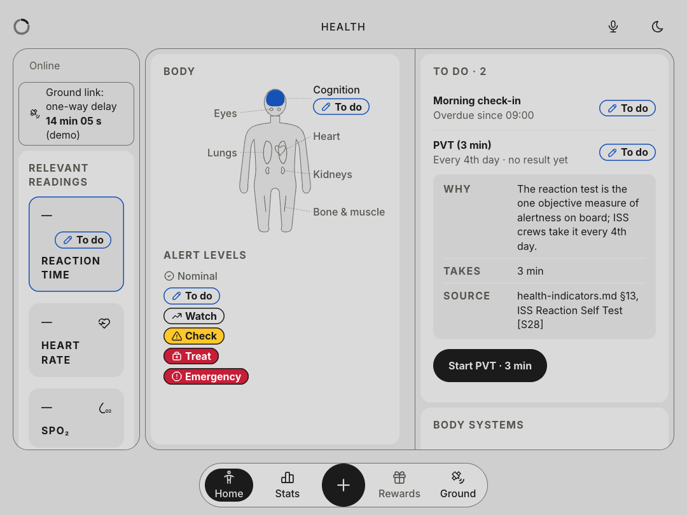
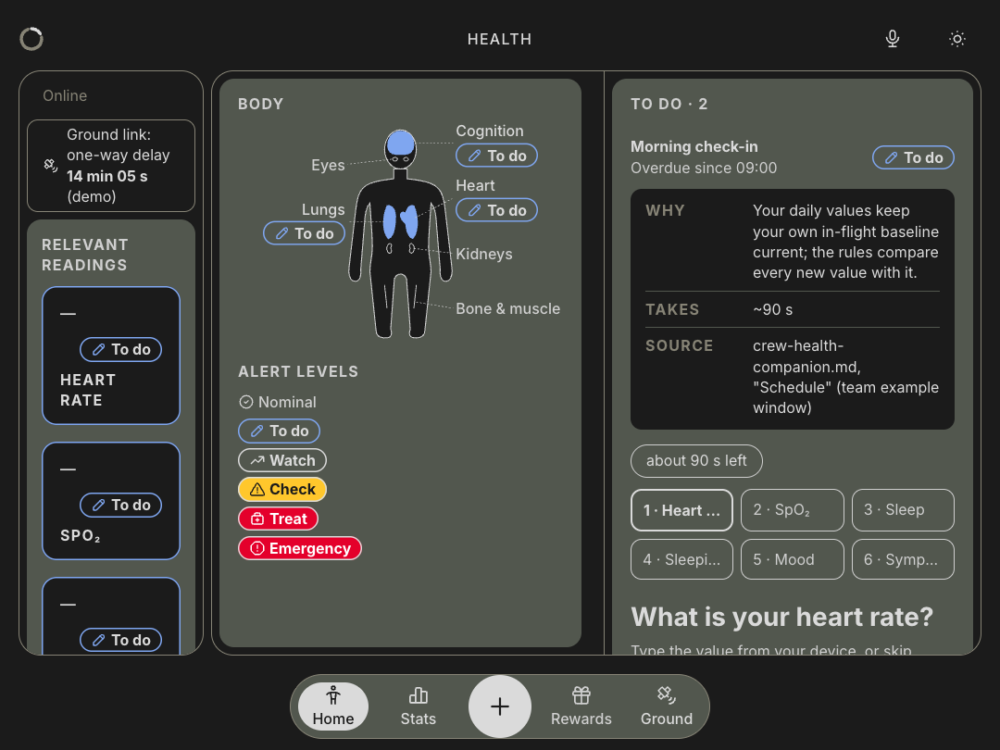
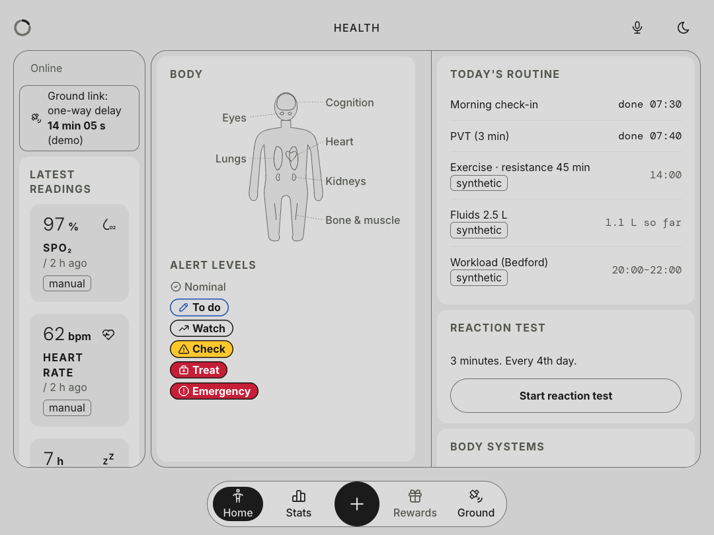
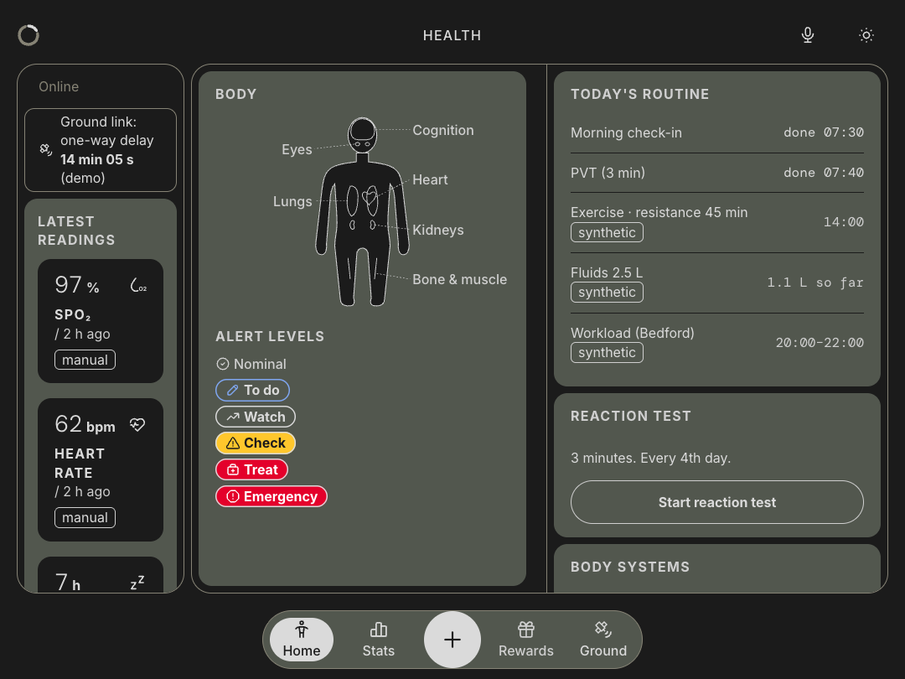
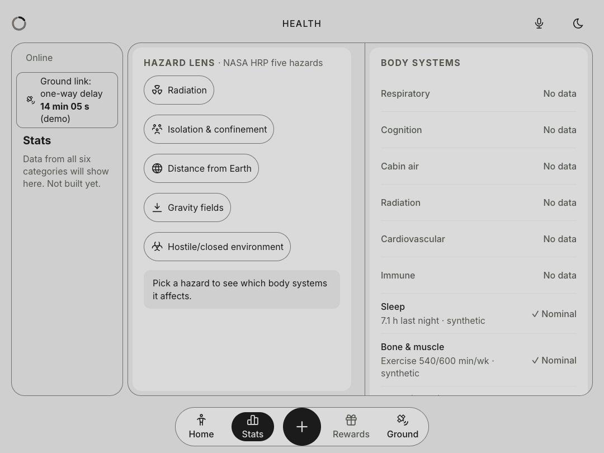
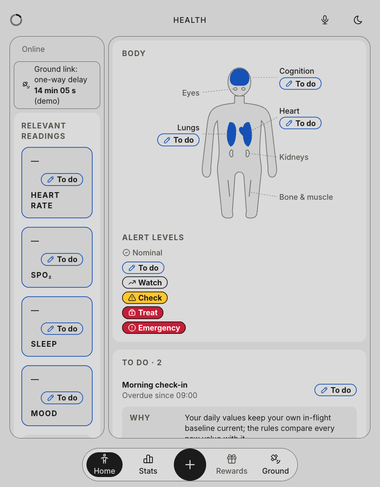
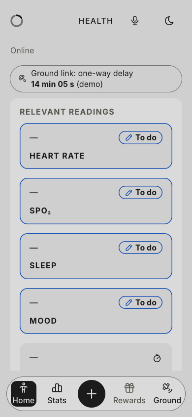

# #52 App shell, Home Nominal and To do, hazard lens on Stats

Every screen now sits in one shell built for the demo iPad (1080 × 810): a side panel with the connection and ground-link pills, then a main panel with one or two panes that scroll on their own. Home follows what the astronaut owes: while the morning check-in or the PVT is due it shows a "To do" card (the check-in's steps right there, or "Start PVT"), puts the readings it asks for first and marks the body systems they feed; otherwise it shows Today's routine and the latest readings. The hazard lens moved to Stats. F6 and F12 in [features.md](../../ideas/features.md), layout in [home-variants.md](../../ideas/home-variants.md); issue [#52](https://github.com/jdo-lv/galagans/issues/52).

**Try it:** `mvn clean verify`, then `mvn spring-boot:run`, open http://localhost:8080 at 1080 × 810. With no check-in today after 09:00, Home shows "To do · 2" with the morning check-in open: answer the steps and "Save check-in", and the PVT row opens with "Start PVT · 3 min". Tap "PVT (3 min)" to see Reaction time move to the top of "Relevant readings" and only Cognition marked on the body. Tap Stats for the hazard lens. **Retake the screenshots** with the app running: `target/node/node docs/features/52-app-shell-home-variants.shots.mjs` ([script](52-app-shell-home-variants.shots.mjs)); set `APP_URL` for another port (the dev server works too) and `CDP_PORT` when 9333 is taken. The script pins the page clock to 14 Nov 2026 10:00, seeds check-ins into IndexedDB, blocks `/api`, and prints the shell's measured sizes.

## Screens

### Home, To do (1080 × 810, light)
No check-in today and no PVT result, at 10:00. "To do · 2": the check-in is open (Why, Takes, Source, then its six steps in place) and the PVT closed. "Relevant readings" lists Heart rate, SpO₂, Sleep and Mood first, each outlined in level 1 blue with a To do badge, then Reaction time and the rest in `READINGS` order. Cognition, Lungs and Heart are filled blue on the body with To do badges.

### Home, To do with the PVT open
After tapping "PVT (3 min)": the check-in's steps go, "Start PVT · 3 min" links to `#/pvt`, Reaction time is the first and only marked tile, and only Cognition is marked on the body.

### Home, To do (dark)
The level 1 tint (`#7FA6F0`) outlines badges and tiles and fills the organs; badge words stay in the text colour on the olive card.

### Home, Nominal (light and dark)
A check-in at 07:30 and a PVT at 07:40: nothing owed. Today's routine, the Reaction test card and Body systems; "Latest readings" in `READINGS` order with no To do mark anywhere but the legend.

### Stats (1080 × 810, light)
`#/stats`: the "Stats" heading and a note in the side panel, the hazard lens alone in the primary pane, Body systems in the secondary. No body figure. The Stats link in the bar is current.

### 800 × 1024 and 390 × 844
From 600 to 999 px the side panel stays beside the main panel, which stacks the Body card over the To do card and scrolls as one. Below 600 px there are no panel outlines: everything is one column in DOM order (pills, readings, Body, To do, Body systems) and the page scrolls.

## Measured in the browser (AC4, AC5)

Printed by the shots script (`getBoundingClientRect` and computed styles):

| Viewport | Side panel | Main panel | Gap | Panes | Page scrolls |
|---|---|---|---|---|---|
| 1080 × 810 | 200 × 632 px, radius 24 px, `overflow-y: auto` | 832 × 632 px, radius 24 px, `overflow: hidden` | 8 px | two, 407 px wide side by side, each `overflow-y: auto`, 8 px between cards | no |
| 800 × 1024 | 200 px, `overflow-y: auto` | 552 px, `overflow-y: auto` | 8 px | stacked (Body card above, 650 px), `overflow-y: visible` | no |
| 390 × 844 | 350 px, no outline | 350 px, no outline, below the side panel | — | stacked, 16 px between cards | yes |

## Mockup and deviations

Follows the team wireframes of 2026-11-15 as rendered in the issue's mocks ([Home, To do](https://github.com/jdo-lv/galagans/blob/a0755aec9e4d49e6b393f94fd2d7724cbc8e57c4/docs/features/img/52-mock.png?raw=true), [Stats](https://github.com/jdo-lv/galagans/blob/a0755aec9e4d49e6b393f94fd2d7724cbc8e57c4/docs/features/img/52-mock-stats.png?raw=true)), not a mockup in `ideas/mockups/`.

| Deviation | Why |
|---|---|
| The open check-in shows the six check-in steps (#29, with the #55 device prefill), not the mock's four fields and "Save check-in" | User decision, 2026-11-15: the four-field form left Home in #29; one check-in flow keeps KSS, symptoms and the prefill. Embedded, it has no Cancel on step 1, takes no focus until a step moves, and skips the completion screen, since Home moves on to the next item (AC14). |
| The header keeps the working "Voice control" mic, not a disabled "Voice assistant (not available yet)" button (AC3) | User decision, 2026-11-15: hands-free voice works (#37) and #64 builds on it. The voice pill joins the side panel after the connection and ground-link pills. |
| The figure is the #14 drawing at the pane's width with the legend under it; the mock's figure is larger, uses icon-shaped organs and overlays the legend bottom-left | #61 specs the traced figure, icon markers and the overlaid legend. |
| "Takes ~90 s", not "~1.5 min" | The routine's estimate, the sum of the six steps (#29). |
| Nominal keeps the Reaction test card between Today's routine and Body systems | Not in the wireframes; it is the only way to start a PVT that isn't owed. |
| The ground-link pill in the side panel has 12 px corners and fills the width | A pill radius on a four-line box reads as a stadium. |
| Hazard chips wrap one per row at 1080 px | The pane is 407 px wide, narrower than in the 1280 px mock. |
