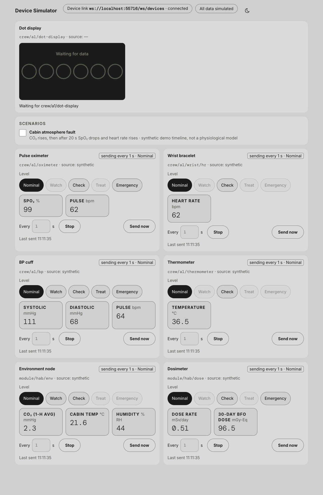
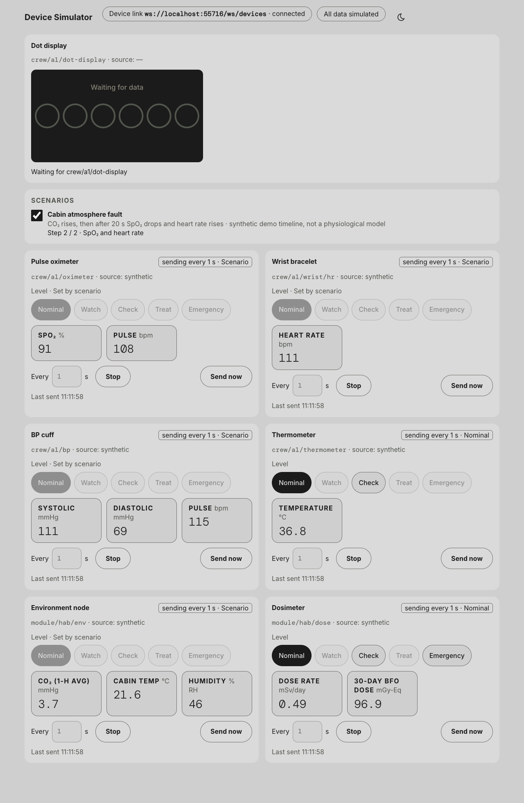
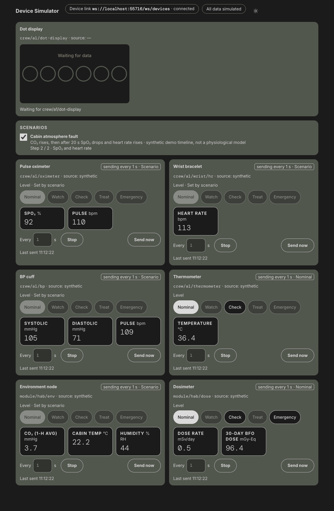

# Device Simulator scenarios: Cabin atmosphere fault (#53)

The Device Simulator gets a Scenarios card above the devices. Checking "Cabin atmosphere fault" makes one hazard drive several devices over time: cabin CO₂ rises at once, and 20 s later SpO₂ drops and the three heart-rate fields rise, until the operator unchecks it, which puts the four devices back at Nominal. The crew app's rules react to the values as they do to any reading (CAB-01, SPO-01 and CV-01, all Check).

Try it: `mvn spring-boot:run`, open `http://localhost:8080/simulator.html` and the crew app side by side, check "Cabin atmosphere fault". Cabin air flags first, then Respiratory and Cardiovascular after 20 s. Uncheck it to go back to nominal.

Scenarios are rows in `src/main/frontend/src/simulator/scenarios.ts`: each step has a start time and a value range per indicator, and a range overrides that indicator's level on every device that carries it. Values and timeline are synthetic; the caption says so.

## Unchecked

Page load: the checkbox is unchecked, no step line, every picker as before.

## Step 1: CO₂ rising (0–20 s)

Checked: CO₂ (1-h avg) 3.2–3.8 mmHg, everything else Nominal. The oximeter, bracelet, BP cuff and environment node pickers read "Level · Set by scenario", are disabled at Nominal and tag "Scenario"; Thermometer and Dosimeter stay editable.

## Step 2: SpO₂ and heart rate (from 20 s)

SpO₂ 91–93 %, oximeter pulse, bracelet heart rate and BP cuff pulse 105–115 bpm, CO₂ still 3.2–3.8 mmHg, systolic and diastolic Nominal. Holds until unchecked.

The screenshots were taken against `npm run preview` (no `/ws`) with `STUB_LINK=1`, a stand-in socket that opens and drops every frame, so the tiles show the values sent; against the jar the real relay is used.

## Mockup and deviations

Follows [the Scenarios mock](img/53-mock.png), built on `ideas/mockups/src/12-simulator-device-sections.html` and the Scenarios column of `ideas/mockups/04-simulator.png`.

- The Dot display card (#45) is still the first card; the Scenarios card sits between it and the device sections, since the mock predates that card.
- Disabled level pills keep the existing faded style, so the pressed Nominal is a faded inverse pill, as in the mock.
- No Run/Pause, step replay or mission clock (out of scope in the issue).
