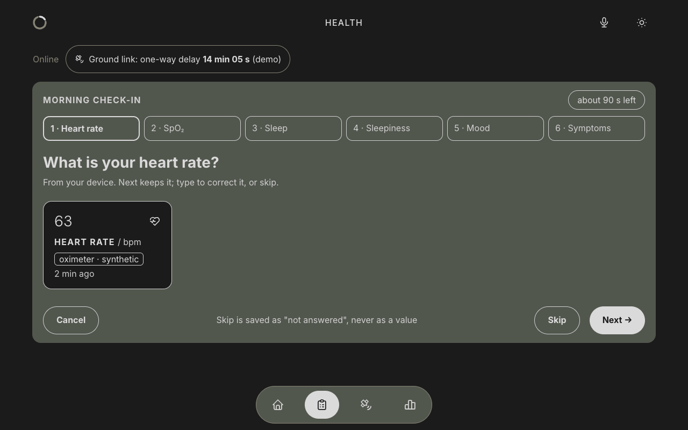
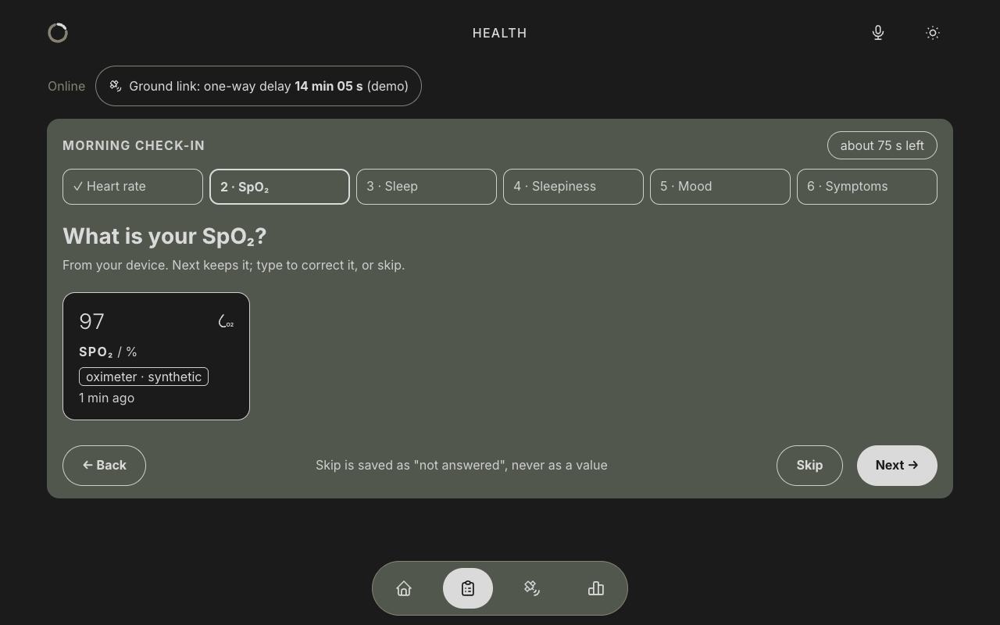
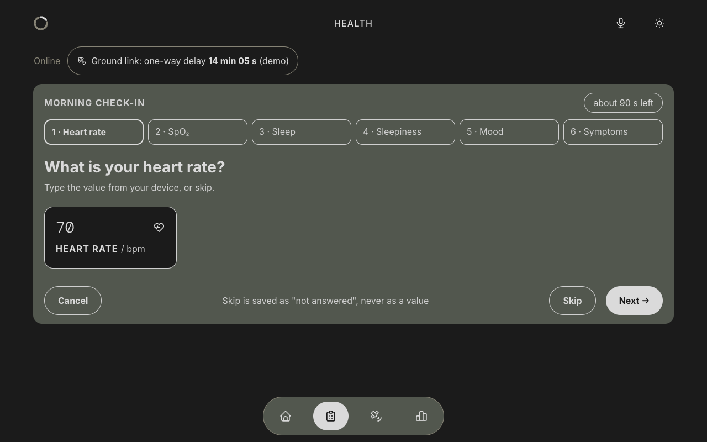
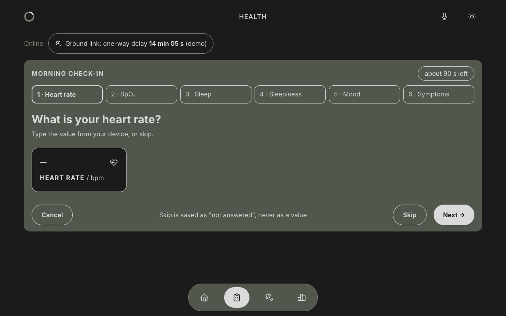
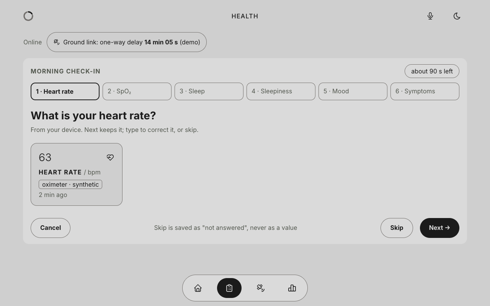
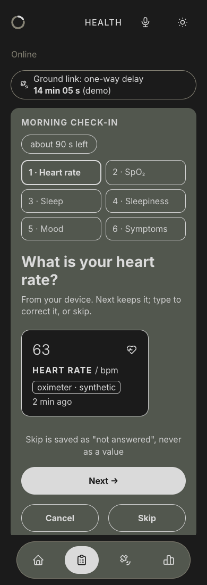

# #55 Check-in: heart rate and SpO₂ prefilled from the latest device reading (F1)

The heart rate and SpO₂ steps of the morning check-in no longer open empty when a device has just measured them. Each opens with the newest device reading of the last 15 min (any device, rounded to the step), its source tag and its age, and the hint "From your device. Next keeps it; type to correct it, or skip." The astronaut confirms it with "Next →", corrects it by typing, or skips it. The confirmed value is saved as a plain check-in value ("manual"), so the stored check-in and the sync API don't change. Issue [#55](https://github.com/jdo-lv/galagans/issues/55).

The device store is read once, when the check-in opens. Readings that arrive later never change a field. A read that finishes late fills only the step on screen and later steps the astronaut hasn't touched, and a failed read leaves every step empty without a message. The 15 min limit is a team heuristic, not a clinical value.

**Try it:** `mvn clean verify`, then `mvn spring-boot:run`. Send an oximeter reading with `target/node/node tools/publish-reading.mjs 97 63` (or let `/simulator.html` publish), open http://localhost:8080 and click Check-in in the navigation bar. Step 1 shows 63 with "oximeter · synthetic" and "just now", and "Next →" shows 97 on step 2. **Retake the screenshots** with the app running: `target/node/node docs/features/55-check-in-device-prefill.shots.mjs` ([script](55-check-in-device-prefill.shots.mjs)), with `APP_URL` for another port (for example `npm run preview`). The script writes the oximeter readings straight into IndexedDB, so no device may publish on the relay while it runs.

## Screens

### Step 1 prefilled (oximeter HR 63, 2 min old)
The tag and the age sit under the "HEART RATE / bpm" row; the hint says where the value came from. No level badge or colour.

### Step 2 prefilled (oximeter SpO₂ 97, 1 min old), after "Next →"
Step 1 kept 63 and reads "✓ Heart rate".

### Step 1 corrected to 70
A value that differs from the device's drops the tag and the age, and the step's own hint returns. Typing 63 again brings them back.

### Step 1 with no fresh reading (oximeter HR 63, 20 min old)
Older than 15 min, so the step opens empty as before.

### Light theme

### Phone (390 px)

A read that resolves after the astronaut typed or moved on, a failed read and a reading that arrives after opening can't be timed from the running app. `src/main/frontend/src/ui/CheckInScreen.test.tsx` covers them ("Device prefill (#55)", AC15–AC20).

## Mockup and deviations

Follows [06-questionnaire.png](../../ideas/mockups/06-questionnaire.png) and the #29 field tile ([29-check-in-questionnaire.md](29-check-in-questionnaire.md)), through the issue mock [55-mock.png](img/55-mock.png). The source tag is the metric tile's row 3 ([ui-guidelines.md](../../ideas/ui-guidelines.md), "Metric tile"); the prefilled field is described under "Field tile (forms)". The screenshots match the issue mock.

| Deviation | Reason |
|---|---|
| The age follows the tag instead of sitting on the label row | "HEART RATE / bpm · 2 min ago" wraps mid-phrase in the 240 px tile (decided in the issue). |
