# #57 Navigation bar: Home, Stats, centre +, Rewards and Ground

The bar at the bottom of every screen now has five items, each an icon over its word: Home, Stats, a raised round "+" that opens an Add entry chooser (Morning check-in or Log symptoms), Rewards (shown, not available yet) and Ground, which opens the crew's own packet history: every surgeon packet sent or waiting, newest first, with when it was built, where it is on its way to the ground, how many items it held and the crew note. The symptom form is still blank. App shell, F1 and F14 in [features.md](../../ideas/features.md); issue [#57](https://github.com/jdo-lv/galagans/issues/57).

**Try it:** `mvn clean verify`, then `mvn spring-boot:run`, open http://localhost:8080. Tap the + at the bottom, then "Morning check-in" (or "Log symptoms" for the blank form). Send a packet from Ground → "New surgeon packet" → "Send packet" → "Confirm send", then tap Ground: the packet is listed with its delivery. Tab moves from the + straight to Ground: Rewards is not a link. **Retake the screenshots** with the app running: `target/node/node docs/features/57-nav-bar-ground.shots.mjs` ([script](57-nav-bar-ground.shots.mjs)); set `APP_URL` for another port (`npm run preview` works too) and `CDP_PORT` when 9333 is taken. The script pins the page clock to 14 Nov 2026 08:00, seeds the packets into IndexedDB and blocks `/api`, so the queued packet stays queued.

## Screens

### Home (1280 px, dark)
Home is current. Links are 76 × 52 px, 16 px apart; the + is a 68 px circle pulled into the pill's padding.
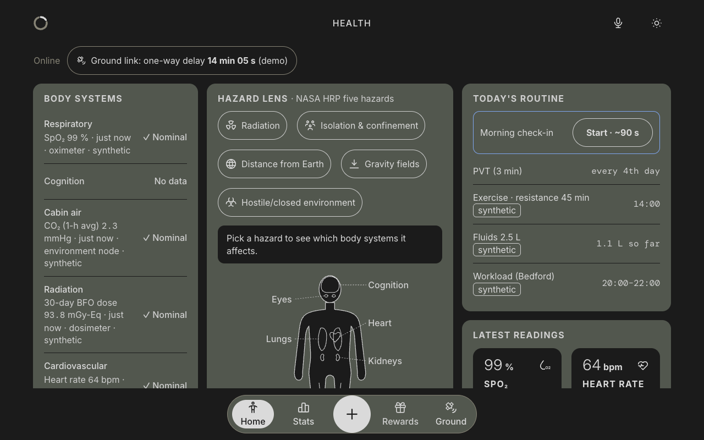

### Home (390 px, light)
Each link is as wide as its word, at least 52 px; the + is 56 px. On phones the current fill has 12 px corners so "Home" stays on it.
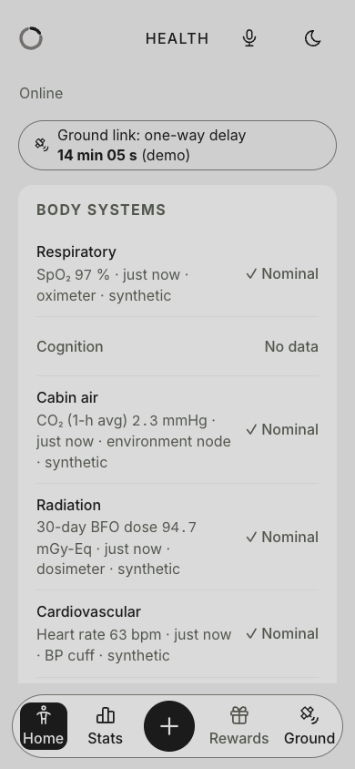

### Add entry chooser (1280 px, light)
The + is current (`aria-current="page"`): it keeps its fill and adds a 2 px ring. One primary, "Morning check-in", and a secondary "Log symptoms", at most 420 px wide.
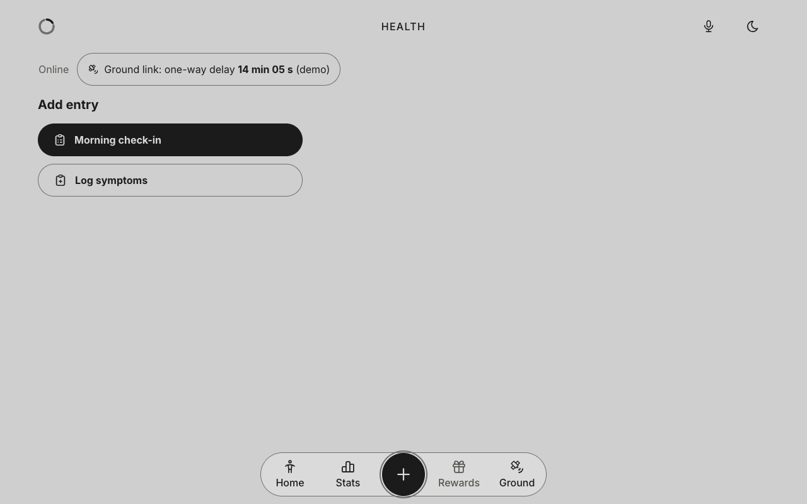

### Add entry chooser (390 px, light)
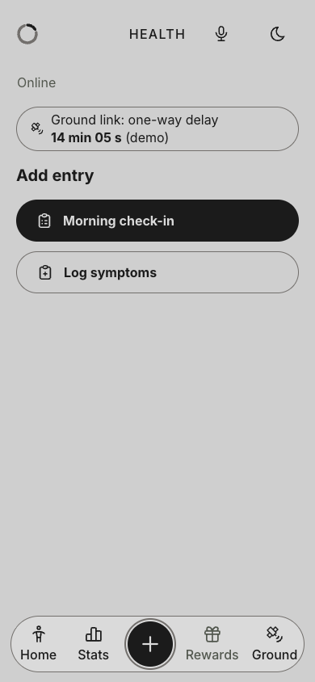

### Log symptoms (1280 px and 390 px, dark)
A focused heading and a blank form that says "Symptom fields come next." The + stays current (`aria-current="true"`).
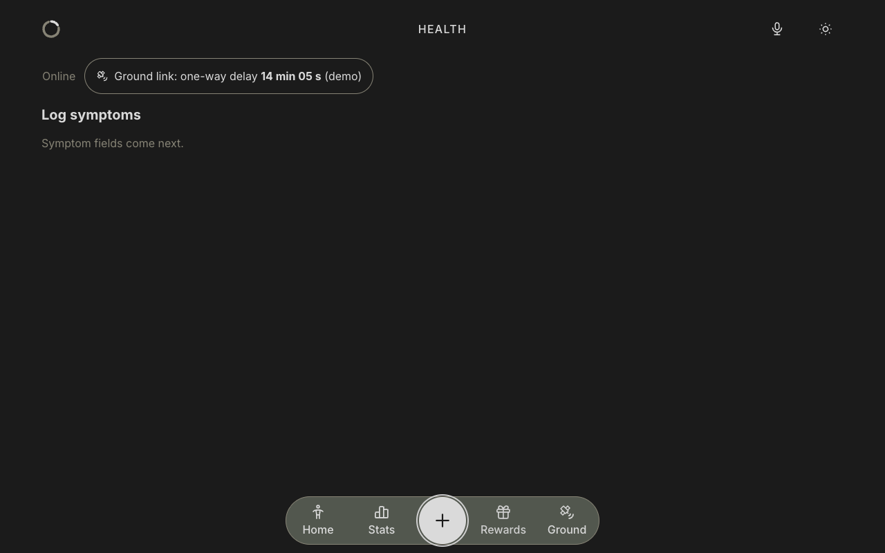
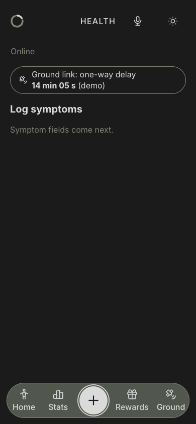

### Morning check-in (1280 px, dark)
Opened from the chooser; the + keeps its ring while the check-in shows.
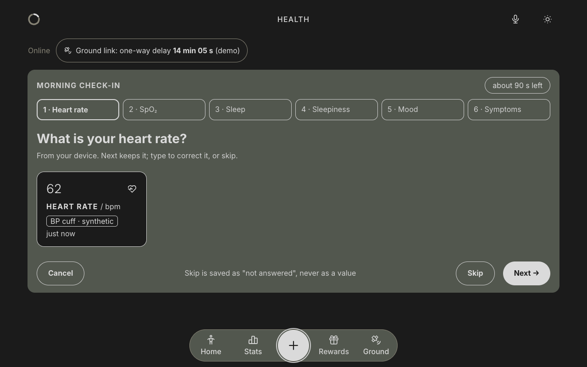

### Ground, no packet (1280 px light, 390 px dark)
The heading, the privacy line with the lock, "New surgeon packet", and an empty "Packet history".
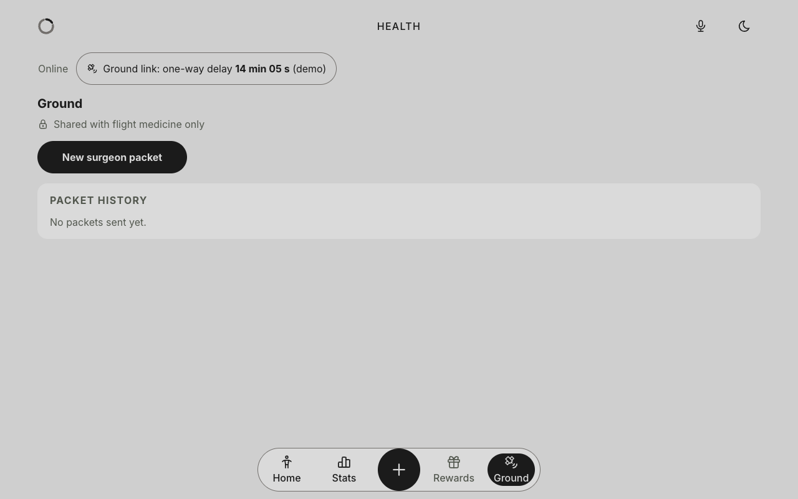
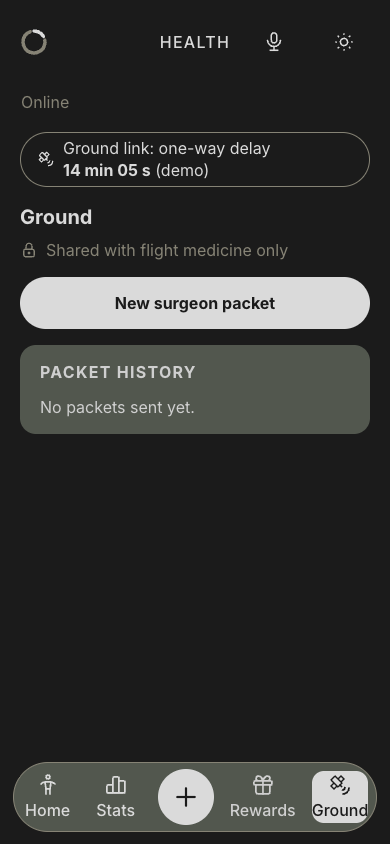

### Ground with three packets at 08:00 (1280 px light, 1280 px dark, 390 px light)
Seeded: built 07:00 and sent 07:01 with a check item and a note (arrived ~07:15); built 07:45 and sent 07:50 (arrives ~08:04); built 07:58 and queued. Newest first. On phones each row puts the built time and contents on the left, delivery and note on the right.
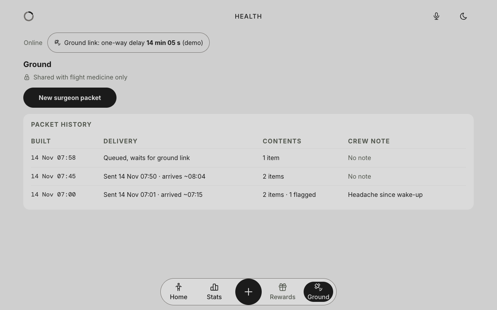
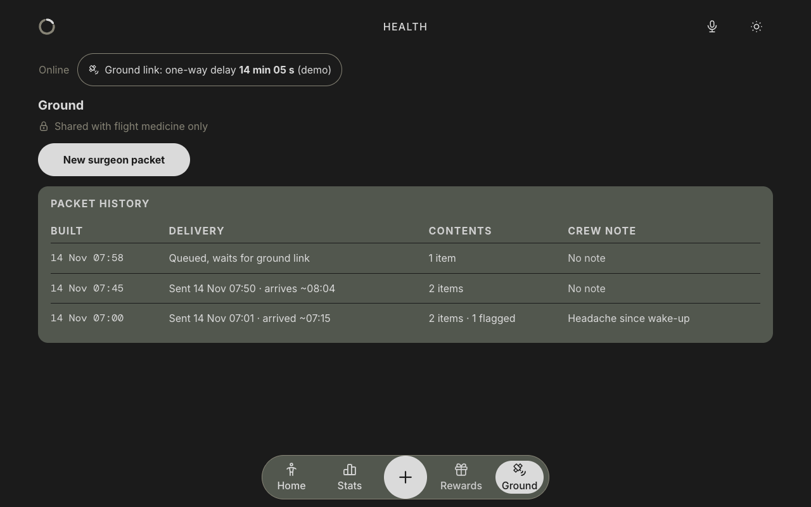
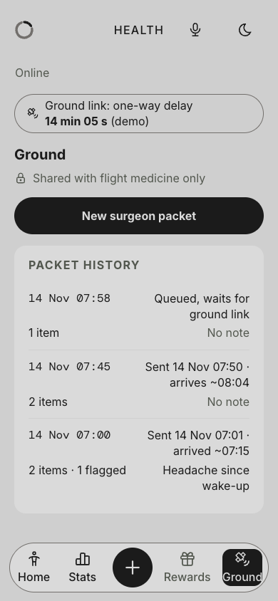

### Surgeon packet from Ground (1280 px, light)
"New surgeon packet" opens `#/packet`: the ground-link pill is current (`page`) and Ground is current too (`true`).
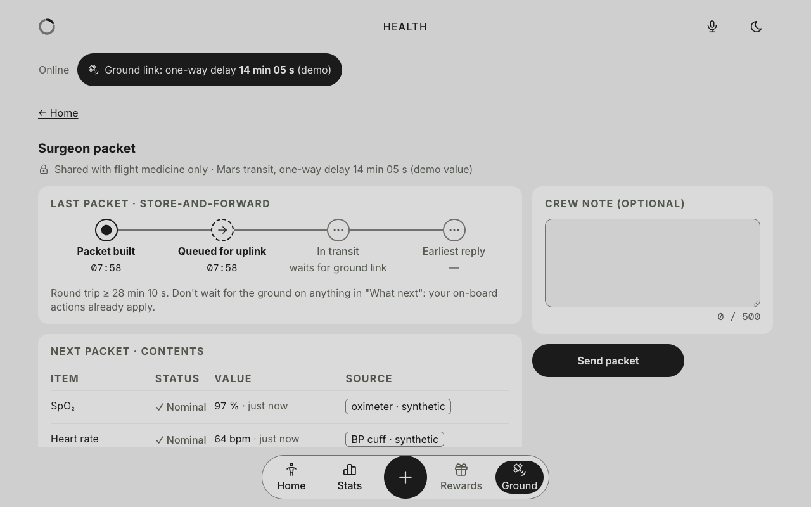

### Close-ups of the bar
On the check-in, the + with its ring (1280 px, light):

Keyboard focus after one Tab from the +: it lands on Ground, skipping Rewards, with the 2 px `--color-focus` ring (the script checks `:focus-visible`):

375 px, dark, on the chooser: the 365 px pill fits with 5 px to spare:
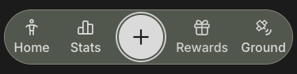

The same, after Tab from Stats: the current + shows the `--color-focus` ring in place of its own (the script checks the outline colour):
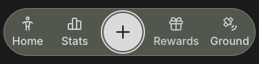

The bar's structure and names, `aria-current` per screen, the chooser, the blank form, the history rows, the uplink and 60 s re-reads, the failed read and focus on Home are covered by `NavBar.test.tsx`, `SymptomLogScreen.test.tsx` and `GroundHistory.test.tsx` in `src/main/frontend/src/ui/`.

## Manual checks

Measured in the running app by the shots script:

- **1280 × 800:** pill 454 × 70 px; Home, Stats, Rewards and Ground 76 × 52 px, 16 px apart; the + 68 × 68 px, its top 1 px under the pill's top edge.
- **375 × 812:** pill 365 px wide from x = 5; Home 52, Stats 52, + 56, Rewards 66, Ground 57 px wide; the page is 375 px wide (no horizontal scroll).
- **[ui-guidelines §8](../../ideas/ui-guidelines.md) checklist:**
  - tokens only, no hex;
  - no level colour: the bar, chooser, form and history use greys and the inverse fill; delivery is in words, never a colour;
  - text 16 px, headings 20 px; targets at least 52 × 52 px; the 16 px gap between bar items is the team's recorded exception (§5 "Navigation bar", §9);
  - icons from `icons.tsx` (`HomeIcon` now Tabler's `man`, new `AddEntryIcon` and `RewardsIcon`, `StatisticsIcon`, `GroundLinkIcon`, `QuestionnaireIcon`, `SymptomIcon`, `PrivateIcon`); the + has `aria-label="Add entry"`; the current item has `aria-current`;
  - keyboard focus visible on every bar link, including the current +, whose ring gives way to the focus ring;
  - checked in light and dark at 375, 390 and 1280 px.

## Mockup and deviations

The bar follows the issue mock ([57-mock.png](img/57-mock.png), [57-mock-ground.png](img/57-mock-ground.png), [57-mock-add-390.png](img/57-mock-add-390.png); script [57-nav-bar-ground.mock.mjs](57-nav-bar-ground.mock.mjs)), the team's wireframe (Home · Stats · raised + · Rewards · Ground, icon over word) on #46's strip and pill ([mockup 14](../../ideas/mockups/14-nav-bar.png), [mockup 15](../../ideas/mockups/15-nav-bar-states.png)).

| Deviation | Reason |
|---|---|
| Five items with words, not four icons (mockups 14 and 15) | The team's wireframe; the NASA rule is never one cue alone (issue). |
| 16 px between items, not the mock's 8 px | Issue: the widest gap that fits five labelled items on a 375 px phone. |
| Below 600 px: links as wide as their word (≥ 52 px), the + 56 px; the mock keeps 64 px links and a 68 px + | Issue Design notes, so the pill fits 375 px. |
| Below 600 px the current link's fill has 12 px corners, not round ends | Found in the screenshots: on a link exactly as wide as its word, round ends left the ends of "Home" and "Ground" off the fill, in `--color-inverse-text` on the pill surface, nearly invisible. Recorded in ui-guidelines §4 and §5. |
| Delivery reads `Queued, waits for ground link` and `arrived ~07:15`, not the mock's "Queued, waits for the ground link" and "arrived 07:15" | Issue: the words of the surgeon packet timeline. |
| Rewards has no `aria-disabled`; "(not available yet)" is visually hidden text | Issue AC4: a plain span doesn't support `aria-disabled`. |
| The privacy line has the lock icon | Issue AC11 (`PrivateIcon`), like the surgeon packet screen. |
| "New surgeon packet" centres its words in the 240 px button | Issue: links styled as buttons centre their content like `<button>`; the chooser's two entries start-align icon and word as in the mock. |
| On phones the history rows stack built time and contents on the left, delivery and note on the right | No phone mock for Ground; the #19 phone table layout, with the built time kept on one line. |
| The screenshot history has a third packet in transit | Shows all three delivery states. |
