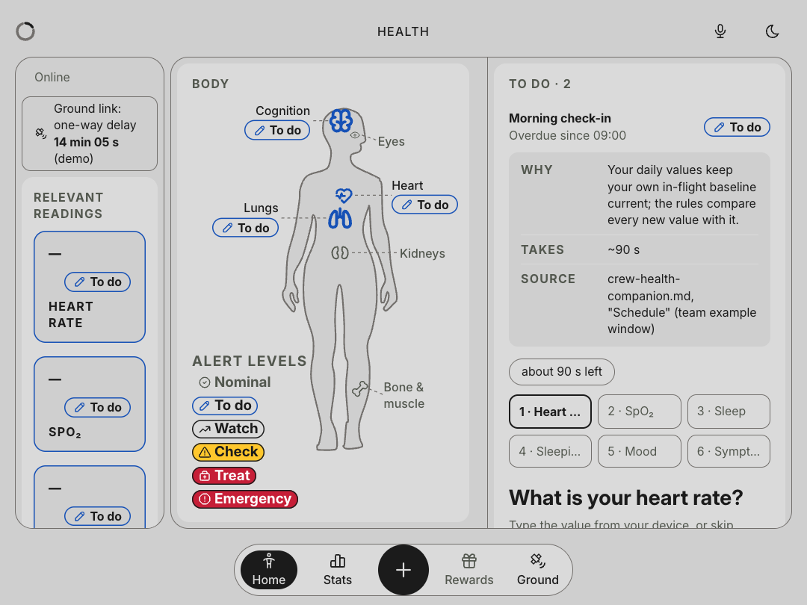
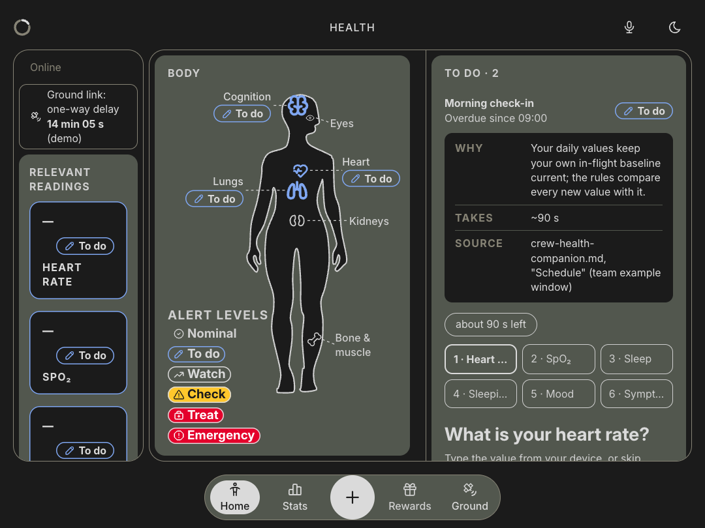
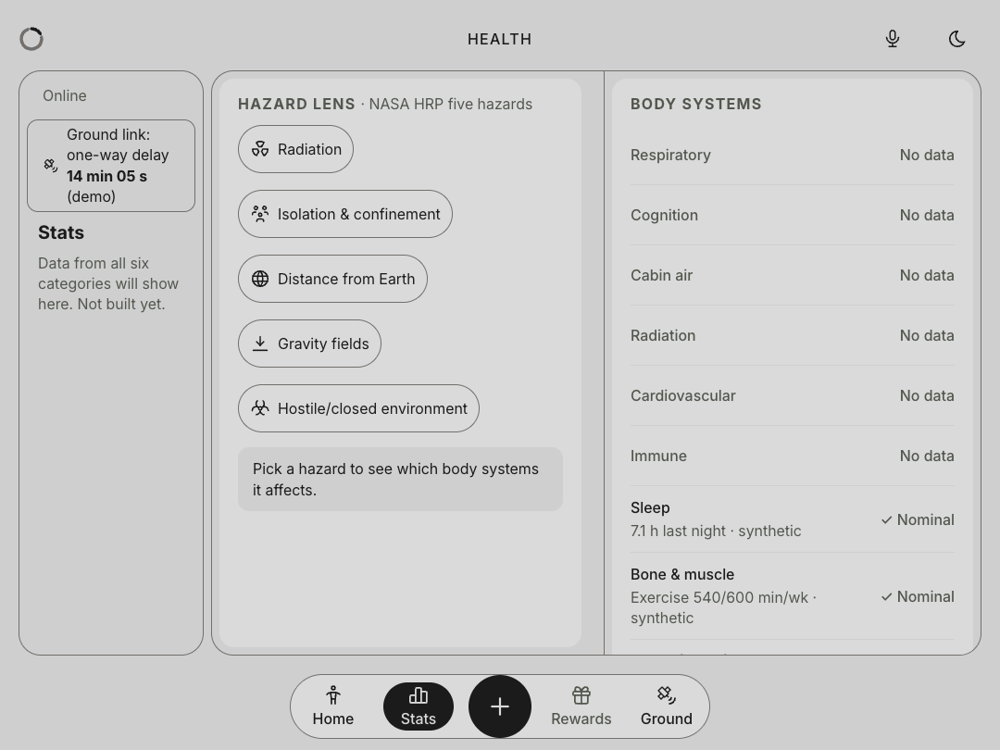

# #61 Body figure: traced outlines, stat-icon markers, compact AAA legend

The body figure on Home is redrawn from the team's drawings. The outline is traced from `ideas/mockups/figure/female.jpg` (a male outline from `male.jpg` is drawn too, not shown yet). Each system is marked by the icon it uses elsewhere in the app: brain, eye, lungs, heart with pulse, kidneys, bone. The figure fills the Body pane, 457 px tall on the iPad. The alert-level legend is one column of 19 px bold chips in the Body card's bottom-left corner. The badge words (Check, Emergency) and the figure's move off Stats, also listed in the issue, had already landed with the alert levels and #52, so this PR only checks them. Feature F6 in [features.md](../../ideas/features.md); issue [#61](https://github.com/jdo-lv/galagans/issues/61), built on #52.

**Try it:** `cd src/main/frontend && npm run dev`, open http://localhost:5173. **Retake the screenshots and measurements** with the dev server running: `target/node/node docs/features/61-body-figure.mock.mjs [base url]` ([script](61-body-figure.mock.mjs)). **Redraw an outline:** `python tools/trace-figure.py ideas/mockups/figure/female.jpg female [overlay dir]` (needs `opencv-python-headless` and numpy), then paste its `outline` into `src/main/frontend/src/ui/bodyOutlines.ts`.

## Screens

### Home, morning check-in owed (1080 × 810, light)
The check-in feeds Cognition, Cardiovascular and Respiratory, so their icons are blue outline (no fill) and their labels carry "To do".

### Home, dark

### Stats: hazard lens and Body systems list, no figure

## Measured (mock script, 1080 × 810)

| Check | Female | Male |
|---|---|---|
| Silhouette height | 457 px | 457 px |
| Legend heading or chip covers the silhouette | none | "Alert levels" heading touches the hip (male not shown) |
| Legend covers a label | no | no |
| `.level-legend` position | absolute | absolute |
| Legend list | column, flex-start | column, flex-start |
| Chips: width = content width (px) | Nominal 114, To do 88, Watch 97, Check 97, Treat 86, Emergency 142 | same |
| Chip font, padding | 19px 700, 1px 8px | same |
| To-do icon | stroke `rgb(22, 81, 182)`, 2.5px, fill none | same |
| Stats has `.body-figure` | no | — |

## Legend contrast (WCAG 2.1 AAA)

19 px bold is large-scale text (14 pt bold ≈ 18.67 px), so AAA needs 4.5:1 ([SC 1.4.6](https://www.w3.org/TR/WCAG21/#contrast-enhanced)). At 16 px it would need 7:1, which the red chips and muted words miss. Computed from `theme/tokens.css`:

| Text on | Light | Dark |
|---|---|---|
| White on red (Treat, Emergency) | 5.77 | 4.85 |
| Muted words (Nominal, heading) on card | 5.30 | 4.76 |
| Ink on yellow (Check) | 11.04 | 11.04 |
| Text on card (To do, Watch) | 12.32 | 5.30 |

## Mockup and deviations

Follows [home-variants.md](../../ideas/home-variants.md) "Body pane" (big figure, legend in the bottom corner) and the team's figure sketches (icons as markers).

- The issue aimed at 480 px; #52's shell gives the Body pane 407 px, so the figure is 457 px. It keeps its side labels (words carry the meaning). To fit, the drawing's empty sides are cropped (view `117 0 264 362`), Bone & muscle sits on the right shin, and the Kidneys label is pulled in.
- The legend sits bottom left (the wireframe note said bottom right, 3 × 2) and uses 19 px instead of 16 px text, for AAA.
- To-do icons are outlined, not filled: a filled line icon turns into a blob.
- No mood mark on the face (in the team's sketch): mood isn't a figure system.
- The male outline has no picker yet; a Female / Male toggle was built and removed at the team's request. If it is wired later, the legend heading needs to move clear of the male hip.
