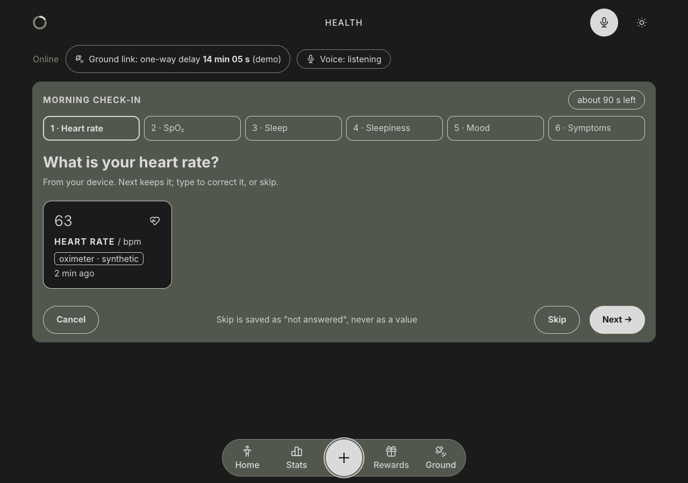
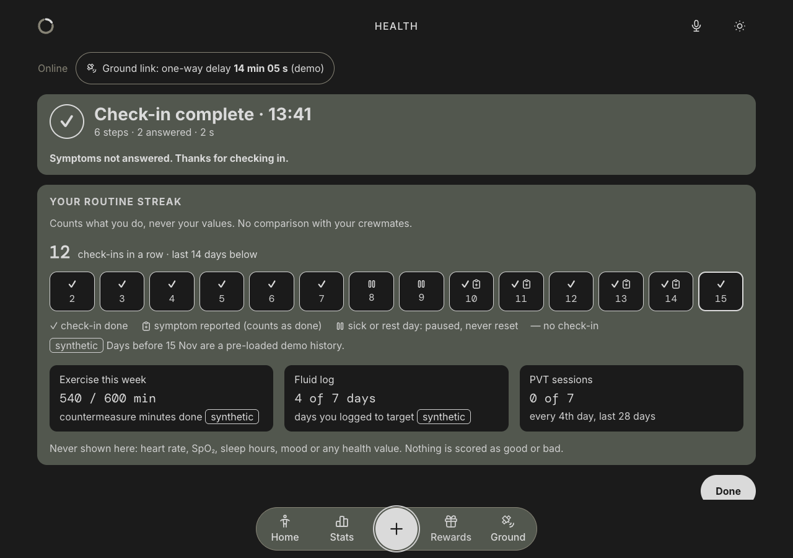
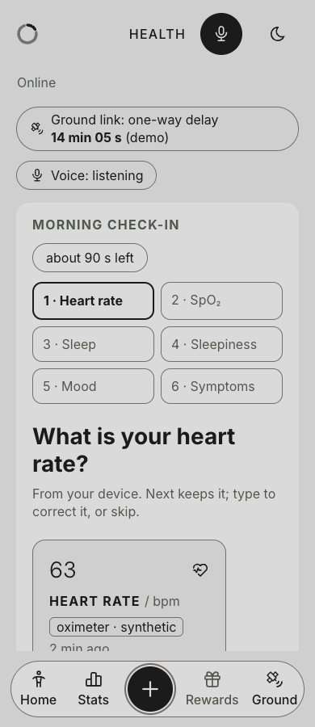

# #64 Hands-free check-in by voice

Voice runs the morning check-in on screen. It asks each of the six steps in a few words, takes "yes" for a value prefilled from a device (#55), fills what it hears and moves on, and stores the check-in only on "save". Every value stays visible on its step, so the screen is the confirmation. Features F25 and F1 in [features.md](../../ideas/features.md); issue [#64](https://github.com/jdo-lv/galagans/issues/64), on top of [#37](37-voice-briefing.md) and [#55](https://github.com/jdo-lv/galagans/issues/55).

**Try it:** start the voice host (`podman compose -f voice-host/compose.yaml up -d --build`) and `cd src/main/frontend && npm run dev`, open http://localhost:5173 in Chrome (voice works only through the Vite dev server). Start the Device Simulator at `/simulator.html` for an oximeter reading, then say "Start my check-in", "Yes", "Yes", "Six and a half hours", "Three", "Four", "Headache", "Save". Or open `#/check-in`, tap the microphone and answer from step 1. **Retake the screenshots** with both running: `APP_URL=http://localhost:5173/ target/node/node docs/features/64-voice-check-in.shots.mjs` ([script](64-voice-check-in.shots.mjs)); it grants the microphone through CDP and ends playback at once, as the #37 script does.

## What it says

The check-in screen doesn't change, so the spoken texts are quoted. No value is read back: values, tags, ages and errors stay on screen.

| Step | Asked | Asked while the field shows a device value |
|---|---|---|
| 1 Heart rate | Heart rate value? | Confirm or update heart rate value. |
| 2 SpO₂ | SpO₂ value? | Confirm or update SpO₂ value. |
| 3 Sleep | Sleep hours? | (no device sends sleep) |
| 4 Sleepiness | Sleepiness, 1 to 9? | |
| 5 Mood | Mood, 1 to 5? | |
| 6 Symptoms | Symptoms, or none? Then say save. | |

Other texts: "Not valid. Say it again." (the screen refused the value and shows why), "Say it again." (nothing understood, or "no", "don't save"), "Check-in saved." (voice then turns off), "Not saved. Try again.", "Check-in cancelled." (Home, voice stays on), "Voice off.".

What the astronaut can say on a step (stop, cancel, skip, go back, then the model's answer, then save or yes):

- A number or a pick fills the step and presses Next →. Numbers round to the step (sleep 6.33 → 6.5, heart rate 72.4 → 72).
- "Yes", "keep it", "correct", "confirm" keep the value on screen and press Next →; "no", "not" and "don't" block that.
- Symptoms are added to the picks ("a headache and back pain", "and a rash"); "none" picks "None of these". Only "save" (not blocked by "don't" or "not", so "no symptoms, save" saves) or a tap on "Save check-in" stores it. "Skip" on Symptoms saves without answering them, as the button does.
- A tap always wins: if the astronaut presses Next → or Cancel while voice listens, the answer heard for the old step is dropped and voice asks the step on screen. A tap on "Save check-in" ends voice without a word.

## Screens

### Step 1 prefilled by the oximeter, voice listening (dark, 1280 px)
Input: heart rate 63 (2 min ago) and SpO₂ 97 stored from the oximeter, mic tapped. Voice has asked "Confirm or update heart rate value." and shows "Voice: listening".

### Completion after a tap on "Save check-in", voice off (dark, 1280 px)
Input: voice on, then "Next →" five times and "Save check-in". The pill is gone and the mic is no longer pressed.

### Phone, 390 px, light, step 1 with the pill

## Mockup and deviations

Follows step 1 of [06-questionnaire.png](../../ideas/mockups/06-questionnaire.png) as built in #55, plus #37's pressed mic and pill; the issue mock is [64-mock.png](img/64-mock.png) ([script](64-voice-check-in.mock.mjs)). Nothing on the check-in screen changes, so there is no deviation. "Check-in saved." after a spoken save can't be captured: voice turns off and the completion screen looks like the tap save above. A voice save by speech needs a real microphone, so the manual smoke check (AC63) is run by a person.
