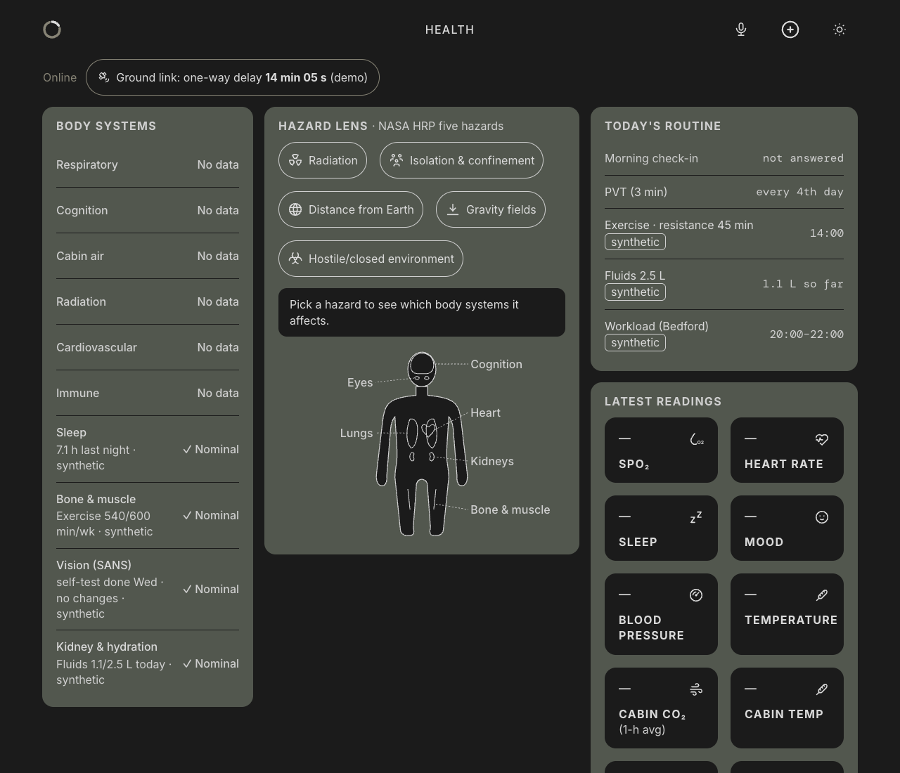
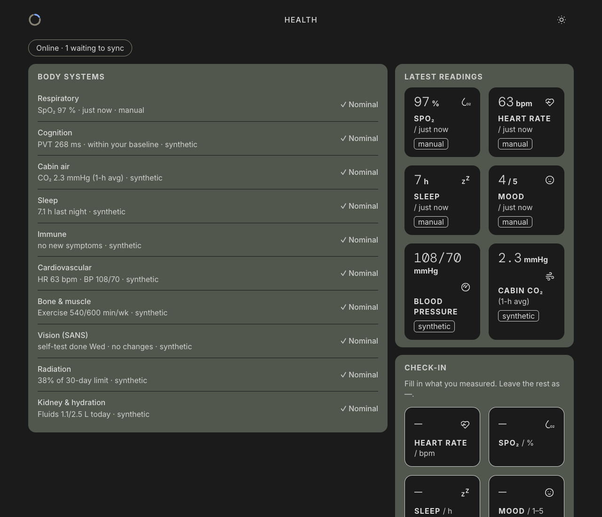
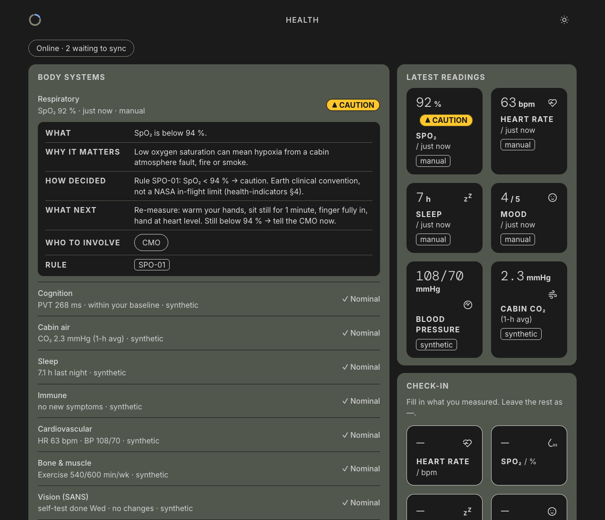
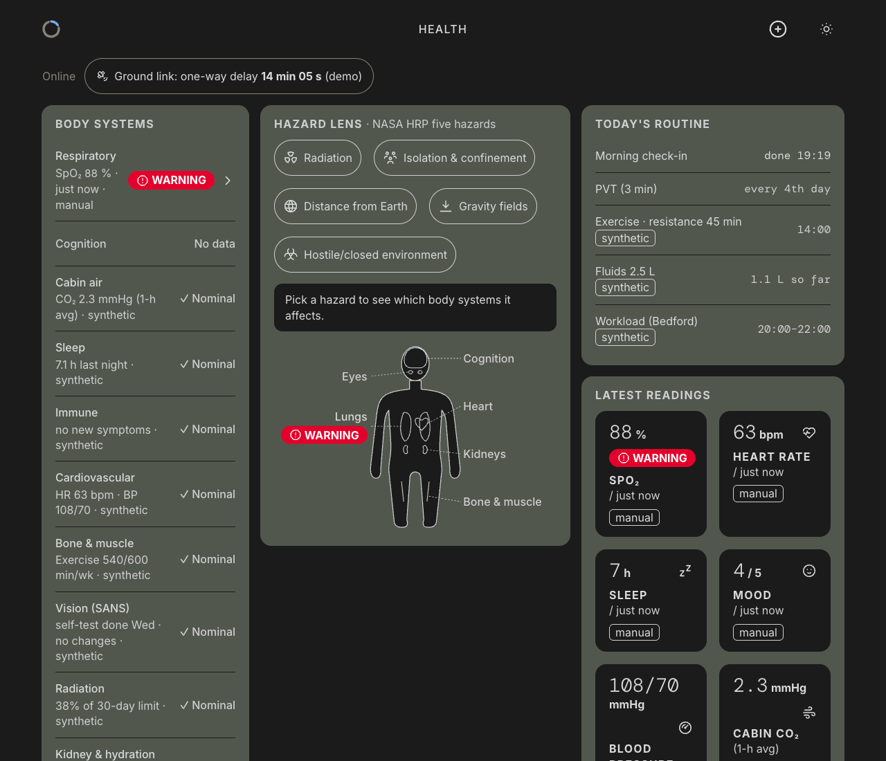
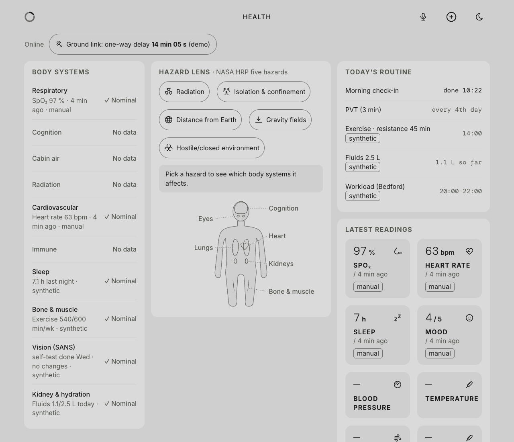
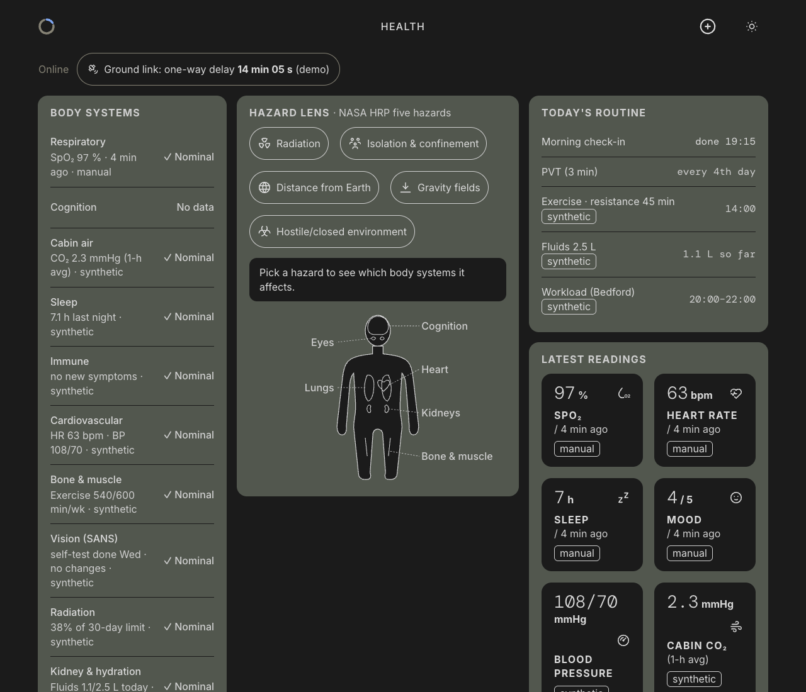
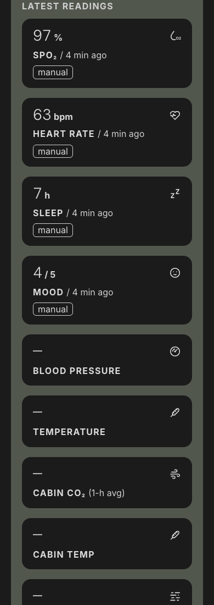

# #7 Latest readings: metric tiles on home

The "Latest readings" card on home shows the crewmember's last SpO₂, heart rate, sleep and mood at a glance. Each tile shows the value with its unit, the data age and the source tag "manual". SpO₂ carries the same caution or warning badge as the Respiratory row. A value older than 24 h looks stale, and a field never entered shows "—". Blood pressure and cabin CO₂ have no input in the app yet, so they show fixed synthetic values labelled "synthetic" (`src/main/frontend/src/infrastructure/mockReadings.ts`). Everything works offline. Feature F6 in [features.md](../../ideas/features.md); issue [#7](https://github.com/jdo-lv/galagans/issues/7).

**Try it:** `mvn clean verify`, then `mvn spring-boot:run`, open http://localhost:8080, click "+" (Add entry) in the header and enter heart rate, SpO₂, sleep and mood on their steps, then "Save check-in" ([#29](29-check-in-questionnaire.md)) and "Done" ([#40](40-reporting-win.md)). Saving only SpO₂ 92 or 88 changes the SpO₂ tile and keeps the other values.

**Retake the screenshots** with the app running: `target/node/node docs/features/7-latest-readings.shots.mjs` (script: [7-latest-readings.shots.mjs](7-latest-readings.shots.mjs)). `APP_URL` points it at another server and `CDP_PORT` picks another DevTools port. These shots came from `npm run preview`, which doesn't serve `/api`, so the status bar shows check-ins waiting to sync. Headless Chrome followed the machine's dark theme. All shots are 1280 px wide unless the heading says otherwise.

## Screens

### No check-ins yet
The four check-in tiles show "—" (read as "No reading") with no unit, age or tag. Blood pressure and cabin CO₂ show their synthetic values; "108/70 mmHg" doesn't fit beside its icon, so the unit wraps under the value and the icon moves to the next line.

### All four values nominal (heart rate 63, SpO₂ 97, sleep 7, mood 4)

### SpO₂ caution (SpO₂ 92, rule SPO-01)
The caution badge replaces the SpO₂ icon and wraps under the value. The other tiles keep their last values.

### SpO₂ warning (SpO₂ 88, rule SPO-02)

### SpO₂ stale (SpO₂ 88 recorded 25 h ago, the other values 10 min ago)
The value and unit turn muted and the age reads "1 d old". The icon comes back and there's no badge, because old data isn't a health status. The Respiratory row says "No recent data".

### Light and dark (nominal, switched with the theme toggle)

### Phone, 390 px (nominal)
The panel stacks under Body systems, one tile per row.

"Readings unavailable" appears when the rules or the stored check-ins fail to load, and then the panel has no tiles. It can't be triggered from the running app; `LatestReadings.test.tsx` covers it (AC14–AC16).

## Mockup and deviations

The panel follows "Latest readings" in [01-body-map.png](../../ideas/mockups/01-body-map.png): a card with a two-column grid of tiles, each with value and unit, label, data age and source tag. Styles follow [ui-guidelines.md](../../ideas/ui-guidelines.md) "Metric tile".

| Deviation | Reason |
|---|---|
| Six tiles instead of four | Heart rate, SpO₂, sleep and mood each get a tile, plus the mockup's blood pressure and cabin CO₂. The KSS and symptoms of the check-in ([#29](29-check-in-questionnaire.md)) have none. |
| Placed under Today's routine and above the Reaction test card | The mockup's column; the Check-in card it once sat above left home in [#29](29-check-in-questionnaire.md). |
| Label under the value | ui-guidelines §5 "Metric tile": value first, then label / data age, then the source tag. |
| Tags "manual" and "synthetic" instead of "BLE · simulated", "bracelet · simulated" and "EDA replay" | Values come from manual check-ins and the #4 synthetic placeholders; there's no device or replay yet. |
| Data age ("just now", "2 h ago") instead of "live" and "07:10" | Every reading shows its data age ([ux-human-factors.md](../../research/ux-human-factors.md) §1.1, V2 10020). |
| Cabin CO₂ 2.3 mmHg nominal instead of a 3.2 mmHg caution | Same synthetic value as #4's Cabin air row. A placeholder has no rule behind it, so it never shows a status. |
| No tile outline and no coloured value | Static tiles have no edge (ui-guidelines §2.4). Status shows only on the badge, never as coloured text. |
| 16 px text and 28 px values | ui-guidelines §3 (the mockups use smaller text). |

**Accepted mismatch with #4.** The synthetic Cardiovascular row ("HR 63 bpm · BP 108/70") and Sleep row ("7.1 h last night") in Body systems stay synthetic. They can differ from the real Heart rate and Sleep tiles until those systems get rules. Blood pressure and cabin CO₂ always match their rows, which `mockReadings.test.ts` checks.
