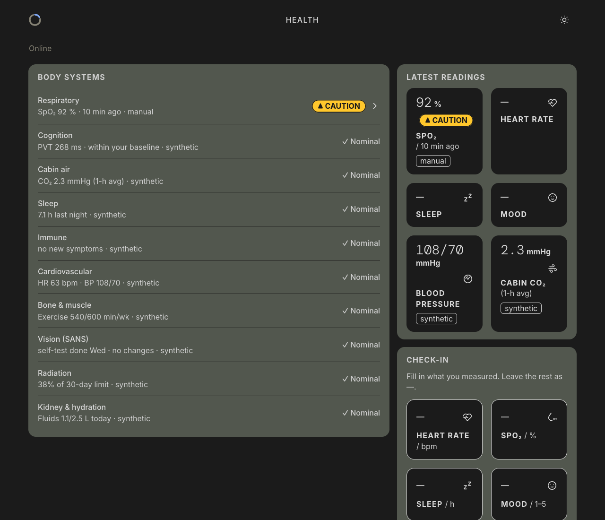
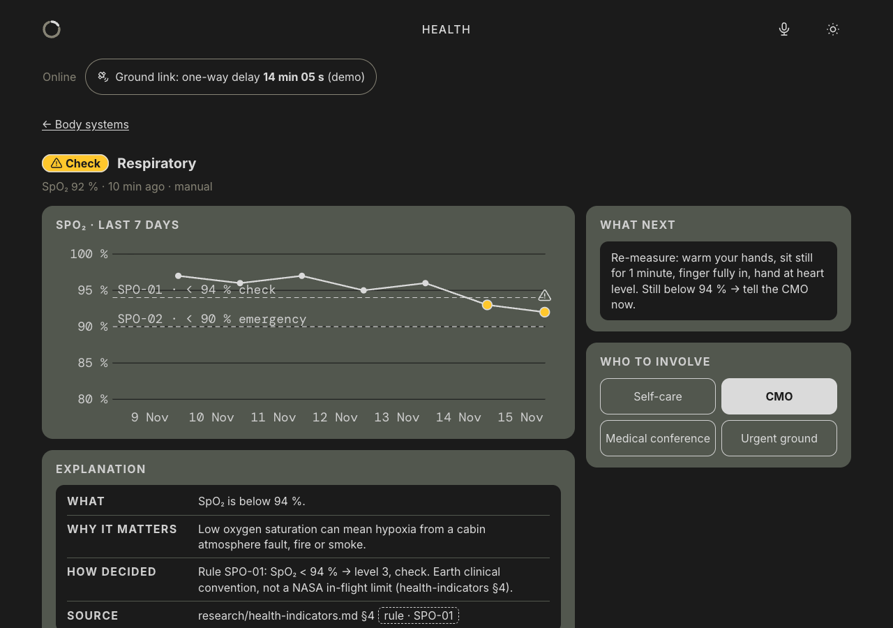
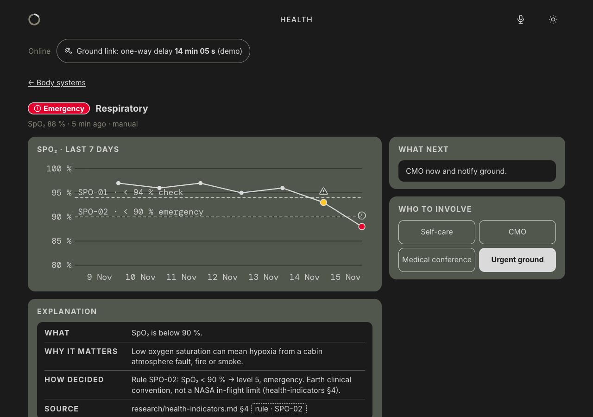
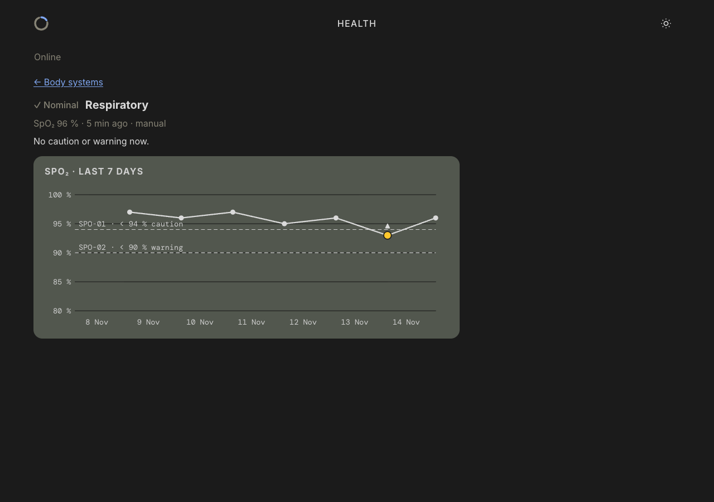
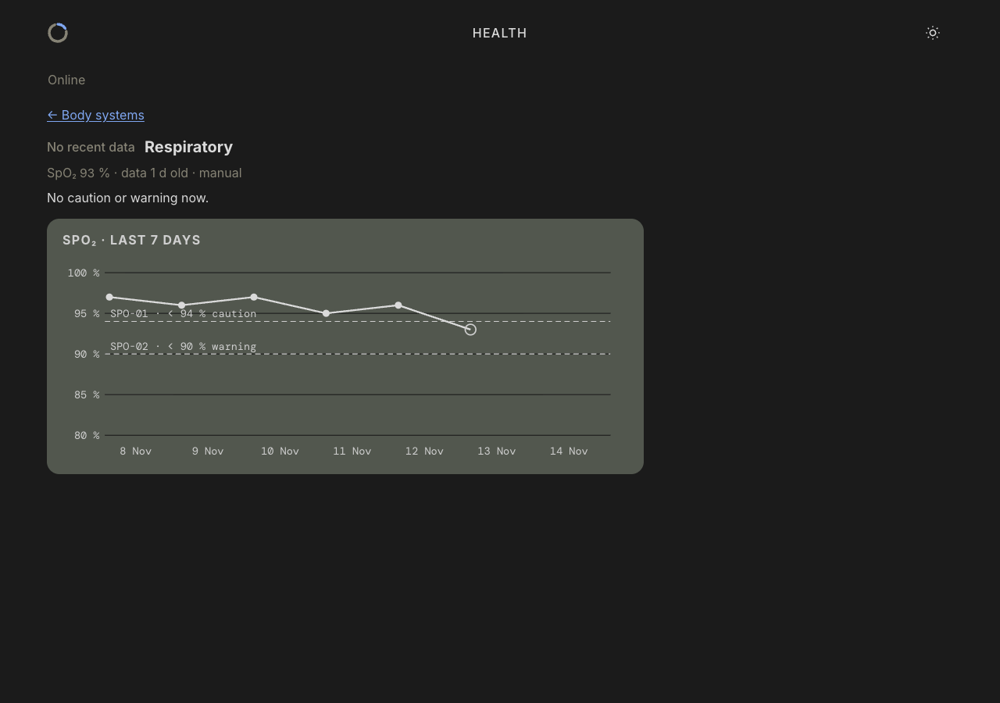
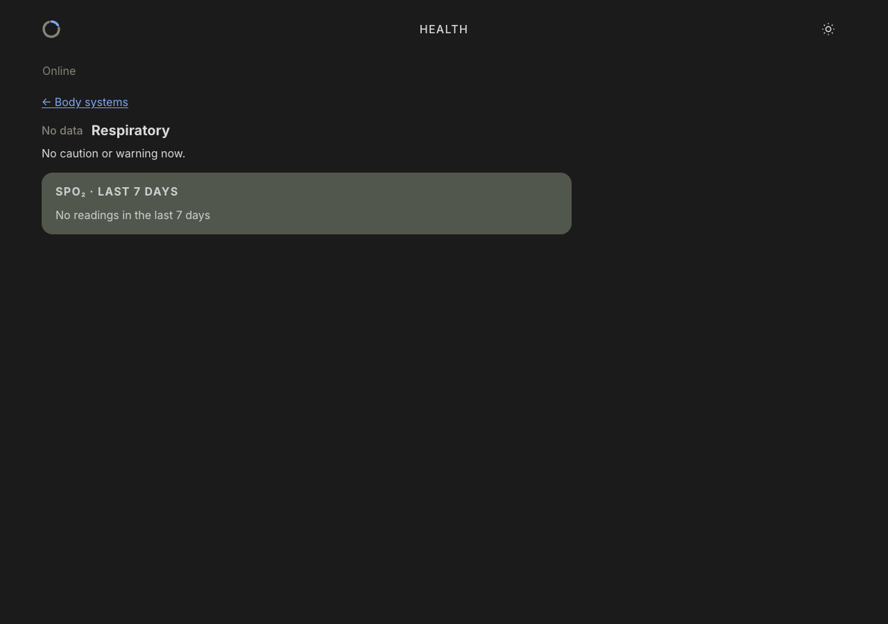
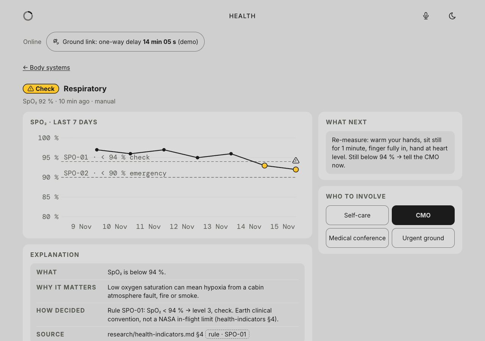
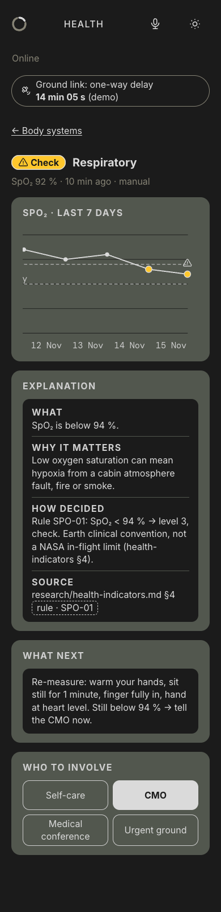

# #9 Body system detail screen

A body system in check or emergency on Home is now a link (whole row, with a chevron). It opens a detail screen with the status and latest reading, a 7-day SpO₂ trend chart with the rule thresholds, the explanation (what, why it matters, how decided, source), what to do next and who to involve. It works offline: the detail reads the same rules and local check-ins as Home. The inline explanation that #1 put in the Home row is gone. Feature F5 in [features.md](../../ideas/features.md); issue [#9](https://github.com/jdo-lv/galagans/issues/9).

**Try it:** `mvn clean verify`, then `mvn spring-boot:run`, open http://localhost:8080. Enter SpO₂ 92 through Check-in in the navigation bar and the check-in steps ([#29](29-check-in-questionnaire.md)), then click the Respiratory row. Or open http://localhost:8080/#/systems/Respiratory directly. **Retake the screenshots** with the app running: `target/node/node docs/features/9-detail-screen.shots.mjs` ([script](9-detail-screen.shots.mjs)). The script writes a week of SpO₂ check-ins into IndexedDB so the chart has history. The 7-day charts need a build with `VITE_DEMO_MODE=false` (DEMO_MODE, on by default since [#43](43-demo-mock-modes.md), shows the last minute).

## Screens

### Home: a flagged row links to the detail (SpO₂ 92 now, a week of history)

### Check (SpO₂ 92, rule SPO-01)
CMO is the selected tier. The newest check point carries the alert-triangle marker.

### Emergency (SpO₂ 88, rule SPO-02)
"Urgent ground" is selected. The emergency point carries the alert-octagon marker.

### Nominal (SpO₂ 96 after a check yesterday)
The detail stays reachable by its link, shows "Nothing to act on now." and only the chart.

### Stale (newest reading 93 %, 1 day old)
The newest point is hollow with no marker. Old data shows its age, never an alarm.

### No data

### Light theme (check)

### Phone, 390 px (check)
The columns stack. The chart keeps 16 px labels by scrolling sideways, and it opens on the newest readings, so the Y-axis labels are scrolled out of view at first.

"Detail unavailable" (rules or storage fail to load) can't be triggered from the running app; it's covered by `SystemDetail.test.tsx` (AC35, AC36). Unknown routes (`#/systems/Sleep`, `#/foo`) go back to Home (AC8). Cognition has its own detail since #17.

## Mockup and deviations

Layout follows [02-detail.png](../../ideas/mockups/02-detail.png) and the issue mock [9-mock.png](img/9-mock.png) ([source](9-detail-screen.mock.html)). The header spans both columns. The chart and Explanation cards are on the left; What next and Who to involve are on the right, aligned with the chart card. Styles follow [ui-guidelines.md](../../ideas/ui-guidelines.md) "Detail screen" and "Charts". The screenshots are dark because the machine that took them is in dark mode.

Chart look superseded by #48: see [48-smooth-trend-chart.md](48-smooth-trend-chart.md); the screenshots here stay.

The mock HTML predates the level tokens of [#33](33-alert-levels.md), so it no longer renders as its committed PNG.

| Deviation | Reason |
|---|---|
| No adaptation corridor or baseline band; X axis is the last 7 days, not flight days; no flight-day scrubber | Corridor (F11) isn't built yet. The Cognition chart shows the pre-flight baseline line since [#28](28-personal-baseline.md). |
| No "Share with CMO" / "Add to surgeon packet" buttons, no tier sentence | Surgeon packet (F14) and conference agenda (F23) aren't built yet. |
| Who to involve is a 2 × 2 grid, not four in a row | At the app's body text size "Medical conference" doesn't fit in a quarter of the 380 px column. |
| One "What next" step, not a numbered list | Each rule row has a single `next` text. |
| No latest-value label on the chart | The header already shows the latest value with its age and source. |
| On phones the chart scrolls sideways instead of shrinking | Its labels stay at 16 px (ui-guidelines §8). |
| Chart markers show icon + colour without the word | The word is in each point's title and the header badge; recorded as an exception in ui-guidelines §2.3. |
